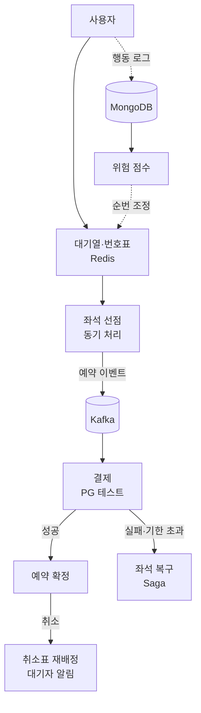

# 제자리

> 기획서 · 2026-11-06 · 작성 길동현

## 목차

1. [프로젝트 개요](#sec-1)
2. [기획 배경](#sec-2)
3. [핵심 기능](#sec-3)
4. [핵심 기술 과제](#sec-4)
5. [차별점: 의심 구간 타임라인](#sec-5)
6. [위험 점수 설계](#sec-6)
7. [기술 스택](#sec-7)
8. [시스템 구조](#sec-8)
9. [역할 분배](#sec-9)
10. [데이터 활용](#sec-10)
11. [추진 일정](#sec-11)
12. [성과 목표](#sec-12)

<b>프로젝트 개요</b>

제자리는 명절·연휴 예매처럼 짧은 시간에 요청이 몰리는 상황에서 좌석을 중복 없이, 공정한 순서로 판매하는 가상 철도 예매 시스템이다. 5인 팀이 3주 동안 Spring Boot 중심 백엔드로 구현하고 웹으로 배포한다.

서비스 아이디어보다 대규모 트래픽, 좌석 동시성, 분산 트랜잭션 문제를 기술적으로 해결하고 그 결과를 수치로 검증하는 데 초점을 둔다. 대량 구매 후 암표 판매나 반복 취소가 의심되는 이용자는 행동 데이터로 위험도를 판단해 대기열 순번을 뒤로 조정하며, 그 판단 근거를 관리자가 되돌아볼 수 있게 기록한다. 실제 운영 기관의 이름과 로고는 사용하지 않는다.

<a href="#목차">↑ 목차로</a>

<b>기획 배경</b>

명절 예매는 짧은 시간에 요청이 집중되고, 예매 이후에도 취소와 암표 문제가 이어진다. 아래 세 가지 근거로 이 상황을 직접 재현하고 기술적으로 해결하는 과정을 프로젝트의 목표로 삼는다.

- 코레일은 2026년 추석 예매를 위해 웹 서버를 평소 11대에서 60대로, 대량접속제어기를 6대에서 20대로 증설했다. ([세계일보](https://www.segye.com/newsView/20260829505201), 2026.08.29)
- 2026년 설 예매 기간 매크로 탐지 설루션으로 비정상 접근 4만2695건을 선제 차단했다. ([쿠키뉴스](https://www.kukinews.com/article/view/kuk202602090043), 2026.02.09)
- 2025년 설·추석 연휴 기간 출발 직전 취소되거나 출발 후 반환되어 재판매되지 못한 기차표는 66만4000장으로, 2021년 12만5000장 대비 약 5.3배 증가했다. ([헤럴드경제](https://www.heraldk.com/article/2026021119093519927), 2026.02.11)

<a href="#목차">↑ 목차로</a>

<b>핵심 기능</b>

필수 기능을 먼저 완성하고, 깊게 구현할 기능 3가지에 시간을 집중한다. 얕게 여러 개를 하기보다 "왜 그렇게 설계했는지" 설명할 수 있는 깊이를 우선한다.

| 구분 | 기능 |
| --- | --- |
| 필수 | 회원가입·모의 본인인증, 열차 조회, 대기열 입장·번호표 확인, 좌석 선택·예약(1인 매수 제한), 결제(PG 테스트 모드), 예매 내역·취소, 취소표 예약 대기 |
| 관리자 | 열차·노선·좌석 등록, 실시간 예매 현황, 위험 사용자 목록 확인·조치 |
| 깊게 구현 | 대기열(Redis), 좌석 동시성(락 방식별 성능 비교), 결제 기한 초과 시 좌석 자동 반환 |
| 신뢰성 | Saga(결제 실패 시 좌석 복구), Outbox(이벤트 유실 방지), 멱등성(중복 예약·결제 방지) |
| 선택 | Isolation Forest 이상 탐지, 타임라인 재생 기능 |

선택 과제는 일정이 밀릴 때 덜어내는 대상이다. 구간별 좌석 재고와 앱(WebView)은 3주 일정에서 하지 않고, 좌석은 열차 1편당 좌석 1개 단위로 단순하게 관리한다.

<a href="#목차">↑ 목차로</a>

<b>핵심 기술 과제</b>

| 과제 | 해결 방법 |
| --- | --- |
| 대기열·번호표 | Redis 기반 대기열로 입장 인원을 제한하고, 순번과 예상 대기 시간을 실시간으로 안내한다. |
| 위험 사용자 후순위 | 요청을 지연시키지 않고, 대기열 진입 시 위험 점수만큼 순번을 뒤로 조정해 서버 자원 낭비 없이 후순위로 처리한다. |
| 좌석 동시성 | 좌석 선점은 동기 처리한다. 같은 좌석을 동시에 선택해도 중복 예약 0건을 목표로 하고, 락 방식별 성능을 비교한다. |
| 결제 기한·자동 반환 | 좌석 선점 후 제한 시간 안에 결제하지 않으면 자동으로 반환한다. |
| 이벤트 기반 처리 | 결제·확정·취소의 상태 변경은 DB 트랜잭션으로 확정하고, 같은 트랜잭션에 Outbox로 남긴 이벤트를 Kafka로 발행해 좌석 반환·취소표 재배정·알림 같은 후속 처리를 한다. 예약 ID 기준 파티셔닝으로 상태 변경 순서를 보장하고, 열차 ID 파티셔닝 시 인기 열차 쏠림 문제와 비교한다. |
| 취소표 재배정 | 취소 발생, 대기 순서대로 배정, 알림, 제한 시간 내 결제, 미결제 시 다음 대기자 순으로 진행한다. |
| 신뢰성 | Saga 패턴(결제 실패 시 좌석 복구), Outbox 패턴(이벤트 유실 방지), 멱등성(중복 예약·결제 방지)을 적용한다. |
| 구간별 좌석 재고(확장) | 한 좌석을 구간 단위로 관리해 재판매한다. 3주 일정에서는 제외한다. |
| 성능 검증 | 부하 테스트로 병목을 확인하고 개선 전후 수치를 비교한다. |

<a href="#목차">↑ 목차로</a>

<b>차별점: 의심 구간 타임라인</b>

위험 점수를 숫자로만 보여주지 않고, 의심 행동이 발생한 구간을 기록해 CCTV처럼 되돌아볼 수 있게 한다. 관리자는 "왜 이 이용자가 후순위인지"를 타임라인으로 확인하고 오탐을 가려낼 수 있어, 기획서의 운영 원칙(점수 근거 기록, 관리자 검토 후 조치)을 눈에 보이는 기능으로 충족한다.

**구현 범위**

- 모든 행동(조회, 대기열 진입, 좌석 선점, 결제, 취소)을 이벤트로 기록해 행동 로그 한 흐름으로 모은다(Kafka → MongoDB).
- 규칙이 발동하면 해당 이벤트 전후를 하나의 의심 구간으로 묶는다. 예: 클릭 간격 기준 미달, 단시간 대량 선점, 구매 후 단시간 취소.
- 관리자 화면에서 계정(또는 기기 단위 묶음)을 선택하면 이벤트 타임라인, 의심 구간, 발동 규칙, 점수 변화를 함께 보여준다.
- "영상처럼 재생"은 선택 과제로 두고, 1차 범위는 시간순 타임라인과 의심 구간 하이라이트까지로 한다.

**검증 수치**

봇 시뮬레이션(k6)으로 만든 시나리오를 정답 라벨로 삼아 탐지율(시뮬레이션 N건 중 N건 구간 탐지)과 오탐률(정상 사용자 오탐 N건)을 측정한다. 목표는 탐지율 90% 이상, 오탐률 5% 이하로 한다.

**주의**

식별 정보는 HMAC 가명처리 값으로만 표시하고, 행동 로그는 180일 후 자동 삭제한다. 구체 기준은 별첨 보안 기준을 따른다.

<a href="#목차">↑ 목차로</a>

<b>위험 점수 설계</b>

| 항목 | 내용 |
| --- | --- |
| 수집 신호 | 1회·누적 구매 매수, 구매 후 취소까지 걸린 시간, 취소 비율, 클릭 간격·반복 조회 등 접속 패턴 |
| 묶음 기준 | 계정이 아닌 인증 정보·결제 수단·기기 정보 단위로 묶고, 식별 정보는 HMAC으로 가명처리한다. |
| 신규 계정 | 이력이 없는 계정은 기본 신뢰도를 낮게 시작한다. |
| 운영 원칙 | 점수 근거를 기록하고, 기간이 지나면 점수를 줄이며, 높은 점수는 관리자 검토 후 조치한다. |
| 구현 | 가상 행동 데이터를 생성하고 규칙 기반으로 점수를 산정한다. 이상 탐지 모델(Isolation Forest)과의 비교는 선택 과제로 둔다. |

<a href="#목차">↑ 목차로</a>

<b>기술 스택</b>

| 영역 | 기술 |
| --- | --- |
| Backend | Spring Boot (REST API), Spring Data JPA |
| Messaging | Apache Kafka |
| Database | Oracle(예약·결제), MongoDB(행동 로그), Redis(대기열·좌석 선점·캐시) |
| Data | Python(가상 데이터 생성), scikit-learn(이상 탐지, 선택) |
| Frontend | 반응형 웹 |
| Infra | Docker Compose, GitHub Actions, Prometheus·Grafana |
| Test | k6 또는 nGrinder(부하 테스트) |

<a href="#목차">↑ 목차로</a>

<b>시스템 구조</b>

사용자는 대기열을 거쳐 좌석을 동기 방식으로 선점하고, 결제와 확정은 DB 트랜잭션으로 처리하고, 그 결과를 Outbox → Kafka 이벤트로 알려 후속 처리를 이어 간다. 결제 실패나 기한 초과는 좌석 복구로, 확정 후 취소는 취소표 재배정으로 이어진다. 행동 로그는 위험 점수를 거쳐 대기열 순번에 반영된다.

<a href="#목차">↑ 목차로</a>

<b>역할 분배</b>

5명 모두 핵심 기술 과제 1개와 검증 가능한 수치 1개를 맡는다.

| 팀원 | 이름 | 직책 | 담당 범위 | 핵심 수치 | 난이도 |
| --- | --- | --- | --- | --- | --- |
| A | 김성원 | 팀원 | 대기열·번호표·예상 대기 시간(Redis), 위험 점수를 받아 순번에 반영, 대기열 입장 토큰 발급·검증, 식별정보 가명처리(HMAC) 모듈 | 동시 접속 처리량, 순번 조정 정확도 | 중상 |
| B | 강동균 | 팀원 | 좌석 선점 동시성, 락 방식 비교(비관적·낙관적·Redis 분산락), 1인 매수 제한, 선점 만료·결제 기한 자동 반환, 열차·노선·좌석 도메인, 공공데이터 적재, 관리자 예매 현황 | 중복 예약 0건, 락 방식별 TPS, 기한 초과 반환율 | 상 |
| C | 길동현 | 팀장 | Kafka 이벤트 설계, 결제(PG 테스트 모드), Saga, Outbox, 멱등성, 재배정 알림 이벤트 처리 | 중복 결제 0건, 복구율 100% | 상 |
| D | 강다인 | 팀원 | 행동 로그 수집(MongoDB), 규칙 기반 위험 점수, 의심 구간 타임라인 API·화면, 취소·환불, 취소표 재배정 대기 관리, 회원·모의 본인인증, 개인정보 암호화(AES-256-GCM) 적용, 위험 사용자 관리자 화면(마스킹 표시) | 탐지율·오탐률, 재배정 순서 보장 | 중 |
| E | 조영준 | 팀원 | 인프라(Docker Compose), CI/CD, Prometheus·Grafana, k6 시나리오(정상 사용자·봇 시뮬레이션), 병목 분석·개선, Spring Security·JWT 공통 인증·비밀값 관리(1주차 완성) | 개선 전후 TPS·응답 시간 | 중상(분야 상이) |

**조정 기준**

- 결제 기한 자동 반환은 좌석 선점·해제 로직과 한곳에 모으기 위해 C에서 B로 옮겼다.
- 취소·환불 로직은 C의 부담을 줄이기 위해 D가 맡는다.
- 가상 데이터는 E의 k6 봇 시뮬레이션이 부하 테스트와 행동 로그 생성을 겸한다.
- 결제 실패 시 C의 Saga는 B가 제공하는 좌석 해제 호출을 예약 ID 기준으로 호출하며, 같은 요청이 반복돼도 결과가 같도록 멱등하게 만든다.
- D의 범위가 넓으므로 일정이 밀리면 타임라인 재생 기능부터 덜어낸다.
- 식별정보 가명처리(HMAC) 모듈은 대기열 진입 시 묶음 키로 가장 먼저 쓰이므로 A가, 이름·연락처 암호화(AES-256-GCM)는 회원·알림 데이터를 다루는 D가 맡는다.
- 관리자 예매 현황은 좌석·예약 데이터를 가진 B가, 트래픽 모니터링은 Grafana를 구성하는 E가 맡고, D는 위험 사용자 화면에 집중한다.
- Spring Security·JWT 공통 인증은 E가 1주차에 완성하고, D의 회원가입·로그인은 이를 사용한다.

<a href="#목차">↑ 목차로</a>

<b>데이터 활용</b>

실제 예매·행동 데이터는 공개되지 않으므로, 공공데이터는 구조를 가져오는 데 쓰고 Kaggle CSV로 패턴을 확인한 뒤 이를 반영해 가상 데이터를 생성한다. 발표 시 "실제 데이터로 패턴을 검증하고, 그 패턴을 반영해 가상 데이터를 생성했다"는 점을 명시한다.

| 번호 | 데이터 | 사용 방식 | 용도 | 유의사항 |
| --- | --- | --- | --- | --- |
| 1 | 공공데이터포털 한국철도공사(차량유형코드·좌석수, 역간 운행거리) | 컬럼(구조)만 사용 | 노선·역·열차·좌석 구조 설계 | 공공기관 공식 데이터, 이용허락범위 제한 없음 |
| 2 | Hotel Booking Demand (Kaggle) | Kaggle 정리된 CSV | 예약 시점·이력과 취소의 관계 분석, 반복 취소 위험 점수 근거 | 포르투갈 호텔 데이터라 도메인 차이를 감안 |
| 3 | Web Server Access Logs (Kaggle) | Kaggle 정리된 CSV | 요청 간격·IP 집중도 등 봇 탐지 특징 추출 | 봇 대부분이 검색엔진 크롤러라 예매 매크로와 다름, 라이선스 확인 권장 |
| 4 | Web Bot Detection Dataset (본머스 대학) | 확보 가능 여부 확인 후 사용 | 웹 로그와 마우스 움직임으로 사람·봇 구분 | 확장 기능용이므로 확인은 추후에 해도 됨 |
| 5 | Spanish High Speed Rail (Renfe, Kaggle) | CSV | 출발일 대비 판매·가격 추이 참고, 가상 트래픽 분포 설계 | 구매 기록이 아닌 웹사이트 반복 조회 기반 가격 관측 데이터, 라이선스 "Other" |

**직접 생성하는 데이터**

- 회원·예매·결제는 스크립트로 대량 생성한다.
- 정상·봇·암표 의심 행동은 k6와 Python으로 시나리오를 설계해 생성한다. 봇 시나리오가 정답 라벨이 되어 탐지율·오탐률의 계산 기준이 된다.
- 직접 만든 가정으로 직접 검증하는 한계가 있으므로, 봇 행동은 사람이 하기 어려운 수준의 보수적 규칙으로 정의한다.

모든 외부 데이터는 사용 전 각 페이지의 라이선스를 확인한다.

<a href="#목차">↑ 목차로</a>

<b>추진 일정</b>

| 주차 | 내용 |
| --- | --- |
| 1주차: 설계와 기반 | 요구사항 정의, 노선 1개·역 4~5개 기준 데이터 설계, API·이벤트 명세, 인프라 구축, 공공데이터 적재, 기본 예약 흐름 |
| 2주차: 핵심 구현 | 대기열·번호표, 좌석 동시성, 결제 기한·Saga, 행동 로그 수집·위험 점수, 의심 구간 타임라인 |
| 3주차: 검증과 정리 | 부하 테스트 및 개선, 통합 테스트, 배포, 트러블슈팅 문서화, 발표 준비 |

일정이 밀리면 타임라인 재생 기능, Isolation Forest 순으로 덜어낸다.

<a href="#목차">↑ 목차로</a>

<b>성과 목표</b>

- 동시 요청 상황에서 좌석 중복 예약 0건, 중복 결제 0건
- 결제 실패·기한 초과 시 좌석 복구율 100% (PG 결과가 확정된 건 기준. PG 결과를 모르는 건은 수동 처리 건수·처리 시간으로 따로 집계)
- 위험 사용자 순번 조정이 의도대로 반영되는지 테스트로 검증
- 봇 시뮬레이션 기준 의심 구간 탐지율과 정상 사용자 오탐률 측정
- TPS·응답 시간 개선 전후 수치 확보
- 문제 상황, 원인 분석, 해결, 개선 수치 형태의 트러블슈팅 문서
- 대기열 입장 토큰 없이 좌석 API를 호출하면 차단율 100%
- 무효화된 토큰 재사용 차단 100%
- DB·MongoDB·로그·JWT payload의 평문 개인정보 0건

<a href="#목차">↑ 목차로</a>

https://claude.ai/artifact/Ev6NDF83KRP5PCHvEuM1Kw#4ccc6962-a894.my5zvbn7maz.29
