# 제자리 종합 ERD

명절 열차 공정 예매 시스템의 전체 데이터 구조입니다. 짧은 시간에 몰리는 예매 트래픽을 대기열로 제어하고, 좌석을 중복 없이 공정한 순서로 판매하며, 되팔이·반복 취소가 의심되는 이용자를 행동 데이터로 찾아 대기 순번을 뒤로 미루고 CCTV처럼 되돌아볼 수 있게 하는 데 필요한 테이블을 모았습니다.

> 스키마 v8 · ERD 편집기(`docs/erd/jejari-erd.html`)에서 생성 · 생성일 2026-11-10
> 이 문서는 편집기에서 자동 생성됩니다. 내용을 바꾸려면 편집기 HTML을 고친 뒤 `node tools/erd-md.js`로 다시 만드세요.
> 예매·결제·취소·이벤트 발행의 트랜잭션 순서와 SQL은 [동시성 절차](concurrency.md)에 있습니다. 비고의 `§` 번호가 그 문서의 절입니다.

## 목차

1. [한눈에 보기](#한눈에-보기)
2. [팀 결정 사항](#팀-결정-사항)
3. [공통 규칙](#공통-규칙)
4. [흐름](#흐름)
5. [영역별 테이블](#영역별-테이블)
   1. [기준 데이터](#g-ref)
   2. [회원·식별](#g-member)
   3. [보안·인증](#g-auth)
   4. [예약·결제](#g-resv)
   5. [이벤트 신뢰성](#g-event)
   6. [취소표 재배정](#g-wait)
   7. [위험 점수·관리자](#g-risk)
   8. [CCTV 되돌아보기](#g-replay)
   9. [MongoDB 로그](#g-mongo)
   10. [Redis](#g-redis)
   11. [외부 빅데이터·분석](#g-ext)
   12. [가상 데이터 전용](#g-synth)
6. [기능 추적표](#기능-추적표)
7. [실패 시나리오](#실패-시나리오)
8. [가상 데이터 생성](#가상-데이터-생성)
9. [확장 계획](#확장-계획)
10. [변경 이력](#변경-이력)
11. [참고 자료](#참고-자료)

## 한눈에 보기

| 항목 | 값 |
|---|---|
| 테이블 | 60개 (운영 56 + 확장 예정 4) |
| 저장소 | Oracle 44 · MongoDB 11 · Redis 1 · 확장 예정 4 |
| 빅데이터 (대량 적재) | 11개 |
| 컬럼 | 505개 |
| 관계 (FK) | 85개 (Oracle 제약 60 · 논리 참조 20) |

| 영역 | 저장소 | 테이블 |
|---|---|---|
| 기준 데이터 | Oracle | `station`, `route`, `route_station`, `car_type`, `train`, `train_car`, `seat`, `train_run`, `train_stop`, `fare`, `purchase_limit_policy`, `sale_event`, `app_policy`, `common_code`(확장), `app_policy_history` |
| 회원·식별 | Oracle | `member`, `payment_method`, `member_device`, `member_push_token`(확장) |
| 보안·인증 | Oracle, MongoDB | `member_credential`, `identity_verification`, `auth_session`, `login_attempt`, `admin_user`, `password_reset_token`(확장) |
| 예약·결제 | Oracle | `seat_inventory`, `reservation`, `reservation_seat`, `reservation_history`, `payment`, `cancellation`, `cancel_fee_policy`, `ticket_transfer`(확장), `purchase_counter` |
| 이벤트 신뢰성 | Oracle | `outbox_event`, `processed_event`, `saga_instance` |
| 취소표 재배정 | Oracle | `waitlist`, `notification` |
| 위험 점수·관리자 | Oracle | `risk_score`, `risk_score_history`, `admin_action`, `model_run` |
| CCTV 되돌아보기 | MongoDB, Oracle | `replay_session`, `replay_event`, `suspicious_case`, `case_session`, `case_marker`, `evidence_snapshot`, `replay_access_log` |
| MongoDB 로그 | MongoDB | `behavior_log`, `queue_log` |
| Redis | Redis | `redis_keys` |
| 외부 빅데이터·분석 | MongoDB, Oracle | `risk_feature`, `ext_hotel_booking`, `ext_web_access_log`, `ext_renfe_price`, `ext_bot_detection`, `ext_dataset` |
| 가상 데이터 전용 | Oracle | `synthetic_label` |

표기: **PK** 기본키 · **FK** 외래키 · **UQ** 유니크 · **NN** NOT NULL · 🅱 빅데이터 · ┄ 확장 예정 (DDL 제외) · MongoDB 쪽 FK는 DB 제약이 없는 논리 참조입니다.

## 팀 결정 사항

팀이 확정하기 전까지 쓰는 **예시값**입니다. 확정되면 편집기 "문서 → 팀 결정 사항"에서 상태를 바꾸세요.

| 항목 | 값 | 반영 위치 | 근거 | 상태 |
|---|---|---|---|---|
| 구간 재고 진행 여부 | OFF (segment_no = 0) | app_policy inventory.segment_mode | 2주차 말 진행 여부 판단 전까지 단일 구간 | 예시 |
| 1인 매수 제한 | 1회 4매 · 열차당 4매 · 명절 전체 8매 | purchase_limit_policy 예시 행 | 다계정 합산은 ci_hash 기준 | 예시 |
| 취소 수수료 구간·비율 | 3일 전 0% · 1~3일 5% · 3시간~1일 10% · 3시간 이내 20% · 출발 후 40% | cancel_fee_policy 예시 행 | 노쇼 억제 효과를 가상 데이터로 비교. 실제 코레일 기준 아님 | 예시 |
| 결제 기한 | 10분 | app_policy reservation.pay_deadline_min | Redis seat:hold TTL과 같은 값 | 예시 |
| 대기열 입장 처리량 | 초당 200명 · 입장 토큰 300초 | app_policy queue.* | 부하 테스트로 조정 | 예시 |
| 회원 패널티 결합 규칙 | MAX (최댓값) | app_policy risk.member_penalty_rule | 다계정 중 하나라도 위험하면 묶음 전체 후순위 | 예시 |
| 위험 점수 → 대기 지연 | 1점당 1초 | app_policy risk.penalty_ms_per_point | 점수 80이면 80초 뒤로 | 예시 |
| 케이스 자동 생성 임계값 | 80점 | model_run.threshold | 모델 버전별로 다르게 둘 수 있게 model_run에 저장 | 예시 |
| 점수 감쇠 | 반감기 30일 | model_run.decay_half_life_days | 운영 원칙: 기간 경과 시 점수 감소 | 예시 |
| 녹화 샘플링 | 위험 상위 10% 전체 녹화, 70점 이상 무조건 | app_policy replay.* | 저장량과 개인정보 부담 사이 절충 | 예시 |
| 녹화 보관 기간 | 90일 (케이스 연결 시 동결) | app_policy replay.retention_days | 개인정보 최소 보관 | 예시 |
| Argon2id 파라미터 | m=19456, t=2, p=1 · 동시 검증 32 | app_policy auth.* | OWASP 권장값 중 하나로 시작, 서버에서 측정 후 조정 | 예시 |
| outbox 보관 시간 | 발행 완료 후 24시간 · 한 번에 500행 | app_policy outbox.* | 릴레이 스캔과 테이블 크기 유지 | 예시 |
| 녹화 전송 상한 | 궤적 50점/이벤트 · 5초 묶음 · 세션당 5000개 | app_policy replay.* | 오픈 시각 Mongo 쓰기 폭주 방지 | 예시 |
| 로그 적재 묶음 | insertMany 1000건 | app_policy behavior.batch_size | Kafka 컨슈머 배치 적재 | 예시 |
| 결제 시작 시 마감 연장 | GREATEST(기존 마감, 지금 + PG 타임아웃 180초 + 여유 60초), 한 번만 | app_policy payment.* | 앱카드·ISP 인증 시간 포함. 연장이 마감을 줄이지 않게 | 예시 |
| outbox 샤드 담당 | Redis 리스 15초, FOR UPDATE WAIT 5초, 재시도 5회 후 샤드 정지 | app_policy relay.*, outbox.max_retry | 리스 이동 중에도 순서 유지 | 예시 |
| outbox 샤드 수 | 16개 고정, 인스턴스가 나눠 담당 | app_policy outbox.shard_count, outbox_event.shard_no | 같은 예약 이벤트는 한 릴레이가 순서대로 발행 | 예시 |
| Inbox 보관 기간 | 8일 | app_policy inbox.retention_days | Kafka 기본 보관 7일보다 길어야 재전달 중복을 막음 | 검토 중 |
| Redis 구성 | 단일 노드 · maxmemory-policy noeviction · AOF everysec | 인프라 | 키가 조용히 밀려나지 않게. 클러스터 전환 시 키를 해시 태그로 바꿔야 함 (concurrency.md §14.4) | 검토 중 |
| Oracle 에디션 | Docker Oracle Free, 파티셔닝 미사용 전제 | 인프라 | 파티셔닝은 부하 테스트 결과를 보고 판단 | 예시 |
| 행동 로그 보관 기간 | 180일 | app_policy behavior.retention_days | 반복 취소·대량 구매 신호를 명절 사이 기간만큼 보기 위해. 기획서의 90일에서 변경 | 확정 |
| 취소표 배정 순서 | 대기자 먼저. 취소로 풀린 좌석은 60초 동안 대기자에게만 제안, 맞는 대기자가 없으면 일반 판매 | app_policy waitlist.reoffer_hold_sec | 기획서 "대기 순서대로 배정". HOLD 만료 좌석은 Redis TTL이 끝나는 순간 모두에게 열림 (concurrency.md §9) | 검토 중 |
| 결제 실패 처리 | 예약 EXPIRED, 사용자는 다시 예매 (결제 재시도 없음) | reservation.status | 재시도마다 마감이 연장돼 좌석을 오래 붙잡는 것 방지. 원인은 payment.status·이벤트 reason (concurrency.md §5.2) | 검토 중 |
| 시간대 | Asia/Seoul (Oracle 컨테이너 OS·JVM·DB 세션), 마감 시각은 앱 시계로 계산 | 인프라 | SYSTIMESTAMP가 DB 서버 OS 시간대를 따라 UTC면 9시간 어긋남 (concurrency.md §0.7) | 검토 중 |
| 구현 범위 | MVP(1~2주차): 기준 데이터·회원·인증·대기열·예약·결제·취소·취소표·outbox/inbox·매수 제한·행동 로그·규칙 위험 점수·의심 구간 타임라인 / 2주차 말 판단: 구간 재고·녹화 재생·외부 데이터 분석 / 발표 후: 증거 해시·legal_hold·열람 감사·Isolation Forest·확장 예정 4개 | 기획서 | 5명 3주에 Oracle 44·MongoDB 11개는 많음. 핵심 수치(중복 0, 복구율, 탐지율)에 필요한 것부터 | 검토 중 |

## 공통 규칙

| 항목 | 규칙 | 이유 |
|---|---|---|
| PK | NUMBER 시퀀스 또는 Snowflake ID | 분산 환경 ID 충돌 방지, Kafka 키로 사용 |
| 시간 | TIMESTAMP, KST 저장. Oracle 컨테이너 OS·JVM·DB 세션 시간대를 Asia/Seoul로 고정하고 마감 시각은 앱 시계로 계산 (concurrency.md §0.7) | SYSTIMESTAMP가 DB 서버 OS 시간대를 따르므로 하나라도 UTC면 9시간 어긋남 |
| 공통 컬럼 | 모든 Oracle 테이블에 created_at, updated_at (DDL 생성 시 자동 추가) | 디버깅, 트러블슈팅 |
| 식별 해시 | *_hash는 HMAC-SHA256(비밀 키). 키는 프로젝트 기간 고정 | 원문 미보관, 같은 값끼리만 묶임 |
| 비밀번호 | Argon2id PHC 문자열 (member_credential, admin_user) | 솔트·파라미터 내장, 재해싱 가능 |
| 토큰 | 리프레시·재설정 토큰은 SHA-256 | 고엔트로피 무작위 값이라 느린 해시 불필요 |
| 복호화 필요한 개인정보 | AES-256-GCM 암호화 + 키 버전 (phone_enc, enc_key_id) | 알림 발송 등 원문이 필요한 값 |
| 상태값 | VARCHAR2 코드. 설명이 "A / B / C" 형식이면 DDL에 CHECK 제약 자동 생성 | Enum 추가 시 스키마 변경 최소화 |
| 금액 | NUMBER(10) 원 단위 | 부동소수점 오차 방지 |
| Kafka 키 | outbox_event.partition_key. 예약 흐름은 모두 reservation_id | 같은 예약 이벤트 순서 보장 |
| MongoDB 참조 | FK 제약 없음 (점선). 애플리케이션에서 존재 확인 | DB가 달라 제약 불가 |
| 식별자 길이 | DDL 제약 이름은 30자 이내로 자동 축약 | Oracle 12.1 이하 호환 |
| 비고(notes) 표기 | UNIQUE(a, b) · CHECK(조건) · FK(a, b) → 표(c, d) · CREATE INDEX 이름 ON 표 (…); 형식은 DDL에 그대로 반영 | 편집기가 단일 FK만 그리므로 복합 제약은 비고로 관리 |
| 수정 없는 테이블 | INSERT만 하는 테이블은 updated_at 생략 (processed_event, reservation_history, app_policy_history) | 의미 없는 컬럼 제거 |
| 예시 데이터 | NOT NULL 컬럼은 예시 행에 반드시 값이 있어야 함 (검사 스크립트가 확인) | DDL의 INSERT 실패 방지 |
| 마감 시각 원천 | reservation.pay_deadline_at이 원천. seat_inventory.hold_expires_at, seat:hold TTL, saga_instance.timeout_at, waitlist.offer_deadline_at은 같은 값을 한 번 계산해 복사하고 바꿀 때도 함께 | 다섯 곳이 어긋나면 만료·재선점 판단이 달라짐 |
| 동시성 절차 | 트랜잭션 경계·실행 순서·SQL·Redis 명령은 docs/concurrency.md가 원천. 테이블 비고에는 제약·인덱스와 절 번호만 | 같은 규칙이 여러 곳에 흩어지면 어긋남 |
| 네이티브 UPDATE | updated_at = SYSTIMESTAMP, version 컬럼이 있으면 version = version + 1, 현재 상태를 WHERE에 넣고 영향 행 수 확인 (concurrency.md §0.3) | 값이 거짓이 되거나 JPA 낙관적 락이 충돌을 놓침 |
| 락 순서 | 예약에 딸린 행은 그 reservation 행을 먼저 잠근 뒤 변경, 여러 예약은 reservation_id 오름차순으로 한 건씩, 새 seat_inventory·purchase_counter는 정렬 순서, waitlist는 SKIP LOCKED (concurrency.md §0.4) | 데드락 방지. IN + ORDER BY FOR UPDATE는 잠금 순서를 보장하지 않음 |
| 참조 전용 테이블 | station·route·car_type은 행 삭제 금지. 이 테이블을 가리키는 FK에는 인덱스를 만들지 않음 (refOnly) | 쓰기 폭주 테이블의 불필요한 인덱스 제거 |
| outbox 샤드 | outbox_event.shard_no는 INSERT 문에서 ORA_HASH(TO_CHAR(:partition_key), 15)로 계산. partition_key는 항상 문자열로 바인딩 | 숫자·문자열 해시가 달라 같은 예약 이벤트가 다른 샤드로 가면 순서가 깨짐 |
| Redis 보상 | DB 롤백이면 그 자리에서 되돌림. 커밋 뒤 정리는 앱이 바로 한 번 + outbox 이벤트 소비자(seat-release)가 한 번 더. 스크립트는 두 번 실행해도 결과가 같음 (concurrency.md §14.3) | 앱이 커밋 직후 죽어도 SOLD 키·한도가 출발까지 남지 않음 |

## 흐름

| 흐름 | 단계 (자세한 절차: docs/concurrency.md) |
|---|---|
| 예매 | 로그인 → 대기열(위험 점수만큼 뒤로) → 입장 토큰(queue:pass) → 멱등 키로 reservation_id 확보 (§1) → limit:* 1차 → seat:hold 전 구간 SET NX, 패배자는 DB 쓰기 0건 → 승자만 한 트랜잭션: reservation → seat_inventory → reservation_seat → purchase_counter → reservation_history → saga_instance → outbox SEAT_HELD (§2) → 롤백되면 Redis 보상 (§2.3) |
| 재선점 | 만료된 HOLD가 있으면 같은 트랜잭션에서 이전 예약을 잠그고 HOLD일 때만 EXPIRED, 이전 예약의 HOLD 행 전부 삭제, 카운터 전체 감소. 결제 중·확정 예약은 재선점 불가 (§3) |
| 결제 시작 | HOLD → PAYMENT_PENDING 조건부 UPDATE로 마감을 GREATEST로 한 번 연장 → seat_inventory·saga 복사, 좌석 수만큼 갱신돼야 진행 → payment REQUESTED → 커밋 후 seat:hold 연장 → PG 호출 (§4) |
| 결제 결과 | reservation 행을 먼저 잠그고 payment 상태로 갈래: REQUESTED면 seat_inventory K행 SOLD → payment APPROVED → reservation CONFIRMED → saga CONFIRMED·DONE → SOLD:R. FAILED 뒤 승인이면 APPROVED 기록 + 전액 환불. PG 실패면 payment FAILED + 예약 EXPIRED (§5) |
| 만료 스캐너 | HOLD 만료(ix_resv_hold_due)와 결제 결과 확인(payment.next_check_at)을 따로 조회. PG 없음이면 주문 취소 후 실패 처리, 모름이면 next_check_at을 미루고 seat:hold 다시 걸기, 자동 만료 없음 (§6) |
| 해제 | 예약 상태 조건부 UPDATE 1행 → HOLD 행 삭제 → 카운터 감소 → saga COMPENSATED → outbox RESERVATION_EXPIRED·CANCELED → 커밋 후 좌석 키 REOFFER·한도 감소 (§7, §14.3) |
| 취소 | CONFIRMED → CANCELED 1행 → SOLD 행 삭제 → 카운터 감소 → cancellation(USER 수수료 / ADMIN 0) → 커밋 후 좌석 키 REOFFER·한도 감소·환불 요청 → 출발 후 resold_yn 배치 (§8) |
| 취소표 | 빈 좌석 이벤트(seat-release) → Redis 보상 → processed_event → 대기자 FOR UPDATE SKIP LOCKED → 맞는 대기자 명의로 선점(입장 토큰 생략, 키 wl:waitlist_id, REOFFER 키 인계) + OFFERED, 한도 초과면 SKIPPED → 대기자가 없으면 REOFFER 해제 (§9) |
| 매수 제한 | limit:* Lua 1차 → purchase_counter 조건부 UPDATE 최종, 행 없으면 INSERT(ORA-00001 재시도) → 감소는 상태 UPDATE 1행일 때만 → 한 트랜잭션의 카운터는 정렬 순서로 → Redis 복원은 SET NX 후 INCRBY (§10) |
| outbox 릴레이 | reservation 행 갱신 뒤 outbox INSERT(seq) → 샤드마다 Redis 리스 → 맨 앞 N개 rowid만 FOR UPDATE WAIT → seq 순 하나씩 발행 → 실패하면 그 회차 즉시 중단, 재시도 소진 시 FAILED·샤드 정지 (§11) |
| Kafka 소비 | processed_event INSERT(중복이면 skip) → 업무 처리 → 커밋 → 오프셋 커밋 (§12) |
| 로그 적재·보관 | behavior_log·replay_event는 Kafka → insertMany. expire_at TTL, legal_hold 세션은 컨슈머가 expire_at 없이 저장 (§13) |
| 운영 설정 변경 | app_policy 값 변경 → version + 1 → app_policy_history 한 행 → policy:cache 갱신 → 각 서버가 version 비교 후 다시 로딩 |
| 위험 점수 | behavior_log·replay_event·cancellation → risk_feature → model_run(활성 모델) → risk_score → risk:* 캐시 → 대기열 score 반영 |
| CCTV | 임계 초과·규칙 적중 → suspicious_case → 같은 CI·기기·결제수단 세션 case_session → 자동 case_marker → evidence_snapshot 동결(조각+해시) → 관리자 재생·판정 → admin_action → replay_access_log에 열람 기록 |
| Argon2 로그인 | rate:login 확인 → 세마포어 획득(auth.max_concurrent_hash) → Argon2id 검증(없는 계정도 더미 해시) → verify_ms 기록 → needs_rehash면 재해싱 → auth_session 발급 |

## 영역별 테이블

### 기준 데이터

```mermaid
erDiagram
  station {
    VARCHAR2 station_id PK
  }
  route {
    NUMBER route_id PK
    VARCHAR2 origin_station_id FK
    VARCHAR2 dest_station_id FK
  }
  route_station {
    NUMBER route_id PK, FK
    VARCHAR2 station_id PK, FK
  }
  car_type {
    VARCHAR2 car_type_code PK
  }
  train {
    NUMBER train_id PK
    NUMBER route_id FK
  }
  train_car {
    NUMBER train_id PK, FK
    NUMBER car_no PK
    VARCHAR2 car_type_code FK
  }
  seat {
    NUMBER seat_id PK
    NUMBER train_id FK
  }
  train_run {
    NUMBER run_id PK
    NUMBER train_id FK
    NUMBER sale_event_id FK
  }
  train_stop {
    NUMBER run_id PK, FK
    VARCHAR2 station_id PK, FK
  }
  fare {
    NUMBER fare_id PK
    VARCHAR2 from_station_id FK
    VARCHAR2 to_station_id FK
  }
  purchase_limit_policy {
    NUMBER policy_id PK
    NUMBER sale_event_id FK
  }
  sale_event {
    NUMBER sale_event_id PK
  }
  app_policy {
    VARCHAR2 policy_key PK
    NUMBER updated_by FK
  }
  common_code {
    VARCHAR2 code_group PK
    VARCHAR2 code PK
  }
  app_policy_history {
    NUMBER history_id PK
    VARCHAR2 policy_key FK
    NUMBER changed_by FK
  }
  seat_inventory {
    NUMBER run_id PK
  }
  reservation {
    NUMBER reservation_id PK
  }
  reservation_seat {
    NUMBER reservation_id PK
  }
  waitlist {
    NUMBER waitlist_id PK
  }
  behavior_log {
    ObjectId _id PK
  }
  queue_log {
    ObjectId _id PK
  }
  cancel_fee_policy {
    NUMBER fee_policy_id PK
  }
  admin_user {
    NUMBER admin_id PK
  }
  station ||--o{ route : "origin_station_id"
  station ||--o{ route : "dest_station_id"
  route ||--o{ route_station : "route_id"
  station ||--o{ route_station : "station_id"
  route ||--o{ train : "route_id"
  train ||--o{ train_car : "train_id"
  car_type ||--o{ train_car : "car_type_code"
  train ||--o{ seat : "train_id"
  train ||--o{ train_run : "train_id"
  sale_event |o--o{ train_run : "sale_event_id"
  train_run ||--o{ train_stop : "run_id"
  station ||--o{ train_stop : "station_id"
  station ||--o{ fare : "from_station_id"
  station ||--o{ fare : "to_station_id"
  sale_event |o--o{ purchase_limit_policy : "sale_event_id"
  train_run ||--o{ seat_inventory : "run_id"
  seat ||--o{ seat_inventory : "seat_id"
  train_run ||--o{ reservation : "run_id"
  station ||--o{ reservation : "from_station_id"
  station ||--o{ reservation : "to_station_id"
  seat ||--o{ reservation_seat : "seat_id"
  train_run ||--o{ waitlist : "run_id"
  station ||--o{ waitlist : "from_station_id"
  station ||--o{ waitlist : "to_station_id"
  train_run |o--o{ behavior_log : "run_id"
  train_run |o--o{ queue_log : "run_id"
  sale_event |o--o{ cancel_fee_policy : "sale_event_id"
  admin_user |o--o{ app_policy : "updated_by"
  app_policy ||--o{ app_policy_history : "policy_key"
  admin_user |o--o{ app_policy_history : "changed_by"
```

#### `station` 역

Oracle · 참조 전용(행 삭제 없음)

역 기본 정보. 공공데이터의 역 코드를 그대로 PK로 사용한다.

| 컬럼 | 타입 | 키 | 출처 | 설명 | 이유 |
|---|---|---|---|---|---|
| `station_id` | VARCHAR2(10) | PK | 공공 | 역 코드 | 공공데이터 코드 그대로 써야 다른 데이터와 조인 가능 |
| `station_name` | VARCHAR2(50) | NN | 공공 | 역 이름 | 화면 표시 |
| `latitude` | NUMBER(9,6) |  | 공공 | 위도 | 선택. 지도·관리자 화면 |
| `longitude` | NUMBER(9,6) |  | 공공 | 경도 | 선택 |

> **제약·비고** 참조 전용: 행 삭제 금지 (이 테이블을 가리키는 FK에는 인덱스를 만들지 않음)

**관계** [`route`](#route).origin_station_id → 이 테이블 · [`route`](#route).dest_station_id → 이 테이블 · [`route_station`](#route-station).station_id → 이 테이블 · [`train_stop`](#train-stop).station_id → 이 테이블 · [`fare`](#fare).from_station_id → 이 테이블 · [`fare`](#fare).to_station_id → 이 테이블 · [`reservation`](#reservation).from_station_id → 이 테이블 · [`reservation`](#reservation).to_station_id → 이 테이블 · [`waitlist`](#waitlist).from_station_id → 이 테이블 · [`waitlist`](#waitlist).to_station_id → 이 테이블

#### `route` 노선

Oracle · 참조 전용(행 삭제 없음)

노선(예: 경부선)과 기점·종점역.

| 컬럼 | 타입 | 키 | 출처 | 설명 | 이유 |
|---|---|---|---|---|---|
| `route_id` | NUMBER | PK | 생성 | 노선 ID |  |
| `route_name` | VARCHAR2(50) | NN | 공공 | 노선명 (예: 경부선) |  |
| `origin_station_id` | VARCHAR2(10) | FK, NN → station | 공공 | 기점역 |  |
| `dest_station_id` | VARCHAR2(10) | FK, NN → station | 공공 | 종점역 |  |

> **제약·비고** 참조 전용: 행 삭제 금지 (이 테이블을 가리키는 FK에는 인덱스를 만들지 않음)

**관계** origin_station_id → [`station`](#station) · dest_station_id → [`station`](#station) · [`route_station`](#route-station).route_id → 이 테이블 · [`train`](#train).route_id → 이 테이블

#### `route_station` 노선별 역 순서

Oracle

노선 안에서 각 역의 순번과 누적 거리. 구간 재고와 운임 계산의 기준.

| 컬럼 | 타입 | 키 | 출처 | 설명 | 이유 |
|---|---|---|---|---|---|
| `route_id` | NUMBER | PK, FK → route | 생성 | 노선 |  |
| `station_id` | VARCHAR2(10) | PK, FK → station | 공공 | 역 |  |
| `station_order` | NUMBER(3) | NN | 공공 | 노선 내 순번 (1부터) | 구간 재고의 핵심. 인접 순번 사이가 1개 segment |
| `distance_from_origin_km` | NUMBER(7,1) | NN | 공공 | 기점부터 누적 거리 | 운임 계산, 구간 거리 = 두 역 누적거리 차 |

> **제약·비고** 한 역이 여러 노선에 속할 수 있어 station과 분리. 노선 추가 시 행만 추가.

**관계** route_id → [`route`](#route) · station_id → [`station`](#station)

#### `car_type` 차량 유형

Oracle · 참조 전용(행 삭제 없음)

차량 유형 코드와 좌석 수. seat 자동 생성의 기준.

| 컬럼 | 타입 | 키 | 출처 | 설명 | 이유 |
|---|---|---|---|---|---|
| `car_type_code` | VARCHAR2(10) | PK | 공공 | 차량 유형 코드 | 실제 코드값으로 세팅 |
| `car_type_name` | VARCHAR2(50) |  | 공공 | 차량 유형명 |  |
| `seat_count` | NUMBER(3) | NN | 공공 | 좌석 수 | seat 자동 생성 기준 |
| `seat_grade` | VARCHAR2(10) | NN | 공공/생성 | GENERAL / FIRST | 등급별 운임·재고 분리 |
| `seat_columns` | VARCHAR2(10) |  | 생성 | 좌석 열 배치 (예: ABCD) | 좌석 번호(5A) 생성 규칙 |

> **제약·비고** 다운로드 후 실제 헤더명에 맞춰 컬럼명 조정 필요 · 참조 전용: 행 삭제 금지 (이 테이블을 가리키는 FK에는 인덱스를 만들지 않음)

**관계** [`train_car`](#train-car).car_type_code → 이 테이블

#### `train` 열차 (정의)

Oracle

열차 번호·종류·노선. 날짜와 무관한 열차 정의.

| 컬럼 | 타입 | 키 | 출처 | 설명 | 이유 |
|---|---|---|---|---|---|
| `train_id` | NUMBER | PK | 생성 | 열차 ID |  |
| `train_no` | VARCHAR2(10) | NN | 생성 | 열차 번호 (101, 103…) |  |
| `train_kind` | VARCHAR2(20) | NN | 생성 | KTX / 새마을 등 | 운임 단가 구분 |
| `route_id` | NUMBER | FK, NN → route | 생성 | 운행 노선 |  |
| `direction` | VARCHAR2(4) | NN | 생성 | DOWN / UP | 상·하행 구분 |

**관계** route_id → [`route`](#route) · [`train_car`](#train-car).train_id → 이 테이블 · [`seat`](#seat).train_id → 이 테이블 · [`train_run`](#train-run).train_id → 이 테이블

#### `train_car` 열차 편성

Oracle

열차의 호차별 차량 유형.

| 컬럼 | 타입 | 키 | 출처 | 설명 | 이유 |
|---|---|---|---|---|---|
| `train_id` | NUMBER | PK, FK → train | 생성 | 열차 |  |
| `car_no` | NUMBER(2) | PK | 생성 | 호차 번호 |  |
| `car_type_code` | VARCHAR2(10) | FK, NN → car_type | 공공 | 차량 유형 | 호차마다 좌석 수·등급이 다름 |

**관계** train_id → [`train`](#train) · car_type_code → [`car_type`](#car-type)

#### `seat` 물리 좌석

Oracle

열차 기준의 고정 좌석 배치. 판매 상태는 seat_inventory에서 날짜별로 관리.

| 컬럼 | 타입 | 키 | 출처 | 설명 | 이유 |
|---|---|---|---|---|---|
| `seat_id` | NUMBER | PK | 생성 | 좌석 ID |  |
| `train_id` | NUMBER | FK, NN → train | 생성 | 열차 |  |
| `car_no` | NUMBER(2) | NN | 생성 | 호차 |  |
| `seat_no` | VARCHAR2(5) | NN | 생성 | 좌석 번호 (5A) | 화면 표시 |
| `seat_grade` | VARCHAR2(10) | NN | 생성 | GENERAL / FIRST | car_type에서 상속. 코드값 통일로 CHECK 제약 적용 |
| `is_window` | CHAR(1) | NN | 생성 | 창측 여부 Y/N | 좌석 선호 분포를 가상 트래픽에 반영 |

> **제약·비고** UNIQUE(train_id, car_no, seat_no) · train_car × car_type.seat_count로 스크립트 자동 생성 · UNIQUE(train_id, seat_id) — seat_inventory 복합 FK의 참조 대상

**관계** train_id → [`train`](#train) · [`seat_inventory`](#seat-inventory).seat_id → 이 테이블 · [`reservation_seat`](#reservation-seat).seat_id → 이 테이블

#### `train_run` 날짜별 운행

Oracle

특정 날짜의 열차 운행. 대기열·재고·Kafka 집계의 기준 단위.

| 컬럼 | 타입 | 키 | 출처 | 설명 | 이유 |
|---|---|---|---|---|---|
| `run_id` | NUMBER | PK | 생성 | 운행 ID | 대기열·재고·Kafka 집계의 기준 단위 |
| `train_id` | NUMBER | FK, NN → train | 생성 | 열차 |  |
| `sale_event_id` | NUMBER | FK → sale_event | 생성 | 명절 예매 행사 | 오픈 일정·정책을 행사 단위로 묶음 |
| `run_date` | DATE | NN | 생성 | 운행일 | 명절 기간 |
| `sale_open_at` | TIMESTAMP | NN | 생성 | 예매 오픈 시각 | 트래픽 폭증 시점. 부하 테스트 시나리오 기준 |
| `sale_close_at` | TIMESTAMP |  | 생성 | 판매 마감 |  |
| `status` | VARCHAR2(10) | NN | 시스템 | SCHEDULED / ON_SALE / CLOSED / DEPARTED | 판매 가능 여부 판단 |

> **제약·비고** UNIQUE(train_id, run_date) · UNIQUE(run_id, train_id) — seat_inventory 복합 FK의 참조 대상

**관계** train_id → [`train`](#train) · sale_event_id → [`sale_event`](#sale-event) · [`train_stop`](#train-stop).run_id → 이 테이블 · [`seat_inventory`](#seat-inventory).run_id → 이 테이블 · [`reservation`](#reservation).run_id → 이 테이블 · [`waitlist`](#waitlist).run_id → 이 테이블 · [`behavior_log`](#behavior-log).run_id → 이 테이블 · [`queue_log`](#queue-log).run_id → 이 테이블

#### `train_stop` 정차 시각

Oracle

운행별 정차역과 도착·출발 시각.

| 컬럼 | 타입 | 키 | 출처 | 설명 | 이유 |
|---|---|---|---|---|---|
| `run_id` | NUMBER | PK, FK → train_run | 생성 | 운행 | 날짜별 시각 변경 대응 |
| `station_id` | VARCHAR2(10) | PK, FK → station | 공공 | 정차역 |  |
| `stop_order` | NUMBER(3) | NN | 생성 | 정차 순서 | route_station.station_order와 매핑 |
| `arrival_time` | TIMESTAMP |  | 생성 | 도착 시각 |  |
| `departure_time` | TIMESTAMP |  | 생성 | 출발 시각 | 출발 직전 취소 판단 기준 |

**관계** run_id → [`train_run`](#train-run) · station_id → [`station`](#station)

#### `fare` 운임

Oracle

열차 종류·등급·구간별 운임과 적용 기간.

| 컬럼 | 타입 | 키 | 출처 | 설명 | 이유 |
|---|---|---|---|---|---|
| `fare_id` | NUMBER | PK | 생성 |  |  |
| `train_kind` | VARCHAR2(20) |  | 생성 | 열차 종류 |  |
| `seat_grade` | VARCHAR2(10) | NN | 생성 | GENERAL / FIRST | 좌석 등급 코드 통일 |
| `from_station_id` | VARCHAR2(10) | FK, NN → station | 공공 | 출발역 |  |
| `to_station_id` | VARCHAR2(10) | FK, NN → station | 공공 | 도착역 |  |
| `amount` | NUMBER(10) | NN | 생성 | 운임 | 거리 × 단가로 산출 |
| `valid_from` | DATE | NN | 생성 | 적용 시작 | 운임 변경 이력 대응 |
| `valid_to` | DATE |  | 생성 | 적용 종료 |  |

**관계** from_station_id → [`station`](#station) · to_station_id → [`station`](#station)

#### `purchase_limit_policy` 매수 제한 정책

Oracle

1회·열차별·명절 전체 매수 제한을 코드 수정 없이 조정.

| 컬럼 | 타입 | 키 | 출처 | 설명 | 이유 |
|---|---|---|---|---|---|
| `policy_id` | NUMBER | PK | 생성 |  |  |
| `sale_event_id` | NUMBER | FK → sale_event | 생성 | 적용 행사 (null이면 상시) | PER_HOLIDAY 범위 정의 |
| `scope` | VARCHAR2(20) | NN | 생성 | PER_RESERVATION / PER_RUN / PER_HOLIDAY | 1회·열차별·명절 전체 제한을 코드 수정 없이 조정 |
| `max_seats` | NUMBER(3) | NN | 생성 | 최대 매수 |  |
| `valid_from` | TIMESTAMP |  | 생성 | 적용 시작 | 설·추석별 다른 정책 |
| `valid_to` | TIMESTAMP |  | 생성 | 적용 종료 |  |

> **제약·비고** 매수 집계 대상: HOLD·PAYMENT_PENDING·CONFIRMED (CANCELED·EXPIRED 제외) · 값은 예시 · 한도 값 고르기: 기간 안의 행사 정책 우선, 없으면 상시, 여러 개면 가장 작은 값. PER_RESERVATION은 요청 매수와 값 비교만 (concurrency.md §10.6)

**관계** sale_event_id → [`sale_event`](#sale-event)

**예시 데이터** (팀 확정 전 예시값)

| policy_id | sale_event_id | scope | max_seats | valid_from | valid_to |
|---|---|---|---|---|---|
| 1 | 1 | PER_RESERVATION | 4 | 2026-09-07 00:00 | 2026-09-27 23:59 |
| 2 | 1 | PER_RUN | 4 | 2026-09-07 00:00 | 2026-09-27 23:59 |
| 3 | 1 | PER_HOLIDAY | 8 | 2026-09-07 00:00 | 2026-09-27 23:59 |

#### `sale_event` 명절 예매 행사

Oracle

설·추석 등 예매 행사. 연휴 기간과 오픈 일정을 묶어 매수 제한·수수료 정책의 범위가 된다.

| 컬럼 | 타입 | 키 | 출처 | 설명 | 이유 |
|---|---|---|---|---|---|
| `sale_event_id` | NUMBER | PK | 생성 |  |  |
| `name` | VARCHAR2(50) | NN | 생성 | 예: 2026 추석 |  |
| `holiday_from` | DATE | NN | 생성 | 연휴 시작 | PER_HOLIDAY 매수 제한의 기간 정의 |
| `holiday_to` | DATE | NN | 생성 | 연휴 끝 |  |
| `sale_open_at` | TIMESTAMP | NN | 생성 | 일반 예매 오픈 | 부하 테스트 시나리오 기준 |
| `priority_open_at` | TIMESTAMP |  | 생성 | 교통약자 사전 예매 오픈 | 확장 시 사용 |
| `status` | VARCHAR2(10) | NN | 시스템 | PLANNED / OPEN / CLOSED |  |

**관계** [`train_run`](#train-run).sale_event_id → 이 테이블 · [`purchase_limit_policy`](#purchase-limit-policy).sale_event_id → 이 테이블 · [`cancel_fee_policy`](#cancel-fee-policy).sale_event_id → 이 테이블

**예시 데이터** (팀 확정 전 예시값)

| sale_event_id | name | holiday_from | holiday_to | sale_open_at | priority_open_at | status |
|---|---|---|---|---|---|---|
| 1 | 2026 추석 (예시) | 2026-09-24 | 2026-09-27 | 2026-09-08 07:00 | 2026-09-07 07:00 | PLANNED |

#### `app_policy` 운영 설정

Oracle

팀이 정하는 운영 값(샘플링 비율, 보관 기간, 대기열 처리량 등)을 코드 수정 없이 바꾸는 키-값 설정. 현재 값은 모두 예시.

| 컬럼 | 타입 | 키 | 출처 | 설명 | 이유 |
|---|---|---|---|---|---|
| `policy_key` | VARCHAR2(60) | PK | 생성 | 설정 키 (예: replay.full_record_ratio) | 점(.)으로 영역 구분 |
| `policy_value` | VARCHAR2(200) | NN | 생성 | 설정 값 (문자열로 저장) |  |
| `version` | NUMBER | NN | 시스템 | 변경할 때마다 1 증가 | 캐시 무효화 기준 (policy:cache의 version과 다르면 다시 로딩) |
| `value_type` | VARCHAR2(10) | NN | 생성 | NUMBER / STRING / BOOL | 읽을 때 형 변환 |
| `description` | VARCHAR2(300) |  | 생성 | 설정 설명 |  |
| `updated_by` | NUMBER | FK → admin_user | 시스템 | 마지막 변경 관리자 | 변경 책임 추적 |

> **제약·비고** 애플리케이션 시작 시 로딩 · 값을 바꾸면 version + 1, app_policy_history에 한 행, Redis policy:cache 갱신 · 모델별 임계값·감쇠는 model_run에 두고 여기엔 중복 저장하지 않음 · 값은 모두 예시

**관계** updated_by → [`admin_user`](#admin-user) · [`app_policy_history`](#app-policy-history).policy_key → 이 테이블

**예시 데이터** (팀 확정 전 예시값)

| policy_key | policy_value | version | value_type | description |
|---|---|---|---|---|
| inventory.segment_mode | OFF | 1 | STRING | 구간 재고 사용 여부 (OFF면 segment_no=0). 2주차 말 결정 |
| queue.admit_per_sec | 200 | 1 | NUMBER | 초당 대기열 입장 허용 인원 |
| queue.pass_ttl_sec | 300 | 1 | NUMBER | 입장 토큰 유효 시간 |
| reservation.pay_deadline_min | 10 | 1 | NUMBER | 좌석 선점 후 결제 기한(분). seat_inventory.hold_expires_at 계산 기준 |
| risk.member_penalty_rule | MAX | 1 | STRING | 회원 패널티 = 연결된 CI·결제수단·기기 점수 중 최댓값 |
| risk.penalty_ms_per_point | 1000 | 1 | NUMBER | 위험 점수 1점당 대기열 score에 더하는 ms |
| replay.full_record_ratio | 0.10 | 1 | NUMBER | 전체 녹화 비율 (위험 상위) |
| replay.full_record_score | 70 | 1 | NUMBER | 이 점수 이상이면 무조건 전체 녹화 |
| replay.retention_days | 90 | 1 | NUMBER | 녹화 보관 기간 |
| replay.max_path_points | 50 | 1 | NUMBER | 이벤트 하나의 마우스 궤적 최대 점 수 |
| replay.batch_sec | 5 | 1 | NUMBER | 클라이언트가 녹화 이벤트를 묶어 보내는 간격(초) |
| replay.max_events_per_session | 5000 | 1 | NUMBER | 세션당 녹화 이벤트 상한 |
| behavior.batch_size | 1000 | 1 | NUMBER | behavior_log 적재 컨슈머의 insertMany 묶음 크기 |
| outbox.retention_hours | 24 | 1 | NUMBER | 발행 완료 outbox 행 보관 시간 |
| outbox.relay_batch | 500 | 1 | NUMBER | 릴레이가 한 번에 가져오는 행 수 |
| auth.argon2_params | m=19456,t=2,p=1 | 1 | STRING | Argon2id 파라미터 (OWASP 권장값 중 하나) |
| auth.max_concurrent_hash | 32 | 1 | NUMBER | 동시 Argon2 검증 수 (해시 1회 약 19MiB) |
| auth.lock_after_failures | 5 | 1 | NUMBER | 연속 실패 시 잠금 기준 |
| auth.lock_minutes | 15 | 1 | NUMBER | 잠금 시간(분) |
| payment.pg_timeout_sec | 180 | 1 | NUMBER | PG 승인 요청 타임아웃(초). 앱카드·ISP 인증 시간 포함 |
| payment.extend_grace_sec | 60 | 1 | NUMBER | 결제 시작 시 마감 연장 여유(초). 새 마감 = GREATEST(기존, 지금 + 타임아웃 + 여유) |
| outbox.shard_count | 16 | 1 | NUMBER | outbox 샤드 수 (INSERT의 ORA_HASH 식·CHECK와 같아야 함) |
| inbox.retention_days | 8 | 1 | NUMBER | processed_event 보관 기간. Kafka 보관(기본 7일)보다 길게 |
| behavior.retention_days | 180 | 1 | NUMBER | behavior_log 보관 기간 (expire_at 계산). 팀 확정 180일 |
| payment.pg_unknown_max_min | 30 | 1 | NUMBER | PG 결과를 모를 때 관리자 알림까지 기다리는 시간(분). 자동 만료하지 않음 |
| idem.ttl_sec | 600 | 1 | NUMBER | 멱등 키 보관 시간 |
| relay.lease_sec | 15 | 1 | NUMBER | outbox 샤드 리스 시간 |
| relay.lock_wait_sec | 5 | 1 | NUMBER | 릴레이 FOR UPDATE WAIT 시간 |
| outbox.max_retry | 5 | 1 | NUMBER | 발행 재시도 한도. 넘으면 FAILED + 샤드 정지 |
| queue_log.retention_days | 30 | 1 | NUMBER | queue_log 보관 기간 |
| evidence.retention_days | 365 | 1 | NUMBER | 케이스 종료 후 증거 보관 기간 |
| payment.pg_recheck_sec | 60 | 1 | NUMBER | PG 결과를 모를 때 다음 조회까지(초). payment.next_check_at을 미룸 |
| waitlist.reoffer_hold_sec | 60 | 1 | NUMBER | 취소로 풀린 좌석을 대기자 제안 전까지 막아 두는 시간(초) |
| replay.hold_cache_sec | 30 | 1 | NUMBER | legal_hold 캐시 TTL(초). 보류 후 이 시간 뒤 $unset 한 번 더 |

#### `common_code` 공통 코드 (확장)

Oracle · ┄ 확장 예정

상태값 코드표. 관리자 화면에서 코드 이름을 보여주거나 새 코드를 추가할 때 사용.

| 컬럼 | 타입 | 키 | 출처 | 설명 | 이유 |
|---|---|---|---|---|---|
| `code_group` | VARCHAR2(40) | PK | 시스템 | 코드 그룹 (예: RESERVATION_STATUS) |  |
| `code` | VARCHAR2(30) | PK | 시스템 | 코드 값 |  |
| `code_name` | VARCHAR2(100) |  | 시스템 | 표시 이름 |  |
| `sort_order` | NUMBER(3) |  | 시스템 | 정렬 순서 |  |
| `use_yn` | CHAR(1) |  | 시스템 | 사용 여부 |  |

> **제약·비고** 확장 예정 — 지금은 DDL의 CHECK 제약과 문서 코드표로 대체

#### `app_policy_history` 운영 설정 이력

Oracle · updated_at 생략

app_policy 값이 바뀔 때마다 한 행. 누가 언제 무엇을 바꿨는지와 캐시 버전을 추적한다.

| 컬럼 | 타입 | 키 | 출처 | 설명 | 이유 |
|---|---|---|---|---|---|
| `history_id` | NUMBER | PK | 시스템 |  |  |
| `policy_key` | VARCHAR2(60) | FK, NN → app_policy | 시스템 | 설정 키 |  |
| `old_value` | VARCHAR2(200) |  | 시스템 | 변경 전 값 | 처음 생성이면 null |
| `new_value` | VARCHAR2(200) | NN | 시스템 | 변경 후 값 |  |
| `version` | NUMBER | NN | 시스템 | 변경 후 버전 | app_policy.version과 같은 값 |
| `changed_by` | NUMBER | FK → admin_user | 시스템 | 변경한 관리자 | 시스템 변경이면 null |
| `changed_at` | TIMESTAMP | NN | 시스템 | 변경 시각 |  |

> **제약·비고** INSERT만 하는 테이블 (updated_at 생략)

**관계** policy_key → [`app_policy`](#app-policy) · changed_by → [`admin_user`](#admin-user)

### 회원·식별

```mermaid
erDiagram
  member {
    NUMBER member_id PK
  }
  payment_method {
    NUMBER method_id PK
    NUMBER member_id FK
  }
  member_device {
    VARCHAR2 device_hash PK
    NUMBER member_id PK, FK
  }
  member_push_token {
    NUMBER token_id PK
    NUMBER member_id FK
  }
  reservation {
    NUMBER reservation_id PK
  }
  payment {
    NUMBER payment_id PK
  }
  waitlist {
    NUMBER waitlist_id PK
  }
  notification {
    NUMBER notification_id PK
  }
  behavior_log {
    ObjectId _id PK
  }
  queue_log {
    ObjectId _id PK
  }
  synthetic_label {
    NUMBER member_id PK
  }
  member_credential {
    NUMBER member_id PK
  }
  identity_verification {
    NUMBER verification_id PK
  }
  auth_session {
    VARCHAR2 session_id PK
  }
  login_attempt {
    ObjectId _id PK
  }
  replay_session {
    String session_id PK
  }
  case_session {
    NUMBER case_id PK
  }
  ticket_transfer {
    NUMBER transfer_id PK
  }
  password_reset_token {
    NUMBER token_id PK
  }
  member ||--o{ payment_method : "member_id"
  member ||--o{ member_device : "member_id"
  member ||--o{ reservation : "member_id"
  payment_method ||--o{ payment : "method_id"
  member ||--o{ waitlist : "member_id"
  member ||--o{ notification : "member_id"
  member |o--o{ behavior_log : "member_id"
  member |o--o{ queue_log : "member_id"
  member ||--o{ synthetic_label : "member_id"
  member ||--o{ member_credential : "member_id"
  member ||--o{ identity_verification : "member_id"
  member |o--o{ auth_session : "member_id"
  member |o--o{ login_attempt : "member_id"
  member |o--o{ replay_session : "member_id"
  member ||--o{ case_session : "member_id"
  member |o--o{ ticket_transfer : "from_member_id"
  member |o--o{ ticket_transfer : "to_member_id"
  member |o--o{ member_push_token : "member_id"
  member |o--o{ password_reset_token : "member_id"
```

#### `member` 회원

Oracle

회원 계정. ci_hash가 위험 점수·매수 제한의 묶음 단위. 비밀번호는 member_credential로 분리.

| 컬럼 | 타입 | 키 | 출처 | 설명 | 이유 |
|---|---|---|---|---|---|
| `member_id` | NUMBER | PK | 생성 | 회원 ID |  |
| `email` | VARCHAR2(100) | UQ, NN | 생성 | 로그인 ID |  |
| `ci_hash` | VARCHAR2(64) | NN | 생성 | 모의 본인인증 CI 해시 | 위험 점수·매수 제한의 묶음 단위. 다계정이어도 같은 값 |
| `name` | VARCHAR2(50) | NN | 생성 | 이름 | 회원가입·예매자 확인 |
| `phone_enc` | VARCHAR2(200) |  | 생성 | 휴대폰 번호 암호문 (AES-256-GCM) | 알림 발송에 원문이 필요해 해시 대신 암호화 |
| `phone_hash` | VARCHAR2(64) |  | 생성 | 휴대폰 번호 HMAC | 암호문끼리는 비교 불가 → 중복 가입 탐지 |
| `enc_key_id` | VARCHAR2(20) |  | 시스템 | phone_enc 암호화 키 버전 | 키 교체 시 어느 키로 복호화할지 판별 |
| `status` | VARCHAR2(10) | NN | 시스템 | ACTIVE / RESTRICTED / BANNED | 관리자 조치 반영 |
| `created_at` | TIMESTAMP |  | 생성 | 가입 시각 | 신규 계정 판별 (기본 신뢰도 낮음) |
| `withdrawn_at` | TIMESTAMP |  | 시스템 | 탈퇴 시각 | 소프트 삭제. 위험 이력은 보존 기간 후 파기 |

> **제약·비고** ci_hash는 UNIQUE를 걸지 않음. 다계정 어뷰저를 재현하려면 같은 CI가 여러 계정에 있어야 함. · ci_hash는 변경 불가 (본인인증 결과가 바뀌면 신규 회원으로 처리). 그래서 reservation.ci_hash 비정규화가 안전함

**관계** [`payment_method`](#payment-method).member_id → 이 테이블 · [`member_device`](#member-device).member_id → 이 테이블 · [`reservation`](#reservation).member_id → 이 테이블 · [`waitlist`](#waitlist).member_id → 이 테이블 · [`notification`](#notification).member_id → 이 테이블 · [`behavior_log`](#behavior-log).member_id → 이 테이블 · [`queue_log`](#queue-log).member_id → 이 테이블 · [`synthetic_label`](#synthetic-label).member_id → 이 테이블 · [`member_credential`](#member-credential).member_id → 이 테이블 · [`identity_verification`](#identity-verification).member_id → 이 테이블 · [`auth_session`](#auth-session).member_id → 이 테이블 · [`login_attempt`](#login-attempt).member_id → 이 테이블 · [`replay_session`](#replay-session).member_id → 이 테이블 · [`case_session`](#case-session).member_id → 이 테이블 · [`ticket_transfer`](#ticket-transfer).from_member_id → 이 테이블 · [`ticket_transfer`](#ticket-transfer).to_member_id → 이 테이블 · [`member_push_token`](#member-push-token).member_id → 이 테이블 · [`password_reset_token`](#password-reset-token).member_id → 이 테이블

#### `payment_method` 결제 수단

Oracle

회원의 결제 수단. method_hash로 여러 계정의 같은 카드를 연결.

| 컬럼 | 타입 | 키 | 출처 | 설명 | 이유 |
|---|---|---|---|---|---|
| `method_id` | NUMBER | PK | 생성 |  |  |
| `member_id` | NUMBER | FK, NN → member | 생성 |  |  |
| `method_hash` | VARCHAR2(64) |  | 생성 | 카드 번호 해시 | 묶음 단위. 여러 계정이 같은 카드를 쓰면 연결 |
| `method_type` | VARCHAR2(10) | NN | 생성 | CARD / ACCOUNT / PAY |  |
| `card_last4` | CHAR(4) |  | 생성 | 끝 4자리 | 화면 표시용 |

**관계** member_id → [`member`](#member) · [`payment`](#payment).method_id → 이 테이블

#### `member_device` 기기

Oracle

기기 지문과 회원의 N:M 연결. 한 기기 다계정 탐지.

| 컬럼 | 타입 | 키 | 출처 | 설명 | 이유 |
|---|---|---|---|---|---|
| `device_hash` | VARCHAR2(64) | PK | 생성 | 기기 지문 해시 | 묶음 단위 |
| `member_id` | NUMBER | PK, FK → member | 생성 |  | 한 기기 다계정 탐지 (N:M) |
| `first_seen_at` | TIMESTAMP |  | 생성 | 최초 사용 |  |
| `last_seen_at` | TIMESTAMP |  | 시스템 | 최근 사용 |  |

**관계** member_id → [`member`](#member)

#### `member_push_token` 앱 푸시 토큰 (확장)

Oracle · ┄ 확장 예정

앱(WebView) 푸시 알림 토큰. 취소표 배정 알림을 앱으로 보낼 때 사용.

| 컬럼 | 타입 | 키 | 출처 | 설명 | 이유 |
|---|---|---|---|---|---|
| `token_id` | NUMBER | PK | 시스템 |  |  |
| `member_id` | NUMBER | FK → member | 시스템 |  |  |
| `device_hash` | VARCHAR2(64) |  | 시스템 | 기기 지문 해시 |  |
| `platform` | VARCHAR2(10) |  | 시스템 | ANDROID / IOS |  |
| `push_token_enc` | VARCHAR2(500) |  | 시스템 | 푸시 토큰 암호문 | 발송 시 원문 필요 |
| `revoked_at` | TIMESTAMP |  | 시스템 | 해지 시각 |  |

> **제약·비고** 확장 예정 — 앱 배포 시

**관계** member_id → [`member`](#member)

### 보안·인증

```mermaid
erDiagram
  member_credential {
    NUMBER member_id PK, FK
  }
  identity_verification {
    NUMBER verification_id PK
    NUMBER member_id FK
  }
  auth_session {
    VARCHAR2 session_id PK
    NUMBER member_id FK
    NUMBER admin_id FK
  }
  login_attempt {
    ObjectId _id PK
    Long member_id FK
    Long admin_id FK
    String session_id FK
  }
  admin_user {
    NUMBER admin_id PK
  }
  password_reset_token {
    NUMBER token_id PK
    NUMBER member_id FK
  }
  admin_action {
    NUMBER action_id PK
  }
  behavior_log {
    ObjectId _id PK
  }
  queue_log {
    ObjectId _id PK
  }
  member {
    NUMBER member_id PK
  }
  replay_session {
    String session_id PK
  }
  suspicious_case {
    NUMBER case_id PK
  }
  case_session {
    NUMBER case_id PK
  }
  case_marker {
    NUMBER marker_id PK
  }
  evidence_snapshot {
    ObjectId _id PK
  }
  replay_access_log {
    NUMBER access_id PK
  }
  app_policy {
    VARCHAR2 policy_key PK
  }
  app_policy_history {
    NUMBER history_id PK
  }
  admin_user ||--o{ admin_action : "admin_id"
  auth_session |o--o{ behavior_log : "session_id"
  auth_session |o--o{ queue_log : "session_id"
  member ||--o{ member_credential : "member_id"
  member ||--o{ identity_verification : "member_id"
  member |o--o{ auth_session : "member_id"
  admin_user |o--o{ auth_session : "admin_id"
  member |o--o{ login_attempt : "member_id"
  admin_user |o--o{ login_attempt : "admin_id"
  auth_session |o--o{ login_attempt : "session_id"
  auth_session ||--o{ replay_session : "session_id"
  admin_user |o--o{ suspicious_case : "assignee_id"
  auth_session ||--o{ case_session : "session_id"
  auth_session ||--o{ case_marker : "session_id"
  admin_user |o--o{ case_marker : "created_by"
  admin_user |o--o{ evidence_snapshot : "frozen_by"
  admin_user ||--o{ replay_access_log : "admin_id"
  auth_session ||--o{ replay_access_log : "session_id"
  admin_user |o--o{ app_policy : "updated_by"
  member |o--o{ password_reset_token : "member_id"
  admin_user |o--o{ app_policy_history : "changed_by"
```

#### `member_credential` 로그인 인증 정보

Oracle

Argon2id 비밀번호 해시와 잠금 상태. 회원 프로필과 분리해 해시가 일반 조회에 섞이지 않게 한다.

| 컬럼 | 타입 | 키 | 출처 | 설명 | 이유 |
|---|---|---|---|---|---|
| `member_id` | NUMBER | PK, FK → member | 생성 | 회원 (1:1) | 프로필과 인증 정보 분리 |
| `password_hash` | VARCHAR2(255) | NN | 시스템 | Argon2id PHC 문자열 ($argon2id$v=19$m=19456,t=2,p=1$salt$hash) | 솔트·파라미터가 문자열 안에 있어 salt 컬럼 불필요 |
| `hash_algo` | VARCHAR2(20) | NN | 시스템 | ARGON2ID | 알고리즘 교체 대비 |
| `hash_params` | VARCHAR2(40) | NN | 시스템 | m=19456,t=2,p=1 | 정책 파라미터와 다르면 재해싱 대상 |
| `pepper_key_id` | VARCHAR2(20) |  | 시스템 | 페퍼 키 버전 | 페퍼는 DB 밖(환경변수·KMS)에 두고 버전만 기록 |
| `needs_rehash` | CHAR(1) | NN | 시스템 | Y/N | 다음 로그인 성공 시 새 파라미터로 재해싱 |
| `failed_count` | NUMBER(3) | NN | 시스템 | 연속 로그인 실패 횟수 | 계정 잠금 기준 |
| `locked_until` | TIMESTAMP |  | 시스템 | 잠금 해제 시각 | 무차별 대입 방지 |
| `password_changed_at` | TIMESTAMP |  | 시스템 | 비밀번호 변경 시각 | 변경 직후 대량 구매 = 탈취 의심 신호 |
| `last_login_at` | TIMESTAMP |  | 시스템 | 마지막 로그인 | 휴면 계정 갑작스런 활동 탐지 |

> **제약·비고** 파라미터 OWASP 권장값 m=19456(19MiB), t=2, p=1로 시작 · 해시 1회 약 19MiB → 동시 검증 수 세마포어 제한 · 없는 계정도 더미 해시로 검증해 응답 시간 동일하게

**관계** member_id → [`member`](#member)

#### `identity_verification` 본인인증 이력

Oracle

모의 본인인증 이력. 같은 CI로 여러 계정을 인증하는 다계정 신호를 잡는다.

| 컬럼 | 타입 | 키 | 출처 | 설명 | 이유 |
|---|---|---|---|---|---|
| `verification_id` | NUMBER | PK | 생성 |  |  |
| `member_id` | NUMBER | FK, NN → member | 생성 | 인증한 계정 |  |
| `ci_hash` | VARCHAR2(64) |  | 생성 | 인증 결과 CI 해시 | 같은 CI로 짧은 기간 여러 계정 인증 = 다계정 신호 |
| `provider` | VARCHAR2(20) | NN | 생성 | MOCK_PASS / MOCK_PHONE | 모의 본인인증 |
| `result` | VARCHAR2(10) | NN | 시스템 | SUCCESS / FAIL |  |
| `verified_at` | TIMESTAMP |  | 생성 | 인증 시각 |  |

**관계** member_id → [`member`](#member)

#### `auth_session` 로그인 세션

Oracle

로그인 세션과 리프레시 토큰. session_id가 CCTV 녹화 단위이자 행동 로그 연결 키.

| 컬럼 | 타입 | 키 | 출처 | 설명 | 이유 |
|---|---|---|---|---|---|
| `session_id` | VARCHAR2(36) | PK | 시스템 | UUID | CCTV 녹화 단위. replay_session, behavior_log와 같은 키 |
| `member_id` | NUMBER | FK → member | 생성 |  |  |
| `actor_type` | VARCHAR2(10) | NN | 시스템 | MEMBER / ADMIN | 관리자 세션은 녹화 대상에서 제외 |
| `admin_id` | NUMBER | FK → admin_user | 시스템 | 관리자 세션일 때 |  |
| `refresh_token_hash` | VARCHAR2(64) | NN | 시스템 | 리프레시 토큰 SHA-256 | 고엔트로피 무작위 토큰이라 Argon2 불필요. 매 갱신마다 검증하므로 빠른 해시 |
| `token_family_id` | VARCHAR2(36) | NN | 시스템 | 토큰 계열 ID | 회전된 옛 토큰 재사용 시 계열 전체 폐기 (탈취 탐지) |
| `device_hash` | VARCHAR2(64) |  | 생성 | 기기 지문 해시 |  |
| `ip_hash` | VARCHAR2(64) |  | 생성 | IP 해시 |  |
| `user_agent` | VARCHAR2(300) |  | 생성 |  |  |
| `created_at` | TIMESTAMP |  | 시스템 | 로그인 시각 |  |
| `expires_at` | TIMESTAMP | NN | 시스템 | 만료 시각 |  |
| `revoked_at` | TIMESTAMP |  | 시스템 | 강제 종료 시각 |  |
| `revoke_reason` | VARCHAR2(20) |  | 시스템 | LOGOUT / ROTATED / ADMIN / SUSPICIOUS | 관리자 조치로 끊긴 세션 구분 |

> **제약·비고** member_id와 admin_id 중 actor_type에 맞는 하나만 채움: CHECK((actor_type = 'MEMBER' AND member_id IS NOT NULL AND admin_id IS NULL) OR (actor_type = 'ADMIN' AND admin_id IS NOT NULL AND member_id IS NULL))

**관계** member_id → [`member`](#member) · admin_id → [`admin_user`](#admin-user) · [`behavior_log`](#behavior-log).session_id → 이 테이블 · [`queue_log`](#queue-log).session_id → 이 테이블 · [`login_attempt`](#login-attempt).session_id → 이 테이블 · [`replay_session`](#replay-session).session_id → 이 테이블 · [`case_session`](#case-session).session_id → 이 테이블 · [`case_marker`](#case-marker).session_id → 이 테이블 · [`replay_access_log`](#replay-access-log).session_id → 이 테이블

#### `login_attempt` 로그인 시도

MongoDB · 🅱 빅데이터

모든 로그인 시도. 크리덴셜 스터핑 탐지와 Argon2 검증 부하 측정.

| 컬럼 | 타입 | 키 | 출처 | 설명 | 이유 |
|---|---|---|---|---|---|
| `_id` | ObjectId | PK | 시스템 |  |  |
| `member_id` | Long | FK → member | 생성 | 대상 계정 (없으면 null) |  |
| `actor_type` | String |  | 시스템 | MEMBER / ADMIN | 관리자 로그인도 같은 방식으로 기록 |
| `admin_id` | Long | FK → admin_user | 시스템 | 관리자 로그인일 때 | 관리자 계정 무차별 대입 탐지 |
| `email_hash` | String |  | 생성 | 입력한 이메일 해시 | 없는 계정 대상 시도도 추적 → 크리덴셜 스터핑 탐지 |
| `result` | String |  | 생성 | SUCCESS / WRONG_PASSWORD / LOCKED / NOT_FOUND / RATE_LIMITED |  |
| `ip_hash` | String |  | 생성 |  | 한 IP에서 여러 계정 시도 탐지 |
| `device_hash` | String |  | 생성 |  |  |
| `user_agent` | String |  | 생성 |  |  |
| `session_id` | String | FK → auth_session | 시스템 | 성공 시 발급된 세션 |  |
| `verify_ms` | Int |  | 시스템 | Argon2 검증 소요 시간 | 예매 오픈 직전 로그인 폭주 시 CPU·메모리 병목 측정 |
| `ts` | Date |  | 생성 | 시도 시각 | TTL 기준 |

> **제약·비고** TTL { ts: 1 } · 인덱스 { ip_hash: 1, ts: -1 }, { email_hash: 1, ts: -1 }

**관계** member_id → [`member`](#member) · admin_id → [`admin_user`](#admin-user) · session_id → [`auth_session`](#auth-session)

#### `admin_user` 관리자

Oracle

관리자 계정과 역할. 녹화 마스킹 해제·내보내기는 SUPERVISOR만.

| 컬럼 | 타입 | 키 | 출처 | 설명 | 이유 |
|---|---|---|---|---|---|
| `admin_id` | NUMBER | PK | 생성 | 관리자 ID | admin_action, suspicious_case, case_marker, replay_access_log, evidence_snapshot이 참조 |
| `login_id` | VARCHAR2(50) | UQ, NN | 생성 | 로그인 ID |  |
| `password_hash` | VARCHAR2(255) | NN | 시스템 | Argon2id PHC 문자열 | 회원과 같은 정책 |
| `role` | VARCHAR2(20) | NN | 생성 | VIEWER / REVIEWER / SUPERVISOR | 마스킹 해제·내보내기는 SUPERVISOR만 |
| `mfa_secret_enc` | VARCHAR2(200) |  | 시스템 | TOTP 비밀키 암호문 | 녹화·개인정보 접근 계정이라 2단계 인증 자리 확보 (구현은 확장) |
| `status` | VARCHAR2(10) | NN | 시스템 | ACTIVE / DISABLED |  |
| `last_login_at` | TIMESTAMP |  | 시스템 | 마지막 로그인 |  |

**관계** [`admin_action`](#admin-action).admin_id → 이 테이블 · [`auth_session`](#auth-session).admin_id → 이 테이블 · [`login_attempt`](#login-attempt).admin_id → 이 테이블 · [`suspicious_case`](#suspicious-case).assignee_id → 이 테이블 · [`case_marker`](#case-marker).created_by → 이 테이블 · [`evidence_snapshot`](#evidence-snapshot).frozen_by → 이 테이블 · [`replay_access_log`](#replay-access-log).admin_id → 이 테이블 · [`app_policy`](#app-policy).updated_by → 이 테이블 · [`app_policy_history`](#app-policy-history).changed_by → 이 테이블

#### `password_reset_token` 비밀번호 재설정 (확장)

Oracle · ┄ 확장 예정

비밀번호 재설정 토큰. 토큰은 무작위 값이라 SHA-256 해시로 저장.

| 컬럼 | 타입 | 키 | 출처 | 설명 | 이유 |
|---|---|---|---|---|---|
| `token_id` | NUMBER | PK | 시스템 |  |  |
| `member_id` | NUMBER | FK → member | 시스템 |  |  |
| `token_hash` | VARCHAR2(64) | UQ | 시스템 | 토큰 SHA-256 | 원문 미보관 |
| `expires_at` | TIMESTAMP |  | 시스템 | 만료 시각 | 짧은 유효 시간 |
| `used_at` | TIMESTAMP |  | 시스템 | 사용 시각 | 1회용 |
| `ip_hash` | VARCHAR2(64) |  | 시스템 | 요청 IP 해시 | 재설정 남용 탐지 |

> **제약·비고** 확장 예정 — 3주차 여유 시

**관계** member_id → [`member`](#member)

### 예약·결제

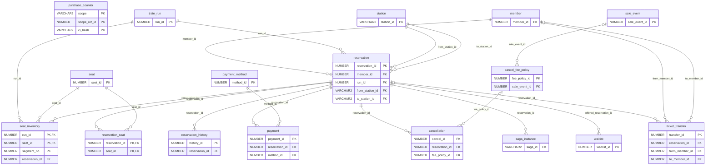

#### `seat_inventory` 좌석 구간 재고 ★

Oracle

운행·좌석·구간 단위 점유. PK와 열차 일치 복합 FK로 중복 예약과 다른 열차 좌석 판매를 DB가 막고, HOLD는 hold_expires_at이 지나면 다음 사람이 이어받는다.

| 컬럼 | 타입 | 키 | 출처 | 설명 | 이유 |
|---|---|---|---|---|---|
| `run_id` | NUMBER | PK, FK → train_run | 시스템 | 운행 |  |
| `train_id` | NUMBER | NN | 시스템 | 좌석이 속한 열차 (= train_run.train_id) | 복합 FK 두 개로 다른 열차 좌석 판매를 DB가 차단 |
| `seat_id` | NUMBER | PK, FK → seat | 시스템 | 좌석 |  |
| `segment_no` | NUMBER(3) | PK | 시스템 | 구간 번호 (역 순번 i → i+1 = i) | 구간 단위 점유 |
| `reservation_id` | NUMBER | FK, NN → reservation | 시스템 | 점유 예약 | 반환 시 이 예약 행만 삭제 |
| `status` | VARCHAR2(10) | NN | 시스템 | HOLD / SOLD | 선점과 확정 구분 |
| `hold_expires_at` | TIMESTAMP |  | 시스템 | HOLD 만료 시각 (SOLD면 null) | = reservation.pay_deadline_at 복사. Redis TTL이 끝난 뒤 남은 HOLD 행을 다른 사람이 이어받는 기준 |

> **제약·비고** PK(run_id, seat_id, segment_no) · FK(train_id, seat_id) → seat(train_id, seat_id) · FK(run_id, train_id) → train_run(run_id, train_id) — 같은 대상의 단일 FK는 DDL에서 생략, 편집기 선만 유지 · CHECK((status = 'HOLD' AND hold_expires_at IS NOT NULL) OR (status = 'SOLD' AND hold_expires_at IS NULL)) · 인덱스는 PK·복합 FK만 (hold_expires_at으로 찾는 쿼리가 없어 부분 인덱스를 두지 않음) · 확장 과제를 안 하면 segment_no = 0 · 예약 하나의 행 수 K = seat_count × 구간 수 (concurrency.md §2.4) · 절차: concurrency.md §2 선점, §3 재선점(이전 예약의 HOLD 행 전부 삭제), §5 확정(K행 SOLD), §7 해제, §8 취소

**관계** run_id → [`train_run`](#train-run) · seat_id → [`seat`](#seat) · reservation_id → [`reservation`](#reservation)

#### `reservation` 예약

Oracle

예약 상태 머신의 중심. reservation_id가 Kafka 파티션 키.

| 컬럼 | 타입 | 키 | 출처 | 설명 | 이유 |
|---|---|---|---|---|---|
| `reservation_id` | NUMBER | PK | 시스템 | 예약 ID | Kafka 파티션 키 → 상태 변경 순서 보장 |
| `member_id` | NUMBER | FK, NN → member | 생성 | 예약자 |  |
| `ci_hash` | VARCHAR2(64) | NN | 생성 | 예약 시점 CI | 매수 제한 집계를 조인 없이 빠르게 |
| `run_id` | NUMBER | FK, NN → train_run | 생성 | 운행 |  |
| `from_station_id` | VARCHAR2(10) | FK, NN → station | 공공 | 승차역 |  |
| `to_station_id` | VARCHAR2(10) | FK, NN → station | 공공 | 하차역 |  |
| `seat_count` | NUMBER(2) | NN | 생성 | 예약 매수 | 1회 구매 매수 위험 신호 |
| `total_amount` | NUMBER(10) | NN | 시스템 | 예약 시점 금액 | 운임 변경과 무관하게 보존 |
| `status` | VARCHAR2(16) | NN | 시스템 | HOLD / PAYMENT_PENDING / CONFIRMED / CANCELED / EXPIRED | 상태 머신 |
| `channel` | VARCHAR2(10) | NN | 생성 | WEB / APP | 채널별 트래픽 분석 |
| `source` | VARCHAR2(10) | NN | 시스템 | NORMAL / WAITLIST | 취소표 재배정 여부 |
| `held_at` | TIMESTAMP | NN | 시스템 | 좌석 선점 시각 |  |
| `pay_deadline_at` | TIMESTAMP | NN | 시스템 | 결제 기한 (마감 시각의 원천) | seat_inventory.hold_expires_at, seat:hold TTL, saga_instance.timeout_at, waitlist.offer_deadline_at은 이 값을 한 번 계산해 복사. 바꿀 땐 다섯 곳을 같은 트랜잭션·같은 값으로 |
| `confirmed_at` | TIMESTAMP |  | 시스템 | 확정 시각 | 구매→취소 시간 계산 시작점 |
| `canceled_at` | TIMESTAMP |  | 시스템 | 취소 시각 |  |
| `idempotency_key` | VARCHAR2(64) | NN | 시스템 | 클라이언트 요청 키 | 따닥 클릭·재시도 시 중복 예약 방지. UNIQUE 범위는 회원 단위 |
| `version` | NUMBER | NN | 시스템 | 낙관적 락 버전 | 락 방식 성능 비교 실험용 |

> **제약·비고** CREATE INDEX ix_resv_hold_due ON reservation (CASE WHEN status = 'HOLD' THEN pay_deadline_at END); HOLD 만료 스캐너용 (조회도 같은 CASE 식, concurrency.md §6.1). 결제 중 예약은 payment.next_check_at으로 따로 조회 · UNIQUE(member_id, idempotency_key) · 마감 시각 원천 = pay_deadline_at (복사본 4곳은 §0.2, 앱 시계로 계산 §0.7) · 결제 시작 연장은 GREATEST로 늘리기만 (§4) · 네이티브 UPDATE는 updated_at·version 갱신 (§0.3) · 결제 실패는 별도 상태 없이 EXPIRED (§5.2) · from·to 역은 운행의 정차역이고 from 순번 < to 순번 (애플리케이션 검증) · 절차: concurrency.md §1~§8

**관계** member_id → [`member`](#member) · run_id → [`train_run`](#train-run) · from_station_id → [`station`](#station) · to_station_id → [`station`](#station) · [`seat_inventory`](#seat-inventory).reservation_id → 이 테이블 · [`reservation_seat`](#reservation-seat).reservation_id → 이 테이블 · [`reservation_history`](#reservation-history).reservation_id → 이 테이블 · [`payment`](#payment).reservation_id → 이 테이블 · [`cancellation`](#cancellation).reservation_id → 이 테이블 · [`saga_instance`](#saga-instance).reservation_id → 이 테이블 · [`waitlist`](#waitlist).offered_reservation_id → 이 테이블 · [`ticket_transfer`](#ticket-transfer).reservation_id → 이 테이블

#### `reservation_seat` 예약 좌석

Oracle

한 예약에 포함된 좌석과 좌석별 금액.

| 컬럼 | 타입 | 키 | 출처 | 설명 | 이유 |
|---|---|---|---|---|---|
| `reservation_id` | NUMBER | PK, FK → reservation | 시스템 |  |  |
| `seat_id` | NUMBER | PK, FK → seat | 시스템 |  | 한 예약에 여러 좌석 |
| `ticket_no` | VARCHAR2(20) | UQ, NN | 시스템 | 승차권 번호 | 예매 내역·반환·신고 대상 식별 |
| `passenger_type` | VARCHAR2(10) | NN | 생성 | ADULT / CHILD / SENIOR | 운임 할인 확장 |
| `amount` | NUMBER(10) | NN | 시스템 | 좌석별 금액 | 부분 취소 대응 |

> **제약·비고** ticket_no는 선점 시 발급하지만 확정(CONFIRMED) 전에는 효력 없음 (concurrency.md §2.2)

**관계** reservation_id → [`reservation`](#reservation) · seat_id → [`seat`](#seat)

#### `reservation_history` 예약 상태 이력

Oracle · updated_at 생략

상태 전이 기록. 순서 보장과 잘못된 전이를 테스트로 증명하는 근거.

| 컬럼 | 타입 | 키 | 출처 | 설명 | 이유 |
|---|---|---|---|---|---|
| `history_id` | NUMBER | PK | 시스템 |  |  |
| `reservation_id` | NUMBER | FK, NN → reservation | 시스템 |  |  |
| `from_status` | VARCHAR2(16) |  | 시스템 | 이전 상태 | 첫 기록이면 null. 허용값은 비고의 CHECK (v4 nn-auto가 NOT NULL로 바꾸지 않도록 설명은 그대로 둠) |
| `to_status` | VARCHAR2(16) | NN | 시스템 | HOLD / PAYMENT_PENDING / CONFIRMED / CANCELED / EXPIRED | 변경 상태. 잘못된 전이(CANCELED→CONFIRMED) 탐지 |
| `event_id` | VARCHAR2(36) |  | 시스템 | 원인 Kafka 이벤트 | 어떤 이벤트가 바꿨는지 추적 |
| `actor_type` | VARCHAR2(10) | NN | 시스템 | USER / SYSTEM / ADMIN | 누가 상태를 바꿨는지 |
| `changed_at` | TIMESTAMP | NN | 시스템 | 변경 시각 | 순서 보장 검증 근거 |

> **제약·비고** event_id는 outbox_event를 논리 참조 (outbox 정리 후에도 이력 보존을 위해 FK 미설정) · INSERT만 하는 테이블 (updated_at 생략) · CHECK(from_status IN ('HOLD', 'PAYMENT_PENDING', 'CONFIRMED', 'CANCELED', 'EXPIRED'))

**관계** reservation_id → [`reservation`](#reservation)

#### `payment` 결제

Oracle

PG 결제 요청과 결과. 실패 시 Saga 보상 트리거.

| 컬럼 | 타입 | 키 | 출처 | 설명 | 이유 |
|---|---|---|---|---|---|
| `payment_id` | NUMBER | PK | 시스템 |  |  |
| `reservation_id` | NUMBER | FK, NN → reservation | 시스템 |  |  |
| `method_id` | NUMBER | FK, NN → payment_method | 생성 | 결제 수단 | 결제 수단 단위 위험 점수 |
| `amount` | NUMBER(10) | NN | 시스템 | 결제 금액 |  |
| `status` | VARCHAR2(10) | NN | 시스템 | REQUESTED / APPROVED / FAILED / REFUNDED | Saga 보상 트리거 |
| `pg_tx_id` | VARCHAR2(64) |  | 시스템 | PG 거래 ID | PG 대사·환불 |
| `fail_reason` | VARCHAR2(100) |  | 시스템 | 실패 사유 | 트러블슈팅 |
| `idempotency_key` | VARCHAR2(64) | NN | 시스템 | 결제 요청 키 | 같은 요청 재시도 방지. UNIQUE 범위는 예약 단위 |
| `requested_at` | TIMESTAMP | NN | 시스템 | 요청 시각 | 결제 소요 시간 측정 |
| `approved_at` | TIMESTAMP |  | 시스템 | 승인 시각 |  |
| `next_check_at` | TIMESTAMP |  | 시스템 | PG 결과 조회 예정 시각 | 결제 시작 때 마감 값으로 시작. PG 결과를 모르면 payment.pg_recheck_sec만큼 미뤄 스캐너가 같은 건을 매 회차 다시 보지 않게 함 |

> **제약·비고** UNIQUE(reservation_id, idempotency_key) · 예약당 승인 1건: CREATE UNIQUE INDEX ux_payment_approved ON payment (CASE WHEN status = 'APPROVED' THEN reservation_id END) · payment.status=REFUNDED는 cancellation.refund_status=DONE과 같은 트랜잭션에서 갱신 · 절차: concurrency.md §1 멱등, §4 결제 시작(REQUESTED), §5 확정, §6 스캐너가 REQUESTED 건은 PG 조회 후 확정 또는 실패 처리 (결과 모르면 자동 만료 안 함), §7.3 늦은 승인 환불 · CREATE INDEX ix_pay_recheck ON payment (CASE WHEN status = 'REQUESTED' THEN next_check_at END); 결제 결과 확인 스캐너용 (concurrency.md §6.2) · payment 상태를 바꾸는 트랜잭션은 그 예약의 reservation 행을 먼저 잠금 (§5) · FAILED 뒤 승인이 오면 APPROVED로 기록하고 전액 환불 (§5.1)

**관계** reservation_id → [`reservation`](#reservation) · method_id → [`payment_method`](#payment-method)

#### `cancellation` 취소·환불

Oracle

취소 유형과 시간 지표. 위험 신호와 재판매율 성과 지표의 원천.

| 컬럼 | 타입 | 키 | 출처 | 설명 | 이유 |
|---|---|---|---|---|---|
| `cancel_id` | NUMBER | PK | 시스템 |  |  |
| `reservation_id` | NUMBER | FK, NN → reservation | 시스템 |  |  |
| `cancel_type` | VARCHAR2(10) | NN | 시스템 | USER / PAY_FAILED / ADMIN | USER = 사용자 확정 취소(수수료), ADMIN = 운영 취소(수수료 0), PAY_FAILED = 늦은 승인 환불(전액). 만료는 돈이 오가지 않아 cancellation을 만들지 않음 |
| `canceled_at` | TIMESTAMP | NN | 생성 | 취소 시각 |  |
| `minutes_after_purchase` | NUMBER |  | 시스템 | 확정 후 취소까지 분 | 구매 후 취소 시간 위험 신호 |
| `minutes_before_departure` | NUMBER |  | 시스템 | 출발 전 남은 분 | 노쇼성 직전 취소 탐지, 기획 배경 통계와 연결 |
| `refund_amount` | NUMBER(10) | NN | 시스템 | 환불액 |  |
| `cancel_fee` | NUMBER(10) | NN | 시스템 | 취소 수수료 | 노쇼 억제 수단 |
| `fee_policy_id` | NUMBER | FK → cancel_fee_policy | 생성 | 적용 수수료 정책 |  |
| `refund_pg_tx_id` | VARCHAR2(64) |  | 시스템 | PG 환불 거래 ID | 환불 대사 |
| `refund_status` | VARCHAR2(10) |  | 시스템 | REQUESTED / DONE / FAILED | 환불 실패 재시도 |
| `resold_yn` | CHAR(1) | NN | 시스템 | 재판매 여부 | INSERT 때 N, 운행 출발 후 배치가 갱신 (concurrency.md §8.3) |

> **제약·비고** 절차: concurrency.md §7.3 늦은 승인 환불(PAY_FAILED: 환불액 = 결제 금액, 수수료 0, 정책·분 컬럼 NULL), §8 확정 예약 취소(USER·ADMIN, 확정 예약도 purchase_counter 감소), §8.3 resold_yn 배치 · refund_status·resold_yn을 나중에 UPDATE하므로 INSERT만 하는 테이블이 아님

**관계** reservation_id → [`reservation`](#reservation) · fee_policy_id → [`cancel_fee_policy`](#cancel-fee-policy)

#### `cancel_fee_policy` 취소 수수료 정책

Oracle

출발 전 남은 시간 구간별 수수료율. 기획 배경의 노쇼 증가에 대한 정책 수단.

| 컬럼 | 타입 | 키 | 출처 | 설명 | 이유 |
|---|---|---|---|---|---|
| `fee_policy_id` | NUMBER | PK | 생성 |  |  |
| `sale_event_id` | NUMBER | FK → sale_event | 생성 | 적용 행사 (null이면 상시) | 명절만 수수료 강화 가능 |
| `min_minutes_before` | NUMBER |  | 생성 | 출발 전 구간 시작(분) |  |
| `max_minutes_before` | NUMBER |  | 생성 | 출발 전 구간 끝(분) |  |
| `fee_rate` | NUMBER(4,3) |  | 생성 | 수수료율 | 노쇼 억제 |
| `after_departure` | CHAR(1) | NN | 생성 | 출발 후 반환 여부 | 출발 후 반환은 재판매 불가 구간 |

> **제약·비고** 예시값이며 실제 코레일 기준이 아님 · 구간은 [min, max) 반열림, max가 null이면 상한 없음 · 같은 행사 안에서 구간이 겹치면 안 됨 · after_departure=Y 행은 출발 후 반환에 적용

**관계** sale_event_id → [`sale_event`](#sale-event) · [`cancellation`](#cancellation).fee_policy_id → 이 테이블

**예시 데이터** (팀 확정 전 예시값)

| fee_policy_id | sale_event_id | min_minutes_before | max_minutes_before | fee_rate | after_departure |
|---|---|---|---|---|---|
| 1 | 1 | 4320 | null | 0 | N |
| 2 | 1 | 1440 | 4320 | 0.05 | N |
| 3 | 1 | 180 | 1440 | 0.1 | N |
| 4 | 1 | 0 | 180 | 0.2 | N |
| 5 | 1 | null | null | 0.4 | Y |

#### `ticket_transfer` 승차권 양도 (확장)

Oracle · ┄ 확장 예정

승차권 양도·선물 기록. 양도 횟수와 양도 직후 재판매 패턴을 위험 신호로 쓴다. 발표 후 판단.

| 컬럼 | 타입 | 키 | 출처 | 설명 | 이유 |
|---|---|---|---|---|---|
| `transfer_id` | NUMBER | PK | 시스템 |  |  |
| `ticket_no` | VARCHAR2(20) |  | 시스템 | 양도한 승차권 번호 | reservation_seat.ticket_no |
| `reservation_id` | NUMBER | FK → reservation | 시스템 | 원 예약 |  |
| `from_member_id` | NUMBER | FK → member | 시스템 | 보낸 회원 |  |
| `to_member_id` | NUMBER | FK → member | 시스템 | 받은 회원 | 같은 상대에게 반복 양도 = 거래 의심 |
| `transferred_at` | TIMESTAMP |  | 시스템 | 양도 시각 | 구매 직후 양도 = 되팔이 신호 |
| `status` | VARCHAR2(10) |  | 시스템 | REQUESTED / ACCEPTED / CANCELED |  |

> **제약·비고** 확장 예정 — 지금은 구현하지 않음

**관계** reservation_id → [`reservation`](#reservation) · from_member_id → [`member`](#member) · to_member_id → [`member`](#member)

#### `purchase_counter` 매수 카운터

Oracle

CI별 보유 매수. 매수 제한의 최종 판정을 조건부 UPDATE 한 번으로 원자적으로 처리하고, Redis 카운터가 사라지면 여기서 복원한다.

| 컬럼 | 타입 | 키 | 출처 | 설명 | 이유 |
|---|---|---|---|---|---|
| `scope` | VARCHAR2(20) | PK | 시스템 | PER_RUN / PER_HOLIDAY | 열차별·명절 전체 제한을 한 테이블에서 |
| `scope_ref_id` | NUMBER | PK | 시스템 | run_id 또는 sale_event_id | scope에 따라 가리키는 대상이 달라 FK 미설정 |
| `ci_hash` | VARCHAR2(64) | PK | 시스템 | CI 해시 | 계정이 아닌 사람 단위 합산 |
| `seat_count` | NUMBER(3) | NN | 시스템 | 현재 보유 매수 | 조건부 UPDATE로 한도 초과 차단 |

> **제약·비고** CHECK(seat_count >= 0) · 증가는 reservation INSERT와 같은 트랜잭션, 감소는 예약 상태 UPDATE가 1행일 때만, 한 트랜잭션의 카운터 행은 (scope, scope_ref_id, ci_hash) 정렬 순서로 갱신, sale_event_id가 NULL이면 PER_HOLIDAY 미적용 · 절차: concurrency.md §10

### 이벤트 신뢰성

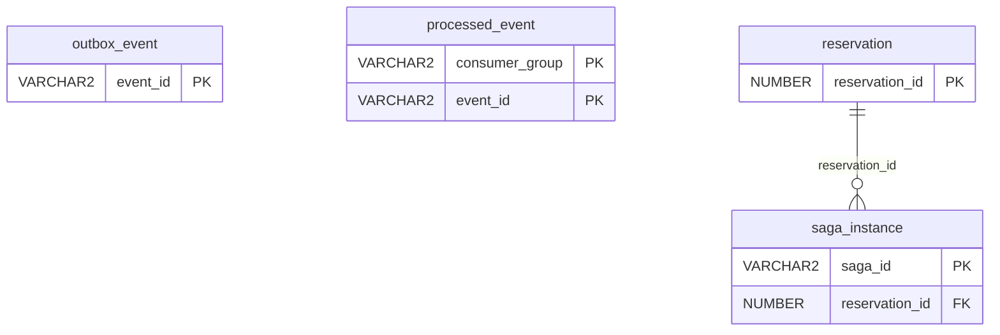

#### `outbox_event` Outbox 이벤트

Oracle

비즈니스 변경과 같은 트랜잭션에서 INSERT → 이벤트 유실 0건.

| 컬럼 | 타입 | 키 | 출처 | 설명 | 이유 |
|---|---|---|---|---|---|
| `event_id` | VARCHAR2(36) | PK | 시스템 | UUID | 소비자 중복 판별 키 |
| `seq` | NUMBER | UQ, NN | 시스템 | 발행 순서 번호 (outbox_seq) | 같은 예약의 이벤트는 reservation 행 락 뒤에 INSERT되므로 seq가 커밋 순서와 같음. 정렬 기준 |
| `aggregate_type` | VARCHAR2(20) | NN | 시스템 | RESERVATION / PAYMENT / WAITLIST | 토픽 라우팅 |
| `aggregate_id` | VARCHAR2(36) | NN | 시스템 | reservation_id, case_id 등 | 숫자·UUID 키 모두 수용 |
| `partition_key` | VARCHAR2(64) | NN | 시스템 | Kafka 메시지 키 | 결제·취소 이벤트도 reservation_id를 키로 써야 같은 예약의 이벤트 순서 보장 |
| `shard_no` | NUMBER(2) | NN | 시스템 | 릴레이 샤드 번호 0~15. INSERT 문에서 ORA_HASH(TO_CHAR(:partition_key), 15)로 계산 | 같은 예약 이벤트는 항상 같은 샤드 → 한 릴레이만 순서대로 발행. 가상 컬럼 대신 일반 컬럼으로 두어 부분 인덱스와 실행 계획을 단순하게 |
| `event_type` | VARCHAR2(30) | NN | 시스템 | SEAT_HELD, PAYMENT_APPROVED … |  |
| `payload` | CLOB | NN | 시스템 | 이벤트 본문 (JSON) | 스키마 변경에 유연 |
| `status` | VARCHAR2(10) | NN | 시스템 | PENDING / PUBLISHED / FAILED | FAILED = retry_count가 outbox.max_retry에 도달. 그 샤드를 멈추고 관리자 확인 후 PENDING으로 되돌림 |
| `retry_count` | NUMBER(2) | NN | 시스템 | 재시도 횟수 | 무한 재시도 방지 |
| `created_at` | TIMESTAMP | NN | 시스템 | 생성 시각 |  |
| `published_at` | TIMESTAMP |  | 시스템 | 발행 시각 | 발행 지연 모니터링 |

> **제약·비고** CREATE SEQUENCE outbox_seq CACHE 1000; · CHECK(shard_no BETWEEN 0 AND 15) · CREATE INDEX ix_outbox_pending ON outbox_event (CASE WHEN status IN ('PENDING', 'FAILED') THEN shard_no END, CASE WHEN status IN ('PENDING', 'FAILED') THEN seq END); FAILED도 포함 — 샤드 맨 앞이 FAILED면 그 샤드 정지 · 샤드 담당은 Redis 리스 relay:shard:{n} · 맨 앞 N개 rowid만 FOR UPDATE WAIT (SKIP LOCKED 금지), 발행 실패 시 그 샤드 회차 즉시 중단 · partition_key는 항상 문자열로 바인딩 · status·retry_count를 UPDATE하므로 INSERT만 하는 테이블이 아님 · 절차: concurrency.md §11

#### `processed_event` 처리 완료 (Inbox)

Oracle · updated_at 생략

Kafka at-least-once 대응. 이미 처리한 이벤트는 skip → 멱등 소비.

| 컬럼 | 타입 | 키 | 출처 | 설명 | 이유 |
|---|---|---|---|---|---|
| `consumer_group` | VARCHAR2(50) | PK | 시스템 | 소비자 그룹 | 그룹마다 독립 처리 |
| `event_id` | VARCHAR2(36) | PK | 시스템 | 이벤트 ID | 이미 있으면 skip → 멱등 소비 |
| `processed_at` | TIMESTAMP | NN | 시스템 | 처리 시각 | 정리 배치 기준 (inbox.retention_days) |

> **제약·비고** INSERT만 하는 테이블 (updated_at 생략) · CREATE INDEX ix_inbox_processed ON processed_event (processed_at); 정리 배치용 · inbox.retention_days(8일)가 지난 행 삭제. Kafka 보관(기본 7일)보다 길게 둬야 재전달 중복을 막음 · 절차: concurrency.md §12

#### `saga_instance` Saga 진행 상태

Oracle

예약→결제→확정 흐름의 진행 단계. 중단 지점에서 재개하거나 보상.

| 컬럼 | 타입 | 키 | 출처 | 설명 | 이유 |
|---|---|---|---|---|---|
| `saga_id` | VARCHAR2(36) | PK | 시스템 |  |  |
| `reservation_id` | NUMBER | FK, NN → reservation | 시스템 |  |  |
| `current_step` | VARCHAR2(20) | NN | 시스템 | SEAT_HELD / PAYING / CONFIRMED | 마지막으로 도달한 단계. 결과는 status (보상은 한 트랜잭션이라 진행 중 단계를 따로 두지 않음) |
| `status` | VARCHAR2(12) | NN | 시스템 | RUNNING / DONE / COMPENSATED | 좌석 복구율 100% 검증 |
| `timeout_at` | TIMESTAMP |  | 시스템 | 다음 단계 제한 시각 | = reservation.pay_deadline_at 복사. 지나면 보상 실행 |
| `updated_at` | TIMESTAMP |  | 시스템 | 갱신 시각 | 멈춘 Saga 탐지 |

> **제약·비고** current_step = 마지막 단계, status = 결과 · 선점 SEAT_HELD·RUNNING (§2.2) · 결제 시작 PAYING + timeout_at 연장 (§4) · 확정 CONFIRMED·DONE (§5.1) · 해제는 status만 COMPENSATED, current_step 유지 (§3, §7) · 절차: concurrency.md

**관계** reservation_id → [`reservation`](#reservation)

### 취소표 재배정

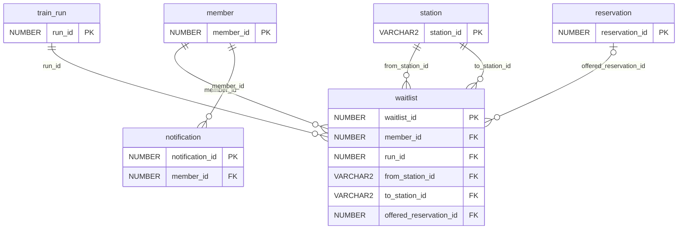

#### `waitlist` 취소표 대기

Oracle

취소 발생 시 신청 순서대로 배정 → 알림 → 제한 시간 내 결제.

| 컬럼 | 타입 | 키 | 출처 | 설명 | 이유 |
|---|---|---|---|---|---|
| `waitlist_id` | NUMBER | PK | 생성 |  |  |
| `member_id` | NUMBER | FK, NN → member | 생성 |  |  |
| `run_id` | NUMBER | FK, NN → train_run | 생성 |  |  |
| `from_station_id` | VARCHAR2(10) | FK, NN → station | 공공 | 희망 승차역 | 구간 일치 취소표만 배정 |
| `to_station_id` | VARCHAR2(10) | FK, NN → station | 공공 | 희망 하차역 |  |
| `seat_grade` | VARCHAR2(10) | NN | 생성 | GENERAL / FIRST | 희망 등급. 좌석 등급 코드 통일 |
| `seat_count` | NUMBER(2) | NN | 생성 | 희망 매수 |  |
| `requested_at` | TIMESTAMP | NN | 생성 | 신청 시각 | 대기 순서 기준 |
| `offered_at` | TIMESTAMP |  | 시스템 | 배정 제안 시각 |  |
| `offer_deadline_at` | TIMESTAMP |  | 시스템 | 결제 기한 | = 제안 예약의 pay_deadline_at 복사. 결제 시작 때 함께 연장 (concurrency.md §4) |
| `offered_reservation_id` | NUMBER | FK → reservation | 시스템 | 제안된 예약 |  |
| `status` | VARCHAR2(10) | NN | 시스템 | WAITING / OFFERED / ACCEPTED / EXPIRED / CANCELED / SKIPPED | SKIPPED = 제안 시 매수 한도 초과로 건너뜀 |

> **제약·비고** CREATE INDEX ix_waitlist_next ON waitlist (run_id, status, requested_at); 다음 대기자 조회용 · 제안 예약의 idempotency_key = 'wl:' || waitlist_id (신청 하나에 제안 하나) · 대기자 우선: 취소로 풀린 좌석은 seat:hold를 REOFFER 값으로 잠시 막고 먼저 제안 · 제안 예약도 purchase_counter 증가, 한도에 걸리면 SKIPPED · 절차: concurrency.md §9

**관계** member_id → [`member`](#member) · run_id → [`train_run`](#train-run) · from_station_id → [`station`](#station) · to_station_id → [`station`](#station) · offered_reservation_id → [`reservation`](#reservation)

#### `notification` 알림

Oracle

취소표 배정·결제 독촉·만료 알림.

| 컬럼 | 타입 | 키 | 출처 | 설명 | 이유 |
|---|---|---|---|---|---|
| `notification_id` | NUMBER | PK | 시스템 |  |  |
| `member_id` | NUMBER | FK, NN → member | 시스템 |  |  |
| `type` | VARCHAR2(20) | NN | 시스템 | WAITLIST_OFFER / PAY_REMINDER / EXPIRED |  |
| `ref_type` | VARCHAR2(20) | NN | 시스템 | RESERVATION / WAITLIST / CASE | ref_id가 어느 테이블을 가리키는지 |
| `ref_id` | NUMBER |  | 시스템 | 관련 예약·대기 ID |  |
| `channel` | VARCHAR2(10) | NN | 시스템 | PUSH / EMAIL / IN_APP | 채널 추가 확장 |
| `sent_at` | TIMESTAMP |  | 시스템 | 발송 시각 | 알림→결제 전환 분석 |
| `read_at` | TIMESTAMP |  | 시스템 | 확인 시각 |  |

**관계** member_id → [`member`](#member)

### 위험 점수·관리자

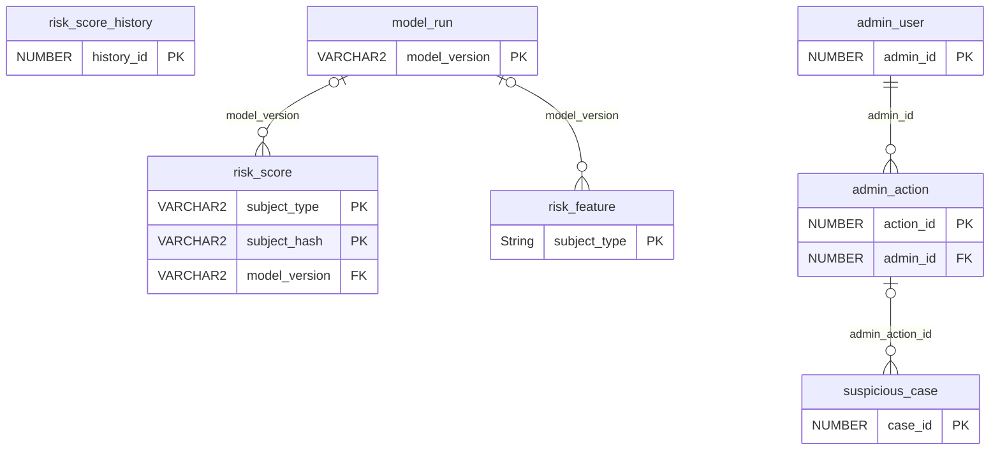

#### `risk_score` 위험 점수 (현재값)

Oracle

계정이 아닌 CI·결제수단·기기 단위 위험 점수. final_score만큼 대기열 순번을 뒤로.

| 컬럼 | 타입 | 키 | 출처 | 설명 | 이유 |
|---|---|---|---|---|---|
| `subject_type` | VARCHAR2(10) | PK | 시스템 | CI / PAYMENT / DEVICE | 계정이 아닌 식별 단위 |
| `subject_hash` | VARCHAR2(64) | PK | 시스템 | 해당 해시 |  |
| `total_purchase_seats` | NUMBER |  | 시스템 | 누적 구매 매수 | 신호 |
| `max_single_purchase` | NUMBER |  | 시스템 | 1회 최대 매수 | 신호 |
| `cancel_ratio` | NUMBER(4,3) |  | 시스템 | 취소 비율 | 신호 |
| `avg_minutes_to_cancel` | NUMBER |  | 시스템 | 평균 구매→취소 시간 | 신호 |
| `last_minute_cancel_cnt` | NUMBER |  | 시스템 | 출발 직전 취소 수 | 신호 |
| `linked_account_cnt` | NUMBER |  | 시스템 | 연결된 계정 수 | 다계정 신호 |
| `avg_request_interval_ms` | NUMBER |  | 시스템 | 평균 요청 간격 | 매크로 신호 |
| `account_age_days` | NUMBER |  | 시스템 | 가장 오래된 계정 나이 | 신규 계정 기본 신뢰도 |
| `rule_score` | NUMBER(5,2) |  | 시스템 | 규칙 기반 점수 |  |
| `iforest_score` | NUMBER(5,2) |  | 시스템 | Isolation Forest 점수 | 두 방식 비교 |
| `final_score` | NUMBER(5,2) | NN | 시스템 | 최종 점수 (0~100) | 대기열 순번 조정량 |
| `reasons` | CLOB |  | 시스템 | 점수 근거 목록 (JSON) | 운영 원칙: 근거 기록 |
| `model_version` | VARCHAR2(20) | FK → model_run | 시스템 | 산정 모델 버전 | 모델 교체 시 비교 |
| `calculated_at` | TIMESTAMP | NN | 시스템 | 산정 시각 | 감쇠 기준 |
| `review_status` | VARCHAR2(10) | NN | 시스템 | NONE / PENDING / CONFIRMED / CLEARED | 높은 점수는 검토 후 조치 |

> **제약·비고** 회원 대기열 패널티 = 연결된 CI·결제수단·기기 점수 중 최댓값

**관계** model_version → [`model_run`](#model-run)

#### `risk_score_history` 위험 점수 이력

Oracle

산정 시점별 점수와 근거. 감쇠 동작 검증, 이의 제기 대응.

| 컬럼 | 타입 | 키 | 출처 | 설명 | 이유 |
|---|---|---|---|---|---|
| `history_id` | NUMBER | PK | 시스템 |  |  |
| `subject_type` | VARCHAR2(10) | NN | 시스템 | CI / PAYMENT / DEVICE | 대상 유형 코드 통일 (CHECK) |
| `subject_hash` | VARCHAR2(64) | NN | 시스템 | 대상 해시 |  |
| `final_score` | NUMBER(5,2) | NN | 시스템 | 당시 점수 | 감쇠 동작 검증, 이의 제기 대응 |
| `reasons` | CLOB |  | 시스템 | 당시 근거 |  |
| `calculated_at` | TIMESTAMP | NN | 시스템 | 산정 시각 |  |

#### `admin_action` 관리자 조치

Oracle

위험 사용자 검토·제재 기록. 감사 추적.

| 컬럼 | 타입 | 키 | 출처 | 설명 | 이유 |
|---|---|---|---|---|---|
| `action_id` | NUMBER | PK | 시스템 |  |  |
| `admin_id` | NUMBER | FK, NN → admin_user | 시스템 | 조치자 | 감사 추적 |
| `subject_type` | VARCHAR2(10) | NN | 시스템 | CI / PAYMENT / DEVICE | 대상 유형 코드 통일 (CHECK) |
| `subject_hash` | VARCHAR2(64) | NN | 시스템 | 대상 해시 |  |
| `action_type` | VARCHAR2(20) | NN | 시스템 | CONFIRM / CLEAR / RESTRICT / BAN |  |
| `memo` | VARCHAR2(500) |  | 시스템 | 사유 |  |
| `acted_at` | TIMESTAMP | NN | 시스템 | 조치 시각 |  |

> **제약·비고** 회원 상태 변경(RESTRICT·BAN)은 member.status와 같은 트랜잭션에서 갱신

**관계** admin_id → [`admin_user`](#admin-user) · [`suspicious_case`](#suspicious-case).admin_action_id → 이 테이블

#### `model_run` 모델 학습 기록

Oracle

규칙·Isolation Forest 모델 버전별 파라미터와 성능. 발표용 수치의 원천.

| 컬럼 | 타입 | 키 | 출처 | 설명 | 이유 |
|---|---|---|---|---|---|
| `model_version` | VARCHAR2(20) | PK | 시스템 | 예: iforest-2026.11-01 | risk_score.model_version이 참조 |
| `algorithm` | VARCHAR2(20) | NN | 시스템 | RULE / IFOREST | 두 방식 비교 |
| `params` | CLOB |  | 시스템 | contamination, n_estimators 등 (JSON) | 재현 |
| `train_source` | VARCHAR2(100) |  | 시스템 | 학습 데이터 범위 |  |
| `trained_at` | TIMESTAMP | NN | 시스템 |  |  |
| `precision_score` | NUMBER(4,3) |  | 시스템 | 정밀도 | 발표용 성능 수치 |
| `recall_score` | NUMBER(4,3) |  | 시스템 | 재현율 |  |
| `f1_score` | NUMBER(4,3) |  | 시스템 | F1 |  |
| `threshold` | NUMBER(5,2) |  | 시스템 | 케이스 자동 생성 임계값 | suspicious_case 트리거 기준 |
| `decay_half_life_days` | NUMBER(4) |  | 시스템 | 점수 반감기 (일) | 기간 경과 시 점수 감소 파라미터 |
| `is_active` | CHAR(1) | NN | 시스템 | 운영 적용 여부 |  |

> **제약·비고** is_active = Y는 한 번에 하나

**관계** [`risk_score`](#risk-score).model_version → 이 테이블 · [`risk_feature`](#risk-feature).model_version → 이 테이블

**예시 데이터** (팀 확정 전 예시값)

| model_version | algorithm | params | train_source | trained_at | threshold | decay_half_life_days | is_active |
|---|---|---|---|---|---|---|---|
| rule-2026.11-01 | RULE | {"weights":"risk_score 신호별 가중치"} | synthetic v1 | 2026-11-18 10:00 | 80 | 30 | Y |
| iforest-2026.11-01 | IFOREST | {"n_estimators":200,"contamination":0.05} | synthetic v1 + ext_web_access_log | 2026-11-18 10:00 | 80 | 30 | N |

### CCTV 되돌아보기

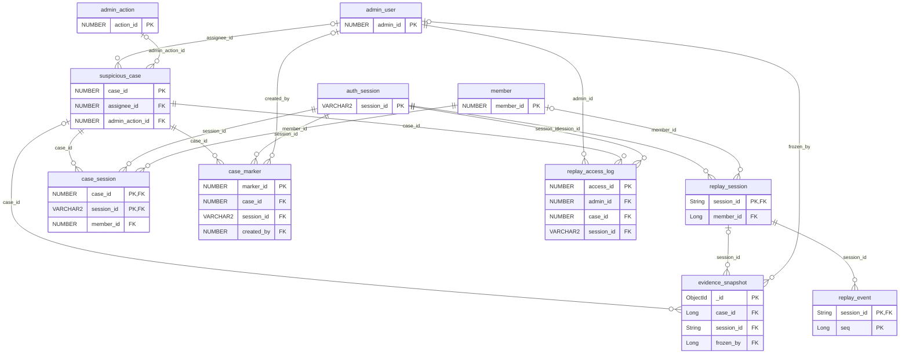

#### `replay_session` 녹화 세션

MongoDB · 🅱 빅데이터

CCTV 녹화 단위. 로그인 세션과 1:1. 평시 샘플링, 위험 사용자는 전체 녹화.

| 컬럼 | 타입 | 키 | 출처 | 설명 | 이유 |
|---|---|---|---|---|---|
| `session_id` | String | PK, FK → auth_session | 시스템 | = auth_session.session_id | 로그인 세션과 1:1 |
| `member_id` | Long | FK → member | 생성 |  |  |
| `ci_hash` | String |  | 생성 | 묶음 키 | 케이스에서 연관 세션 검색 |
| `device_hash` | String |  | 생성 | 묶음 키 |  |
| `ip_hash` | String |  | 생성 | 묶음 키 |  |
| `started_at` | Date |  | 생성 | 녹화 시작 |  |
| `ended_at` | Date |  | 생성 | 녹화 종료 |  |
| `event_count` | Int |  | 시스템 | 이벤트 수 | 재생 전 분량 확인 |
| `run_ids` | Array |  | 생성 | 이 세션에서 본 운행 | 특정 열차 기준 세션 검색 |
| `recording_mode` | String |  | 시스템 | SAMPLED / FULL | 평시 샘플링, 위험 시 전체 녹화 → 저장량 제어 |
| `risk_score_at_start` | Double |  | 시스템 | 시작 시점 점수 | 녹화 모드 결정 근거 |
| `mask_policy_version` | String |  | 시스템 | 입력 마스킹 규칙 버전 | 어떤 규칙으로 가렸는지 추적 |
| `retention_until` | Date |  | 시스템 | 보관 기한 (기본 90일) | 원래 보관 기한. legal_hold 중에도 지우지 않아 해제 때 기준이 됨. 개인정보 최소 보관 |
| `expire_at` | Date |  | 시스템 | 삭제 예정 시각 | TTL 기준. legal_hold면 필드 없음 |
| `legal_hold` | Boolean |  | 시스템 | 삭제 보류 | true로 바꾸면 그 세션 expire_at을 $unset하고 캐시 TTL 뒤 한 번 더 (concurrency.md §13.2). 해제 시 expire_at = max(retention_until, 지금 + 1일) |

> **제약·비고** 점선은 논리 참조 · TTL { expire_at: 1 }, expireAfterSeconds: 0 · 절차: concurrency.md §13

**관계** session_id → [`auth_session`](#auth-session) · member_id → [`member`](#member) · [`replay_event`](#replay-event).session_id → 이 테이블 · [`evidence_snapshot`](#evidence-snapshot).session_id → 이 테이블

#### `replay_event` 녹화 이벤트

MongoDB · 🅱 빅데이터

화면 행동과 서버 도메인 이벤트를 한 타임라인에 기록. 재생기가 화면을 다시 그린다. 일반 컬렉션.

| 컬럼 | 타입 | 키 | 출처 | 설명 | 이유 |
|---|---|---|---|---|---|
| `session_id` | String | PK, FK → replay_session | 시스템 | 녹화 세션 | session_id+seq 유니크로 재전송 중복 제거 |
| `ts` | Date |  | 생성 | 이벤트 시각 (ms) | TTL 기준 |
| `expire_at` | Date |  | 시스템 | 삭제 예정 시각 | TTL 기준. 세션 시작 + replay.retention_days로 기록, legal_hold면 필드 제거 |
| `seq` | Long | PK | 시스템 | 세션 내 순번 | 같은 ms 이벤트도 순서 보장 |
| `t_offset_ms` | Long |  | 시스템 | 세션 시작부터 경과 시간 | 재생 타임라인 위치, 다중 세션 정렬 |
| `type` | String |  | 생성 | PAGE_VIEW / CLICK / INPUT / SCROLL / MOUSE_PATH / VISIBILITY / API / DOMAIN |  |
| `screen` | String |  | 생성 | 화면 ID (queue, seat_map, payment) | 재생기가 화면을 다시 그리는 기준 |
| `target` | String |  | 생성 | 요소 ID (seat-5A, btn-pay) | 어떤 좌석·버튼을 눌렀는지 |
| `x` | Int |  | 생성 | 클릭 X (화면 비율 0~1000) | 해상도와 무관하게 재생 |
| `y` | Int |  | 생성 | 클릭 Y (화면 비율 0~1000) |  |
| `path` | Array |  | 생성 | 마우스 궤적 [[dt, x, y], …] | 사람은 곡선·가감속, 매크로는 직선·등속·순간이동 |
| `input_masked` | String |  | 시스템 | 입력값 마스킹 (길이만) | 개인정보 미보관 |
| `api` | Object |  | 시스템 | { method, path, status, latency_ms } | 화면 행동과 서버 응답을 같이 봄 |
| `domain_event` | Object |  | 시스템 | { type, ref_id, kafka_event_id } | 클릭 → 좌석 선점 → 결제 → 취소가 한 줄로 |

> **제약·비고** UNIQUE { session_id: 1, seq: 1 } (재전송 중복 제거) · TTL { expire_at: 1 }, expireAfterSeconds: 0 · 적재 컨슈머는 저장 전 세션 legal_hold 확인 (보류 중이면 expire_at 없이 저장) · 상한: replay.max_path_points, replay.batch_sec, replay.max_events_per_session · 시계열 컬렉션은 metaField=session_id 버킷 문제와 unique 인덱스 불가로 제외 · DOM 녹화(rrweb)는 확장 과제 · 절차: concurrency.md §13

**관계** session_id → [`replay_session`](#replay-session)

#### `suspicious_case` 의심 케이스

Oracle

위험 점수·규칙·관리자 지정으로 열리는 조사 건. 되돌아볼 시간 범위와 판정을 기록.

| 컬럼 | 타입 | 키 | 출처 | 설명 | 이유 |
|---|---|---|---|---|---|
| `case_id` | NUMBER | PK | 시스템 |  |  |
| `subject_type` | VARCHAR2(10) | NN | 시스템 | CI / PAYMENT / DEVICE | 계정이 아닌 묶음 단위 |
| `subject_hash` | VARCHAR2(64) | NN | 시스템 |  |  |
| `trigger_type` | VARCHAR2(20) | NN | 시스템 | RISK_THRESHOLD / RULE / MODEL / ADMIN | 어떻게 열렸는지 |
| `trigger_detail` | VARCHAR2(200) |  | 시스템 | 예: 같은 CI 4계정 동시 좌석 선점 | 첫 화면에서 이유 확인 |
| `risk_score_at_open` | NUMBER(5,2) |  | 시스템 | 생성 시점 점수 |  |
| `window_from` | TIMESTAMP |  | 시스템 | 되돌아볼 시작 시각 | 재생 범위 기본값 |
| `window_to` | TIMESTAMP |  | 시스템 | 되돌아볼 끝 시각 |  |
| `status` | VARCHAR2(12) | NN | 시스템 | OPEN / REVIEWING / CONFIRMED / DISMISSED |  |
| `assignee_id` | NUMBER | FK → admin_user | 시스템 | 담당 관리자 |  |
| `verdict` | VARCHAR2(20) |  | 시스템 | RESELLER / MACRO / CANCEL_ABUSE / NORMAL | synthetic_label과 비교해 오탐률 측정 |
| `admin_action_id` | NUMBER | FK → admin_action | 시스템 | 최종 조치 |  |
| `evidence_hash` | VARCHAR2(64) |  | 시스템 | 증거 조각 해시를 이어 붙인 SHA-256 | 증거 묶음 전체 무결성. Oracle에 따로 둬서 Mongo 쪽 변조와 분리 |
| `opened_at` | TIMESTAMP | NN | 시스템 |  |  |
| `closed_at` | TIMESTAMP |  | 시스템 |  | 처리 소요 시간 |

**관계** assignee_id → [`admin_user`](#admin-user) · admin_action_id → [`admin_action`](#admin-action) · [`case_session`](#case-session).case_id → 이 테이블 · [`case_marker`](#case-marker).case_id → 이 테이블 · [`evidence_snapshot`](#evidence-snapshot).case_id → 이 테이블 · [`replay_access_log`](#replay-access-log).case_id → 이 테이블

#### `case_session` 케이스-세션 연결

Oracle

한 케이스에 묶인 여러 세션. 같은 CI·기기의 다계정 세션을 나란히 재생.

| 컬럼 | 타입 | 키 | 출처 | 설명 | 이유 |
|---|---|---|---|---|---|
| `case_id` | NUMBER | PK, FK → suspicious_case | 시스템 |  |  |
| `session_id` | VARCHAR2(36) | PK, FK → auth_session | 시스템 |  | 한 케이스에 여러 세션 |
| `member_id` | NUMBER | FK, NN → member | 시스템 | 세션 계정 |  |
| `link_reason` | VARCHAR2(20) | NN | 시스템 | TRIGGER / SAME_CI / SAME_DEVICE / SAME_PAYMENT / SAME_IP | 다계정을 나란히 재생하는 근거 |
| `sync_offset_ms` | NUMBER |  | 시스템 | 동시 재생 시간 보정 | 기기 시계 오차 보정 |

**관계** case_id → [`suspicious_case`](#suspicious-case) · session_id → [`auth_session`](#auth-session) · member_id → [`member`](#member)

#### `case_marker` 타임라인 마커

Oracle

재생 타임라인의 북마크. 시스템이 자동으로 찍고 관리자가 메모를 더한다.

| 컬럼 | 타입 | 키 | 출처 | 설명 | 이유 |
|---|---|---|---|---|---|
| `marker_id` | NUMBER | PK | 시스템 |  |  |
| `case_id` | NUMBER | FK, NN → suspicious_case | 시스템 |  |  |
| `session_id` | VARCHAR2(36) | FK, NN → auth_session | 시스템 | 표시할 세션 |  |
| `at_ts` | TIMESTAMP | NN | 시스템 | 타임라인 위치 | 누르면 그 시점으로 이동 |
| `marker_type` | VARCHAR2(10) | NN | 시스템 | AUTO / MANUAL | 시스템 탐지와 관리자 메모 구분 |
| `rule_code` | VARCHAR2(30) | NN | 시스템 | FAST_CLICK / SAME_SEAT_RETRY / CANCEL_AFTER_PAY / MULTI_ACCOUNT_SYNC / LINEAR_MOUSE | 어떤 규칙이 잡았는지 |
| `label` | VARCHAR2(200) | NN | 시스템 | 예: 0.1초 간격 좌석 클릭 28회 |  |
| `severity` | VARCHAR2(6) | NN | 시스템 | LOW / MID / HIGH |  |
| `created_by` | NUMBER | FK → admin_user | 시스템 | 작성 관리자 (AUTO는 null) |  |

**관계** case_id → [`suspicious_case`](#suspicious-case) · session_id → [`auth_session`](#auth-session) · created_by → [`admin_user`](#admin-user)

#### `evidence_snapshot` 증거 동결

MongoDB · 🅱 빅데이터

케이스 구간의 녹화 이벤트 복사본과 해시. 원본 TTL 삭제와 사후 변조에 대비.

| 컬럼 | 타입 | 키 | 출처 | 설명 | 이유 |
|---|---|---|---|---|---|
| `_id` | ObjectId | PK | 시스템 |  |  |
| `case_id` | Long | FK → suspicious_case | 시스템 | 케이스 |  |
| `session_id` | String | FK → replay_session | 시스템 |  |  |
| `chunk_no` | Int |  | 시스템 | 조각 번호 | 문서 1개 16MB 한도 → 이벤트를 나눠 저장 |
| `chunk_count` | Int |  | 시스템 | 전체 조각 수 | 누락 조각 검사 |
| `events` | Array |  | 시스템 | 구간 replay_event 복사본 (조각) | 원본이 TTL로 지워져도 증거 보존 |
| `event_count` | Int |  | 시스템 |  |  |
| `sha256` | String |  | 시스템 | 이 조각 events 해시 | 조각별 변조 확인. 전체 해시는 suspicious_case.evidence_hash |
| `frozen_at` | Date |  | 시스템 | 동결 시각 |  |
| `expire_at` | Date |  | 시스템 | 삭제 예정 시각 | 케이스가 열려 있는 동안 없음. 종료 시 closed_at + evidence.retention_days |
| `frozen_by` | Long | FK → admin_user | 시스템 | 동결한 관리자 |  |

> **제약·비고** TTL { expire_at: 1 }, expireAfterSeconds: 0 — 케이스 종료 전에는 삭제되지 않음 · 절차: concurrency.md §13

**관계** case_id → [`suspicious_case`](#suspicious-case) · session_id → [`replay_session`](#replay-session) · frozen_by → [`admin_user`](#admin-user)

#### `replay_access_log` 녹화 열람 기록

Oracle

누가 언제 왜 녹화를 봤는지. 녹화 열람 자체가 개인정보 처리이므로 감사 기록.

| 컬럼 | 타입 | 키 | 출처 | 설명 | 이유 |
|---|---|---|---|---|---|
| `access_id` | NUMBER | PK | 시스템 |  |  |
| `admin_id` | NUMBER | FK, NN → admin_user | 시스템 | 열람자 |  |
| `case_id` | NUMBER | FK, NN → suspicious_case | 시스템 |  | 케이스 없이 임의 열람 불가 |
| `session_id` | VARCHAR2(36) | FK, NN → auth_session | 시스템 |  |  |
| `action` | VARCHAR2(10) | NN | 시스템 | VIEW / UNMASK / EXPORT | 마스킹 해제는 별도 기록 |
| `purpose` | VARCHAR2(200) | NN | 시스템 | 열람 사유 (필수) | 개인정보 처리 감사 |
| `accessed_at` | TIMESTAMP | NN | 시스템 |  |  |

**관계** admin_id → [`admin_user`](#admin-user) · case_id → [`suspicious_case`](#suspicious-case) · session_id → [`auth_session`](#auth-session)

### MongoDB 로그

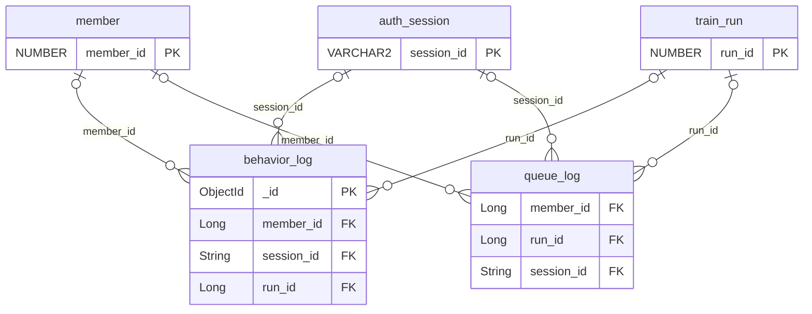

#### `behavior_log` 행동 로그

MongoDB · 🅱 빅데이터

요청 단위 행동 로그. Python 분석으로 위험 점수의 신호를 뽑는다.

| 컬럼 | 타입 | 키 | 출처 | 설명 | 이유 |
|---|---|---|---|---|---|
| `_id` | ObjectId | PK | 시스템 |  |  |
| `member_id` | Long | FK → member | 생성 |  |  |
| `ci_hash` | String |  | 생성 |  | 묶음 단위 집계 |
| `device_hash` | String |  | 생성 |  | 묶음 단위 집계 |
| `ip_hash` | String |  | 생성 |  | IP 집중도 |
| `session_id` | String | FK → auth_session | 생성 | = auth_session.session_id | 세션 단위 패턴, CCTV 녹화와 연결 |
| `event_type` | String |  | 생성 | VIEW_TRAIN / VIEW_SEAT / QUEUE_ENTER / SEAT_HOLD / PAY / CANCEL |  |
| `run_id` | Long | FK → train_run | 생성 | 대상 운행 | 인기 열차 쏠림 분석 |
| `ts` | Date |  | 생성 | 이벤트 시각 (ms) |  |
| `expire_at` | Date |  | 시스템 | 삭제 예정 시각 | TTL 기준. ts + behavior.retention_days로 기록 |
| `interval_ms` | Int |  | 생성 | 직전 요청과 간격 | 매크로 신호 (사람은 수백 ms~초, 봇은 균일·짧음) |
| `user_agent` | String |  | 생성 |  | 헤드리스 브라우저 탐지 |
| `channel` | String |  | 생성 | WEB / APP |  |
| `response_status` | Int |  | 시스템 | HTTP 상태 | 차단·에러 분석 |
| `meta` | Object |  | 시스템 | 이벤트별 추가 정보 | 스키마 변경 없이 필드 확장 |

> **제약·비고** 인덱스: { ci_hash: 1, ts: -1 }, { run_id: 1, ts: 1 } · TTL { expire_at: 1 }, expireAfterSeconds: 0 · 앱 → Kafka → insertMany 배치 (앱이 Mongo에 직접 쓰지 않음) · 샤드 키는 부하 테스트 후 판단 (후보: { ci_hash: "hashed" }) · 점선은 논리 참조 · 절차: concurrency.md §13

**관계** member_id → [`member`](#member) · session_id → [`auth_session`](#auth-session) · run_id → [`train_run`](#train-run)

#### `queue_log` 대기열 기록

MongoDB · 🅱 빅데이터

대기열 진입·조정·입장 기록. 순번 조정이 의도대로 됐는지 사후 검증.

| 컬럼 | 타입 | 키 | 출처 | 설명 | 이유 |
|---|---|---|---|---|---|
| `member_id` | Long | FK → member | 시스템 |  |  |
| `run_id` | Long | FK → train_run | 시스템 |  |  |
| `session_id` | String | FK → auth_session | 시스템 | 로그인 세션 | CCTV 재생과 연결 |
| `ticket_no` | Long |  | 시스템 | 발급 번호표 | 사용자에게 보인 번호와 대조 |
| `entered_at` | Date |  | 시스템 | 실제 진입 시각 |  |
| `expire_at` | Date |  | 시스템 | 삭제 예정 시각 | entered_at + queue_log.retention_days |
| `risk_score` | Double |  | 시스템 | 진입 시 점수 |  |
| `penalty_ms` | Long |  | 시스템 | 뒤로 밀린 양 |  |
| `initial_rank` | Long |  | 시스템 | 조정 전 순번 | 조정이 의도대로 됐는지 검증 |
| `adjusted_rank` | Long |  | 시스템 | 조정 후 순번 |  |
| `admitted_at` | Date |  | 시스템 | 입장 시각 | 실제 대기 시간 vs 예상 대기 시간 비교 |
| `left_reason` | String |  | 시스템 | ADMITTED / TIMEOUT / LEFT | 이탈률 |

> **제약·비고** TTL { expire_at: 1 }, expireAfterSeconds: 0 · 점선은 논리 참조 · 절차: concurrency.md §13

**관계** member_id → [`member`](#member) · run_id → [`train_run`](#train-run) · session_id → [`auth_session`](#auth-session)

### Redis

#### `redis_keys` Redis 키

Redis

대기열·좌석 선점·매수 제한·캐시용 키. 이름 칸이 키 패턴, 타입 칸이 Redis 자료형.

| 컬럼 | 타입 | 키 | 출처 | 설명 | 이유 |
|---|---|---|---|---|---|
| `idem:{memberId}:{key}` | STRING+TTL |  | 시스템 | 값: reservation_id (결제는 idem:pay:{reservationId}:{key}) | 같은 버튼 재시도에 같은 예약을 돌려줌 |
| `relay:shard:{n}` | STRING+TTL |  | 시스템 | 값: 릴레이 인스턴스 ID | 샤드 담당 리스. 갱신 실패 시 그 샤드 처리 즉시 중단 |
| `queue:{runId}` | ZSET |  | 시스템 | member=memberId, score=진입시각ms + penalty_ms | 위험 점수를 score에 더하면 별도 지연 없이 후순위 처리 |
| `queue:active:{runId}` | ZSET |  | 시스템 | 입장 허용된 사용자, score=만료시각 | 동시 입장 인원 제한 |
| `queue:throughput:{runId}` | STRING |  | 시스템 | 초당 입장 처리 수 | 예상 대기시간 = 내 순번 ÷ 처리량 |
| `queue:pass:{runId}:{memberId}` | STRING+TTL |  | 시스템 | 입장 토큰 (대기열 통과 증명) | 좌석 조회·선점 API가 토큰을 검사해야 대기열 우회 차단 |
| `seat:hold:{runId}:{seatId}:{segNo}` | STRING+TTL |  | 시스템 | 값: reservation_id (HOLD), SOLD:reservation_id (확정), REOFFER:reservation_id (대기자 제안 대기) | 만료 = pay_deadline_at, SOLD는 출발 시각, REOFFER는 waitlist.reoffer_hold_sec. 해제·연장은 값이 일치할 때만 (compare-and-delete) |
| `limit:{runId}:{ciHash}` | STRING |  | 시스템 | 구매 매수 | DB 조회 없이 1차 차단 |
| `limit:event:{saleEventId}:{ciHash}` | STRING |  | 시스템 | 명절 전체 구매 매수 | PER_HOLIDAY 제한의 빠른 체크 |
| `limit:dec:{reservationId}` | STRING+TTL |  | 시스템 | 값: 1 (이 예약의 한도 감소 완료 표시) | limit_decr.lua가 SET NX에 성공할 때만 감소 → 커밋 직후 앱과 outbox 소비자가 둘 다 실행해도 한 번만 감소 |
| `risk:{subjectType}:{hash}` | STRING |  | 시스템 | final_score 캐시 | 대기열 진입 시 DB 미조회 |
| `seatmap:{runId}` | HASH |  | 시스템 | seatId → 상태 | 조회 트래픽을 DB에서 분리 |
| `rate:login:{ipHash}` | STRING+TTL |  | 시스템 | 로그인 시도 카운터 | Argon2 연산 남용·크리덴셜 스터핑 차단 |
| `rate:api:{memberId}` | STRING+TTL |  | 시스템 | 초당 API 호출 수 | 매크로 요청 폭주 1차 차단 |
| `policy:cache` | HASH |  | 시스템 | app_policy 캐시 | 매 요청마다 DB 조회 방지 |

> **제약·비고** 단일 노드 전제, maxmemory-policy noeviction, AOF everysec (concurrency.md §14.5) · 키 이름의 중괄호는 자리표시자 (실제 키 예: seat:hold:1001:57:0) · Lua 스크립트 hold·release·extend·rehold·sold·reoffer·limit_incr·limit_decr, 커밋 후 보상의 outbox 보장 경로, 클러스터 전환 시 해시 태그는 concurrency.md §14

### 외부 빅데이터·분석

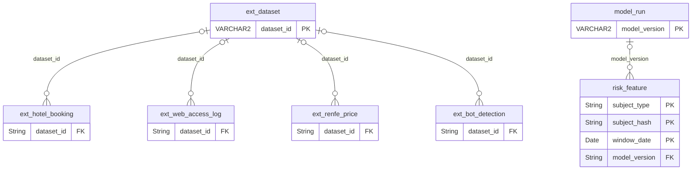

#### `risk_feature` 학습용 피처 스냅샷

MongoDB · 🅱 빅데이터

시점별 위험 신호 묶음. 모델 학습·평가 재현용.

| 컬럼 | 타입 | 키 | 출처 | 설명 | 이유 |
|---|---|---|---|---|---|
| `subject_type` | String | PK | 시스템 | 대상 유형 |  |
| `subject_hash` | String | PK | 시스템 | 대상 해시 |  |
| `window_date` | Date | PK | 시스템 | 집계 기준일 | 시점별 재현 |
| `features` | Object |  | 시스템 | risk_score 신호 + 마우스 직선도 등 replay 신호 | 신호 추가 시 스키마 변경 없음 |
| `label` | String |  | 생성 | synthetic_label 조인 값 | 학습·평가에만 사용 |
| `source` | String |  | 시스템 | SYNTHETIC / EXT_HOTEL / EXT_LOG | 어떤 데이터에서 나온 피처인지 |
| `model_version` | String | FK → model_run | 시스템 | 이 피처로 학습한 모델 |  |

**관계** model_version → [`model_run`](#model-run)

#### `ext_hotel_booking` Hotel Booking 원본

MongoDB · 🅱 빅데이터

Kaggle Hotel Booking Demand 원본 (약 12만 건, 32컬럼 전부 적재). 예약 시점·이력과 취소의 관계 → 반복 취소 위험 점수 근거.

| 컬럼 | 타입 | 키 | 출처 | 설명 | 이유 |
|---|---|---|---|---|---|
| `dataset_id` | String | FK → ext_dataset | 시스템 | 적재 배치 | 라이선스·버전 추적 |
| `hotel` | String |  | 외부 | City / Resort | 도메인 구분 |
| `is_canceled` | Int |  | 외부 | 취소 여부 0/1 | 취소 예측 라벨 |
| `lead_time` | Int |  | 외부 | 예약~도착 일수 | 예매~출발 간격과 취소율 관계 |
| `arrival_date_year` | Int |  | 외부 | 도착 연도 | 성수기 효과 비교 |
| `arrival_date_month` | String |  | 외부 | 도착 월 |  |
| `arrival_date_day_of_month` | Int |  | 외부 | 도착 일 |  |
| `adults` | Int |  | 외부 | 인원 | 매수와 취소율 관계 |
| `previous_cancellations` | Int |  | 외부 | 과거 취소 횟수 | 반복 취소 위험 점수 가중치 근거 |
| `previous_bookings_not_canceled` | Int |  | 외부 | 과거 정상 이용 횟수 | 신뢰 이력이 위험을 상쇄하는 정도 |
| `is_repeated_guest` | Int |  | 외부 | 재방문 여부 | 신규 계정 기본 신뢰도 근거 |
| `booking_changes` | Int |  | 외부 | 예약 변경 횟수 |  |
| `deposit_type` | String |  | 외부 | No Deposit / Non Refund / Refundable | 취소 수수료 정책이 취소율에 주는 영향 |
| `days_in_waiting_list` | Int |  | 외부 | 대기 일수 | 취소표 대기 설계 참고 |
| `market_segment` | String |  | 외부 | 판매 세그먼트 | 대리점 경로 = 대량 구매자 패턴 |
| `distribution_channel` | String |  | 외부 | 판매 채널 |  |
| `customer_type` | String |  | 외부 | Transient / Group 등 |  |
| `adr` | Double |  | 외부 | 1박 평균 요금 |  |
| `reservation_status` | String |  | 외부 | Check-Out / Canceled / No-Show | 노쇼 비율 |
| `reservation_status_date` | String |  | 외부 | 상태 변경일 | 취소 시점 분포 → minutes_before_departure 생성 |

> **제약·비고** 주요 컬럼만 표시. 포르투갈 호텔 데이터라 도메인 차이 감안

**관계** dataset_id → [`ext_dataset`](#ext-dataset)

#### `ext_web_access_log` Web Access Log 원본

MongoDB · 🅱 빅데이터

Kaggle Web Server Access Logs (Nginx combined 형식) 파싱 적재. 요청 간격·IP 집중도 → 봇 특징.

| 컬럼 | 타입 | 키 | 출처 | 설명 | 이유 |
|---|---|---|---|---|---|
| `dataset_id` | String | FK → ext_dataset | 시스템 | 적재 배치 | 라이선스·버전 추적 |
| `ip` | String |  | 외부 | 요청 IP (적재 시 해시) | IP 집중도 |
| `ts` | Date |  | 외부 | 요청 시각 | 요청 간격 분포 |
| `method` | String |  | 외부 | HTTP 메서드 |  |
| `url` | String |  | 외부 | 요청 경로 | 반복 조회 패턴 |
| `protocol` | String |  | 외부 |  |  |
| `status` | Int |  | 외부 | HTTP 상태 |  |
| `bytes` | Int |  | 외부 | 응답 크기 |  |
| `referrer` | String |  | 외부 |  | 봇은 referrer 없는 직접 접근 비율 높음 |
| `user_agent` | String |  | 외부 |  | 봇 UA 라벨링 |
| `session_key` | String |  | 시스템 | ip+UA 30분 윈도우 세션 | 세션 단위 피처 추출 |
| `interval_ms` | Int |  | 시스템 | 같은 세션 직전 요청과 간격 | 매크로 interval_ms 분포의 실데이터 근거 |

> **제약·비고** 봇 대부분이 검색엔진 크롤러라 예매 매크로와 다름 · 라이선스 확인 필요

**관계** dataset_id → [`ext_dataset`](#ext-dataset)

#### `ext_renfe_price` Renfe 가격 원본

MongoDB · 🅱 빅데이터

Kaggle 스페인 고속철 가격 관측 데이터. 출발일 대비 추이 → 가상 트래픽 분포.

| 컬럼 | 타입 | 키 | 출처 | 설명 | 이유 |
|---|---|---|---|---|---|
| `dataset_id` | String | FK → ext_dataset | 시스템 | 적재 배치 | 라이선스·버전 추적 |
| `insert_date` | Date |  | 외부 | 관측 시각 |  |
| `origin` | String |  | 외부 | 출발역 |  |
| `destination` | String |  | 외부 | 도착역 |  |
| `start_date` | Date |  | 외부 | 출발 시각 |  |
| `end_date` | Date |  | 외부 | 도착 시각 |  |
| `train_type` | String |  | 외부 | AVE 등 |  |
| `train_class` | String |  | 외부 | 등급 |  |
| `fare` | String |  | 외부 | 요금제 |  |
| `price` | Double |  | 외부 | 가격 |  |
| `days_before` | Int |  | 시스템 | start_date − insert_date | 출발일 대비 수요 곡선 → 가상 트래픽 분포 |

> **제약·비고** 개별 구매 기록이 아닌 반복 조회 기반 가격 관측 · 라이선스 Other

**관계** dataset_id → [`ext_dataset`](#ext-dataset)

#### `ext_bot_detection` Bot Detection 원본 (선택)

MongoDB · 🅱 빅데이터

본머스 대학 Web Bot Detection Dataset. 웹 로그 + 마우스 움직임으로 사람·봇 구분. 확보 후 필드 확정.

| 컬럼 | 타입 | 키 | 출처 | 설명 | 이유 |
|---|---|---|---|---|---|
| `dataset_id` | String | FK → ext_dataset | 시스템 | 적재 배치 | 라이선스·버전 추적 |
| `session_id` | String |  | 외부 | 세션 |  |
| `label` | String |  | 외부 | human / moderate bot / advanced bot | 마우스 궤적 판별 기준 검증 |
| `web_log` | Array |  | 외부 | 세션 요청 로그 |  |
| `mouse_movements` | Array |  | 외부 | 마우스 좌표 시퀀스 | replay_event.path 형태로 변환 |

> **제약·비고** 공개 페이지에 파일이 보이지 않아 확보 가능 여부 확인 필요

**관계** dataset_id → [`ext_dataset`](#ext-dataset)

#### `ext_dataset` 외부 데이터셋 카탈로그

Oracle

적재한 외부 데이터셋의 출처·라이선스·건수·해시. 기획서의 "사용 전 라이선스 확인" 원칙 기록.

| 컬럼 | 타입 | 키 | 출처 | 설명 | 이유 |
|---|---|---|---|---|---|
| `dataset_id` | VARCHAR2(40) | PK | 시스템 | 예: hotel_booking@v1 | 모든 ext_* 문서의 dataset_id가 참조 |
| `name` | VARCHAR2(100) | NN | 시스템 | 데이터셋 이름 |  |
| `source_url` | VARCHAR2(300) | NN | 시스템 | 원본 주소 | 발표 출처 |
| `license` | VARCHAR2(50) | NN | 시스템 | 확인한 라이선스 | 사용 전 라이선스 확인 기록 |
| `license_checked_at` | DATE |  | 시스템 | 확인일 |  |
| `row_count` | NUMBER |  | 시스템 | 적재 건수 | 빅데이터 규모 수치 |
| `checksum_sha256` | VARCHAR2(64) |  | 시스템 | 원본 파일 해시 | 같은 파일로 재현했는지 확인 |
| `ingested_at` | TIMESTAMP |  | 시스템 | 적재 시각 |  |
| `caveat` | VARCHAR2(300) |  | 시스템 | 도메인 차이 등 유의사항 | 호텔 데이터·검색 크롤러 봇 등 한계 명시 |

**관계** [`ext_hotel_booking`](#ext-hotel-booking).dataset_id → 이 테이블 · [`ext_web_access_log`](#ext-web-access-log).dataset_id → 이 테이블 · [`ext_renfe_price`](#ext-renfe-price).dataset_id → 이 테이블 · [`ext_bot_detection`](#ext-bot-detection).dataset_id → 이 테이블

### 가상 데이터 전용

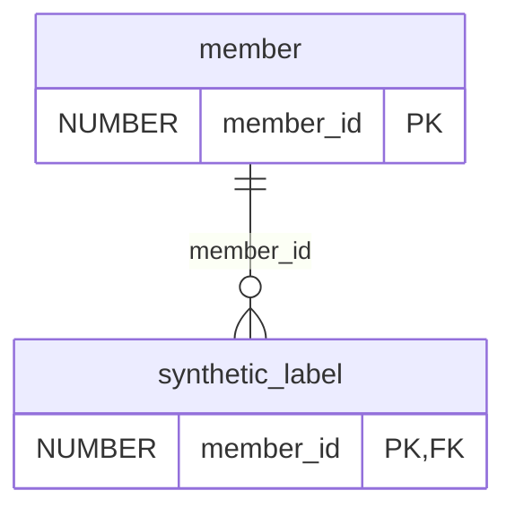

#### `synthetic_label` 정답 라벨

Oracle

가상 데이터의 정답. 위험 점수의 정밀도·재현율 측정용. 운영 로직에서 참조 금지.

| 컬럼 | 타입 | 키 | 출처 | 설명 | 이유 |
|---|---|---|---|---|---|
| `member_id` | NUMBER | PK, FK → member | 생성 | 회원 |  |
| `user_type` | VARCHAR2(20) | NN | 생성 | NORMAL / RESELLER / CANCEL_ABUSER / MACRO | 위험 점수의 정밀도·재현율 측정 |
| `group_id` | NUMBER |  | 생성 | 같은 어뷰저가 만든 다계정 묶음 | 묶음 탐지 성능 측정 |
| `generation_params` | CLOB |  | 생성 | 생성 시 사용한 분포 파라미터 (JSON) | 재현 가능성, 발표 시 근거 |

> **제약·비고** 운영 로직에서 참조 금지

**관계** member_id → [`member`](#member)

## 기능 추적표

| 기능 | 테이블·키 | 검증 |
|---|---|---|
| 회원가입·모의 본인인증 | member, member_credential, identity_verification | 같은 CI 다계정 생성 테스트 |
| 로그인 (Argon2id) | member_credential, auth_session, login_attempt, rate:login | verify_ms p95, 잠금 동작 |
| 열차 조회 | train, train_run, train_stop, fare, seatmap:{runId} | 캐시 적중률 |
| 대기열·번호표 | queue:{runId}, queue:active, queue:pass, queue_log | 입장 토큰 없이 좌석 API 호출 시 거부 |
| 좌석 예약·1인 매수 제한 | seat_inventory, reservation, reservation_seat, purchase_limit_policy, purchase_counter, sale_event, limit:* | 동시 선점 테스트 중복 0건, 같은 CI 동시 요청 한도 초과 0건 |
| 결제 (PG 테스트) | payment, payment_method | 예약당 APPROVED ≤ 1 |
| 예매 내역·취소 | reservation_seat.ticket_no, cancellation, cancel_fee_policy | 수수료 계산, 환불 상태 |
| 취소표 예약 대기 | waitlist, notification, seat:hold(REOFFER) | 대기 순서대로 배정, 취소 좌석은 대기자 먼저 |
| 관리자: 열차·노선·좌석 등록 | route, route_station, train, train_car, seat, train_run | 좌석 자동 생성 수 = car_type.seat_count 합 |
| 관리자: 실시간 현황 | Prometheus·Grafana + reservation 집계 | 대시보드 |
| 관리자: 위험 사용자 조치 | risk_score, admin_action, admin_user, member.status | 조치 후 대기열 반영 |
| CCTV 되돌아보기 | replay_session, replay_event, suspicious_case, case_session, case_marker, evidence_snapshot, replay_access_log | 증거 해시 재계산 일치 |
| 운영 설정 | app_policy, app_policy_history, policy:cache | 값 변경 후 version 증가·이력·캐시 갱신 |
| 빅데이터 분석 | ext_dataset, ext_hotel_booking, ext_web_access_log, ext_renfe_price, risk_feature, model_run | 정밀도·재현율·F1 |

## 실패 시나리오

| 시나리오 | 막는 장치 | 결과 |
|---|---|---|
| 같은 좌석 동시 클릭 | seat:hold SET NX → seat_inventory PK | 한 명만 성공 |
| 구간이 다른 같은 좌석 | segment_no가 달라 PK 다름 | 둘 다 성공 (구간 재판매) |
| 결제 버튼 연타 | UNIQUE(reservation_id, idempotency_key) | 첫 요청만 처리 |
| 키를 바꿔 결제 재시도 | 예약당 승인 1건 함수 기반 유니크 인덱스 | 두 번째 승인 저장 실패 → 환불 보상 |
| 결제 실패 | payment FAILED + 예약 EXPIRED, 같은 트랜잭션에서 좌석·카운터 반환 (§5.2) | 좌석 복구, 사용자는 다시 예매 |
| 결제 기한 초과 | seat:hold TTL + ix_resv_hold_due 부분 인덱스(HOLD의 pay_deadline_at) 스캐너 | Redis·DB 양쪽 반환 |
| Kafka 중복 전달 | processed_event | 두 번째 skip |
| DB 저장 후 발행 전 장애 | outbox_event | 재기동 후 발행 |
| 이벤트 순서 뒤섞임 | partition_key = reservation_id | 순서대로 소비 |
| 대기열 우회 | queue:pass 토큰 검사 | 거부 |
| 다계정 매수 우회 | limit:{runId}:{ciHash}, limit:event:{saleEventId}:{ciHash} | 합산 제한 |
| 다른 CI 계정 구매 | 기기·결제수단 묶음 → risk_score → suspicious_case | 후순위 + CCTV 확인 |
| 로그인 폭주 | 세마포어 + rate:login | 지연은 있어도 다운 없음 |
| 관리자 계정 무차별 대입 | login_attempt.actor_type=ADMIN + rate:login | 잠금 |
| 리프레시 토큰 탈취 | token_family_id | 계열 전체 폐기 |
| 녹화 이벤트 재전송 | replay_event {session_id, seq} 유니크 | 중복 없음 |
| 녹화 원본 TTL 삭제 | legal_hold + evidence_snapshot | 증거 보존 |
| 이유 없는 녹화 열람 | replay_access_log.purpose, SUPERVISOR 권한 | 감사 기록 |
| 운영 값 무단 변경 | app_policy.updated_by, app_policy_history | 변경자·이전 값 추적 |
| 앱 버그로 다른 열차 좌석 선점 | seat_inventory 복합 FK (train_id, seat_id)·(run_id, train_id) | INSERT 실패 |
| Redis TTL 만료 후 DB에 HOLD 행이 남은 채 재선점 | 이전 예약 HOLD→EXPIRED + 그 예약의 HOLD 행 전부 삭제 후 INSERT (concurrency.md §3) | 이어받음, 고아 행 없음 |
| 좌석을 뺏긴 이전 예약자의 늦은 결제 | 결제 확정 시 seat_inventory.reservation_id 확인 | 거부 후 환불 |
| 같은 CI로 동시에 예약 2건 | purchase_counter 조건부 UPDATE | 한도 안의 요청만 통과 |
| Redis 재시작으로 매수 카운터 유실 | purchase_counter에서 limit:* 복원 | 제한 유지 |
| 오픈 후 outbox 비대 | PENDING 부분 인덱스 + 정리 배치 | 릴레이 속도 유지 |
| 인스턴스 여러 대가 같은 대기자에게 제안 | FOR UPDATE SKIP LOCKED + WAITING→OFFERED 조건부 UPDATE | 한 번만 제안 |
| 설정 변경 후 서버마다 다른 값 | app_policy.version 비교 | 다시 로딩 |
| PG 승인 중에 HOLD 만료 | 결제 시작 시 마감을 GREATEST로 연장 + 결제 중 예약은 재선점 불가 + 스캐너는 PG 조회 후 처리 (§4, §6) | 좌석 유지, 승인된 결제를 만료시키지 않음 |
| 릴레이 두 대가 같은 예약 이벤트를 나눠 발행 | shard_no + Redis 리스로 샤드 담당 고정, FOR UPDATE WAIT (SKIP LOCKED 금지), seq 순 발행 (§11) | 순서 유지 |
| 취소와 만료가 동시에 도착 | 예약 상태 조건부 UPDATE 1행일 때만 카운터 감소 | 한 번만 감소 |
| 같은 CI 첫 예약 2건이 동시에 카운터 행 생성 | INSERT ORA-00001 → UPDATE부터 재시도 | 한도 유지 |
| Redis 경쟁에서 진 요청 | reservation_id만 발급하고 DB 쓰기 없음 | DB 부하 없음 |
| 케이스 연결된 녹화가 TTL로 삭제 | legal_hold 시 replay_event.expire_at 제거 | 증거 보존 |
| 네이티브 UPDATE 후 updated_at이 그대로 | 조건부 UPDATE마다 updated_at = SYSTIMESTAMP | 수정 시각 정확 |
| 선점 1분 뒤 결제 시작 | GREATEST로 연장 (§4) | 마감이 줄지 않음 |
| 2석 예약의 1석만 재선점 | 이전 예약의 HOLD 행 전부 삭제, 카운터 전체 감소 (§3) | 고아 HOLD 행 없음 |
| 재선점과 결제 확정이 같은 행에 동시 도착 | 확정은 구간 수만큼 HOLD→SOLD일 때만 성공 (§5) | 한쪽만 성공 |
| 같은 idempotency_key로 선점 재시도 | idem 키 조회 후 기존 예약 반환 (§1) | 중복 예약·자기 충돌 없음 |
| 같은 예약 이벤트 중 하나가 발행 실패 | FAILED도 부분 인덱스에 남기고 그 샤드 정지 (§11.4) | 뒤 이벤트가 앞지르지 않음 |
| DB가 한도 초과로 롤백 | release.lua·limit_decr.lua·idem 삭제 (§2.3, §14.3) | Redis hold가 TTL까지 남지 않음 |
| Redis 복원과 INCR가 동시에 | limit_incr.lua가 SET NX 후 INCRBY (§10.4) | 덮어쓰기 없음 |
| 네이티브 UPDATE 뒤 JPA로 같은 예약 수정 | version = version + 1 (§0.3) | 낙관적 락 충돌 감지 |
| PG 결과를 모르는 채 마감 경과 | PG 조회 먼저, 모르면 자동 만료 없이 알림 (§6) | 승인된 결제를 만료로 보상하지 않음 |
| 서로 다른 CI 재선점 2건이 교차 | 카운터 행을 (scope, scope_ref_id, ci_hash) 정렬 순서로 갱신 (§10.3) | 데드락 없음 |
| 확정 예약 취소 | CONFIRMED→CANCELED 1행일 때만 카운터·limit 감소 (§8) | 한도 반환 |
| 취소표 대기자가 한도 초과 | SKIPPED 후 다음 대기자 (§9) | 제안이 막히지 않음 |
| legal_hold 이후 도착한 녹화 이벤트 | 컨슈머가 legal_hold 확인 후 expire_at 없이 저장 (§13.2) | 삭제되지 않음 |
| 스캐너가 실패로 정리한 뒤 승인 도착 | payment FAILED 갈래: APPROVED 기록 + 전액 환불 (§5.1) | 돈만 빠지고 기록이 없는 일 없음 |
| 만료된 예약의 승인 콜백 재전송 | payment와 예약 상태를 함께 보고 응답 (§5.1) | 성공으로 잘못 응답하지 않음 |
| 발행 실패 뒤 같은 샤드의 다음 행 | 실패하면 그 샤드의 이번 회차 즉시 중단 (§11.3) | 뒤 이벤트가 앞지르지 않음 |
| 적체된 outbox 수만 행이 한꺼번에 잠김 | rowid 서브쿼리로 맨 앞 N개만 FOR UPDATE (§11.3) | 락 범위 제한 |
| 커밋 후 Redis 보상 유실 | outbox 소비자(seat-release)가 다시 실행, limit:dec 표시로 한 번만 감소 (§14.3) | 좌석·한도가 출발까지 막히지 않음 |
| Redis 한도가 DB보다 큼 | 거절할 때 purchase_counter와 대조해 자가 복구 (§10.7) | 정상 사용자가 막히지 않음 |
| PG 결과를 모르는 결제가 쌓임 | HOLD 만료와 결제 확인 쿼리 분리 + payment.next_check_at (§6) | HOLD 만료가 밀리지 않음 |
| 결과를 모르는 동안 Redis 키 만료 | rehold.lua로 좌석 키 다시 걸기 (§6.2) | 헛도는 재선점 경쟁 없음 |
| 취소 직후 일반 사용자가 그 좌석 선점 | seat:hold를 REOFFER로 잠시 막고 대기자에게 먼저 제안 (§9) | 대기 순서대로 배정 |
| legal_hold 직후 캐시 창 안에 도착한 이벤트 | 캐시 TTL 뒤 $unset 한 번 더 (§13.2) | 삭제되지 않음 |
| Oracle 컨테이너가 UTC | 시간대 고정 + 마감은 앱 시계 (§0.7) | 9시간 어긋남 없음 |
| partition_key를 숫자로 바인딩 | ORA_HASH(TO_CHAR(…)) (§11.1) | 같은 예약은 같은 샤드 |
| idem TTL이 지난 뒤 같은 키로 재요청 | ORA-00001이면 새 요청의 Redis 보상 후 기존 예약 반환 (§1) | 중복 예약·Redis 잔여 없음 |

## 가상 데이터 생성

실제 예매 행동 데이터는 개인정보라 공개되지 않으므로, 공개 데이터로 패턴을 검증한 뒤 그 패턴을 반영해 가상 데이터를 생성합니다.

| 유형 | 생성 규칙 | 근거 데이터 |
|---|---|---|
| NORMAL | 1~2매, 취소율 낮음, 요청 간격 불규칙, 마우스 곡선 | ext_hotel_booking 일반 예약 분포 |
| RESELLER | 상한 근처 매수, 다계정·같은 결제수단·같은 기기, 출발 직전 대량 취소 | ext_hotel_booking 취소 이력·리드타임 |
| CANCEL_ABUSER | 예약 후 단시간 반복 취소 | ext_hotel_booking previous_cancellations |
| MACRO | 오픈 직후 집중, interval_ms 짧고 균일, 마우스 직선·등속, 반복 조회 | ext_web_access_log, ext_bot_detection |
| 트래픽 분포 | 오픈 시각 스파이크 후 감쇠, 출발일 근접 시 재증가 | ext_renfe_price days_before |
| 정답 라벨 | 모든 가상 회원에 user_type, 다계정 묶음에 group_id | synthetic_label |

## 확장 계획

| 항목 | 지금 준비한 것 | 나중 작업 | 판단 시점 |
|---|---|---|---|
| 구간 재고 | segment_no, app_policy | segment_mode=ON | 2주차 말 |
| 승차권 양도 | ticket_no, ticket_transfer(확장) | 양도 기능·위험 신호 | 발표 후 |
| 관리자 2단계 인증 | admin_user.mfa_secret_enc | TOTP 검증 | 3주차 여유 시 |
| 교통약자 사전 예매 | sale_event.priority_open_at | 대상 인증 | 발표 후 |
| DOM 녹화 | replay_event.type 확장 | rrweb 이벤트 저장 | 발표 후 |
| 앱 푸시 | member_push_token(확장) | 푸시 발송 | 앱 배포 시 |
| 비밀번호 재설정 | password_reset_token(확장) | 메일·문자 발송 | 3주차 여유 시 |
| 코드표 | common_code(확장), CHECK 제약 | 관리자 코드 화면 | 필요 시 |
| 파티셔닝 | run_id·시각 컬럼 | reservation·payment 운행일 기준 분할 | 부하 테스트 후 |
| 해시 키 교체 | pepper_key_id, enc_key_id | *_hash 재계산 배치 | 운영 전환 시 |

## 변경 이력

| 버전 | 변경 |
|---|---|
| v1 | 기준·회원·예약·결제·이벤트·취소표·위험·MongoDB·Redis 33개 테이블 |
| v2 | Argon2id 보안 4개, CCTV 되돌아보기 7개, 빅데이터·분석 6개 추가 (49개). 비밀번호를 member_credential로 분리 |
| v3 | 점검: 대기열 입장 토큰, replay_event 일반 컬렉션화, 증거 조각 저장, 멱등 키 범위, partition_key, admin_user·sale_event·cancel_fee_policy·ext_dataset 추가 (53개) |
| v4 | 팀 결정 예시값(app_policy·예시 행), 관리자 로그인·세션 구분, 명절 매수 Redis 키, 확장 예정 테이블 4개, DDL 개선(CHECK·FK 인덱스·이름 축약·예시 INSERT) (58개) |
| v5 | 팀 검토 반영: seat_inventory 열차 일치 복합 FK·HOLD 만료 재선점, purchase_counter, outbox 부분 인덱스·정리, reservation·waitlist 인덱스, 수정 없는 테이블 updated_at 생략, 로그 Kafka 적재·녹화 상한, app_policy version·이력, ci_hash 불변, 위험 대상 코드 CHECK, model_run 예시 행 보정 (60개) |
| v6 | 팀 2차 검토 반영: 결제 시작 시 마감 연장, 마감 시각 원천 규칙, outbox shard_no·샤드별 릴레이, 예매 흐름 순서(ID 발급 → Redis 경쟁 → 한 트랜잭션 INSERT), 참조 전용 테이블 FK 인덱스 생략·ix_resv_ci_run 제거, purchase_counter 동시성 규칙·CHECK, Mongo expire_at TTL, processed_event 정리 인덱스, updated_at 규칙, Redis 클러스터 메모 |
| v7 | 팀 3차 검토 반영 + 동시성 절차를 docs/concurrency.md로 분리: 마감 연장 GREATEST·PG 180+60초, 재선점 시 이전 예약 HOLD 행 전부 삭제, 멱등 키 선조회, outbox seq·시퀀스·FAILED 샤드 정지·Redis 리스·FOR UPDATE WAIT, Redis 보상·limit 복원 SET NX, version 증가 규칙, PG 결과 미확인 만료 금지, 카운터 정렬 갱신, 취소·취소표 카운터, Mongo expire_at 확대·legal_hold 확인, Redis 클러스터 태그 {runId}, 비고 축약 |
| v8 | 동시성 4차 검토 반영: 결제 결과 갈래(늦은 승인 환불·실패 시 EXPIRED), 스캐너 분리(ix_resv_hold_due, payment.next_check_at·ix_pay_recheck), ix_seatinv_hold 제거, cancellation 유형 정리(EXPIRED 제거)·resold_yn 배치, saga 단계 정리, 취소표 대기자 우선(REOFFER)·제안 기한 연장·wl 멱등 키, 한도 값 규칙·자가 복구, Redis 보상 outbox 보장·limit:dec, ORA_HASH 문자열, inbox 8일, 행동 로그 180일 확정, 시간대·Redis 설정 결정 |

## 참고 자료

**공공데이터포털 (기준 데이터)**
- 한국철도공사_차세대예약발매_차량유형코드: https://www.data.go.kr/data/15137680/fileData.do
- 한국철도공사_철도운행거리_전체: https://www.data.go.kr/data/15137040/fileData.do
- 한국철도공사_KTX 노선별 역정보: https://www.data.go.kr/dcat/metadata/15127571
- 한국철도공사 역간 최단 운행거리: https://www.data.go.kr/dcat/metadata/15153835
- 한국철도공사 간선 철도역 위치정보: https://www.data.go.kr/dcat/metadata/15127532
- 한국철도공사_공통기준 역상세 정보: https://www.data.go.kr/data/15153852/fileData.do
- 한국철도공사 역별 키로정: https://www.data.go.kr/dcat/metadata/15153841
- 한국철도공사 세그먼트 구간 정보: https://www.data.go.kr/dcat/metadata/15153579
- 한국철도공사 역무열차종별 코드: https://www.data.go.kr/dcat/metadata/15154143

**외부 데이터셋 (빅데이터)**
- Kaggle, Hotel Booking Demand: https://www.kaggle.com/datasets/jessemostipak/hotel-booking-demand
- Kaggle, Web Server Access Logs 활용 예: https://github.com/zaki1003/bot-detection-prototype
- Iliou et al., Web Bot Detection Dataset, Bournemouth University (2020): https://bordar.bournemouth.ac.uk/272/
- Kaggle, Spanish High Speed Rail Tickets Pricing (Renfe): https://www.kaggle.com/thegurusteam/spanish-high-speed-rail-system-ticket-pricing

**보안**
- OWASP Password Storage Cheat Sheet: https://cheatsheetseries.owasp.org/cheatsheets/Password_Storage_Cheat_Sheet.html
- Argon2id 파라미터·PHC 형식: https://rubydoc.info/gems/argon2id/file/README.md
- Argon2 vs bcrypt: https://mojoauth.com/security-guides/bcrypt-vs-argon2
- Spring Security 비밀번호 저장: https://docs.spring.io/spring-security/reference/features/authentication/password-storage.html

**MongoDB·CCTV 되돌아보기**
- MongoDB Time Series Collections: https://www.mongodb.com/docs/current/core/timeseries-collections/
- MongoDB 시계열 metaField 카디널리티: https://oneuptime.com/blog/post/2026-03-31-mongodb-time-series-metafields/view
- MongoDB GridFS (문서 16MB 한도): https://www.mongodb.com/docs/upcoming/core/gridfs/
- rrweb (DOM 녹화, 확장 시 참고): https://github.com/rrweb-io/rrweb/blob/main/guide.md

**Oracle**
- Oracle SQL Reserved Words (19c): https://docs.oracle.com/en/database/oracle/oracle-database/19/sqlrf/Oracle-SQL-Reserved-Words.html

**기획 배경**
- 세계일보, 「추석 기차표, 언제 예매하지?」 (2026.08.29): https://www.segye.com/newsView/20260829505201
- 쿠키뉴스, 「설 승차권 암표 거래 절대 안 돼」 (2026.02.09): https://www.kukinews.com/article/view/kuk202602090043
- 헤럴드경제, 「작년 명절 노쇼 기차표 5년 새 5.3배 급증」 (2026.02.11): https://www.heraldk.com/article/2026021119093519927
