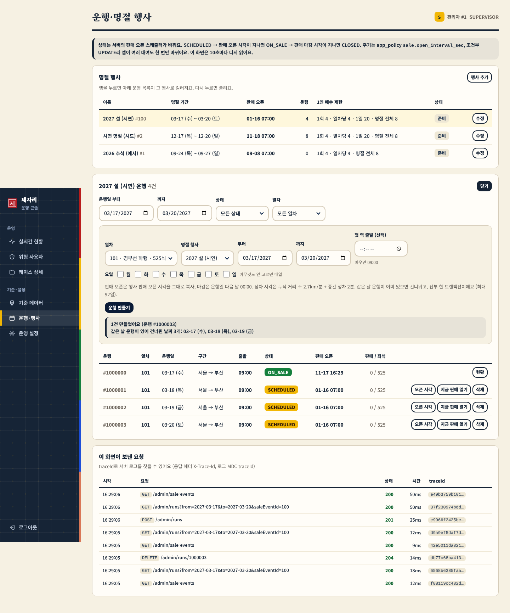

# 관리자 기준 데이터·운행 관리 (ADM-01·02)

> 담당: 강동균 · 화면: A-02, A-03 · 코드: `src/main/java/com/jejari/train/admin/`
> 테스트: `TrainAdminInfraTest` (실제 Oracle, 11개)

## 한 줄 요약

관리자가 **역·노선·차량 유형·열차**를 등록하고(열차를 만들면 좌석이 자동으로 생김),
**명절 행사**를 만들고, 기간·요일로 **운행을 한꺼번에** 만들고, 필요하면 **판매를 바로 연다**.

## API

보기는 VIEWER 이상, 저장은 SUPERVISOR만 (기능설계서 7장).

| 메서드 | 경로 | 하는 일 |
|---|---|---|
| GET·POST·PUT | `/api/v1/admin/stations` | 역 (`?q=`로 이름·코드 검색) |
| GET·POST·PUT | `/api/v1/admin/routes` | 노선 + 역 순서·누적 거리 |
| GET·POST·PUT | `/api/v1/admin/car-types` | 차량 유형 (좌석 수·등급·열 배치 `ABCD`) |
| GET·POST·PUT | `/api/v1/admin/trains` | 열차 + 호차 구성 → 좌석 자동 생성 |
| GET·POST·PUT | `/api/v1/admin/sale-events` | 명절 행사 + 전용 매수 제한 |
| GET·POST·PUT·DELETE | `/api/v1/admin/runs` | 운행 목록 · 일괄 생성 · 시각 수정 · 삭제 |
| POST | `/api/v1/admin/runs/{runId}/open` | 지금 판매 열기 |

삭제는 운행에만 있습니다. 역·노선·차량 유형은 지우지 않는 참조 데이터(ERD `refOnly`)라서요.

## 핵심 원리 3개

### 1. 쓰이는 동안 구조는 못 바꾼다

이미 판 좌석·운임·정차 시각과 어긋나면 안 되니까:

| 대상 | 언제든 | 쓰이면 못 바꿈 (`409 IN_USE`) |
|---|---|---|
| 노선 | 이름 | 역 구성 (열차가 붙으면) |
| 차량 유형 | 이름 | 좌석 수·등급·열 (열차가 쓰면) |
| 열차 | 번호·종류 | 노선·방향·편성 (운행이 붙으면) |
| 운행 | — | 판매가 시작되면 시각 수정·삭제 불가 (`409 RUN_NOT_SCHEDULED`) |

운행의 "판매 전인지" 확인은 `WHERE status = 'SCHEDULED'`를 넣은 **조건부 UPDATE**입니다.
판매 오픈 스케줄러가 같은 순간 ON_SALE로 바꾸면 0행이 되어 거절됩니다 (concurrency.md §0.3).

### 2. 시드와 같은 규칙으로 만든다

화면으로 만든 데이터와 시드 데이터가 다르게 생기면 안 되니까, 시드 SQL의 계산을 그대로 옮겼습니다.

- 좌석 ID: `train_id × 100000 + car_no × 1000 + 순번`, 좌석 번호 = 행 + 열(`1A`), 양 끝 열이 창가 (시드 02)
- 판매 오픈: 명절 행사면 행사 오픈 시각, 아니면 **출발 2개월 전 07:00** (시드 04). 말일 규칙이 Java와 달라 Oracle `ADD_MONTHS`로 계산
- 판매 마감: 운행일 다음 날 00:00
- 정차 시각: 누적 거리 ÷ 2.7km/분 + 중간 정차 2분, 상행은 순서·거리를 뒤집음. 기본 출발 하행 09:00 · 상행 15:00 (시드 05)

예) 0km·27km·54km 노선, 하행 09:00 출발 → 2번역 09:12 도착·09:14 출발 → 3번역 09:24 도착

### 3. 명절 행사를 만들면 매수 제한도 같이 만든다

동시성 §10.6은 "그 행사 전용 정책이 없으면 상시 정책"입니다. 행사만 만들고 정책을 안 만들면
**명절 전체 8매 제한이 아예 안 걸립니다.** 그래서 행사 등록 때 전용 정책 4개(1회 4 · 열차당 4 · 1일 20 · 명절 8)를
같은 트랜잭션에 넣습니다. 값은 요청의 `limits`로 바꿀 수 있습니다.

행사 오픈 시각을 고치면 그 행사의 **판매 전 운행**도 같이 바뀝니다 (일괄 오픈이 깨지지 않게).

## ID는 어떻게 매기나

이 표들에는 시퀀스가 없고, 시드가 작은 번호를 직접 씁니다. 그래서 화면에서 만든 행은 대역을 따로 둡니다.

| 표 | 시드·테스트 | 화면 |
|---|---|---|
| route | 1~ | 100~ |
| train | 1~ | 1000~ (좌석 ID 계산식 때문에 99999까지) |
| sale_event · purchase_limit_policy | 1~10 | 100~ |
| train_run | 1001~2004 · 9001~9003 · 테스트 9101~ | 1000000~ |

`MAX + 1`로 매기고, 두 명이 동시에 저장해 PK가 겹치면 한 번 더 시도합니다 (관리자 화면이라 경합이 드묾).

## 요청 예

```http
POST /api/v1/admin/trains
{"trainNo":"201","trainKind":"KTX","routeId":1,"direction":"DOWN","cars":["60303101","60313101","60313101"]}

POST /api/v1/admin/runs
{"trainId":1000,"from":"2027-03-01","to":"2027-03-31","weekdays":[5,6,7],"departTime":"08:30"}
→ {"created":[1000000,1000001,…],"skipped":["2027-03-07"]}   // 같은 날 운행이 이미 있던 날짜
```

## 화면 (A-03, 2026-11-17)

`frontend/src/admin/Runs.jsx` · 주소 `/admin/runs`



- 명절 행사 표: 행을 누르면 운행 목록이 그 행사로 걸러지고, "행사 추가"·"수정"으로 등록·수정 (추가할 때 매수 제한 4개도 같이)
- 운행 표: 기간·상태·열차로 거르고 10초마다 다시 읽음. 구간(첫·마지막 정차역), 판매 / 좌석(`seat_inventory` SOLD 좌석 수) 표시
- 판매 전 운행: "오픈 시각" 고치기, "지금 판매 열기", "삭제" (열기·삭제는 두 번 눌러야 실행)
- 판매 중 운행: "현황" → A-04 실시간 현황으로
- 일괄 생성: 열차·행사·기간·요일·출발 시각 → 서버 응답 그대로 "N건 만들었어요 (#a ~ #b), 건너뛴 날짜"
- 백엔드가 보이게: 화면 위에 상태를 바꾸는 주체(판매 오픈 스케줄러, 조건부 UPDATE)를 적고, 실패는 오류 코드·traceId까지,
  아래에 이 화면이 보낸 요청 기록

주의: 명절 운행에 "지금 판매 열기"를 누르면 그 운행만 오픈 시각이 지금으로 당겨져 행사 일괄 오픈과 달라진다 (시연·점검용).

## 남은 것

`docs/강동균/보완할-일.md`의 "ADM-01·02 관리자 API 뒤에 남은 것" (새 노선 운임, 행사 매수 제한 수정, 화면 연결 등).
