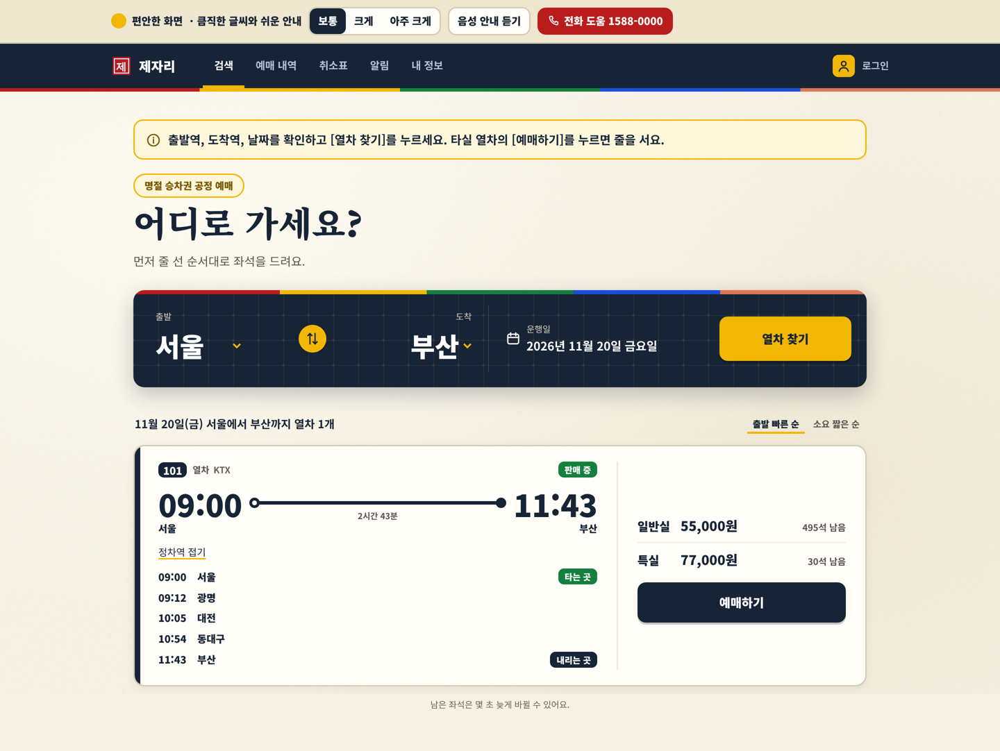
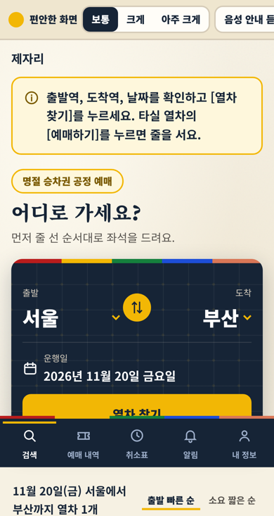

# 메인·운행 검색 화면 (U-03)

> 담당: 강동균 · 코드: `frontend/src/user/Search.jsx`, `UserLayout.jsx`, `styles/user.css`
> 관련: TRN-01~03, 화면 U-03 · 주소 `/` (`/?from=3900023&to=3900114&date=2026-11-20`)

## 한 줄 요약

출발역·도착역·날짜로 운행을 찾고, 열차마다 등급별 운임·남은 좌석·판매 상태를 보여 준다. 로그인 없이 누구나 볼 수 있다.

## 화면

- **편안한 화면 도우미 줄** (모든 사용자 화면 공통): 글자 크기 보통·크게·아주 크게, 음성 안내(켜면 화면마다 안내 한 줄을 읽음), 전화 도움.
  고른 값은 다른 화면으로 가도 유지 (지금은 이 브라우저에만 저장)
- **검색판**: 출발·도착 역(바꾸기 버튼), 운행일(누르면 달력). 조건은 주소에 남아 새로고침·뒤로 가기·링크 공유에도 같은 결과
- **운행 카드**: 열차 번호, 출발→도착 시각, 소요 시간, 등급별 운임·남은 좌석, "정차역 보기"(타는 곳·내리는 곳 표시)
- **판매 상태별 버튼**

| 상태 | 배지 | 버튼 |
|---|---|---|
| 판매 중 (`bookable`) | 판매 중 | 예매하기 → `/queue/{runId}` (U-04, 아직 자리만) |
| 판매 중인데 모든 등급 0석 | 매진 | 취소표 대기 신청 → `/waitlist` (U-10, 아직 자리만) |
| SCHEDULED | 오픈 전 | "11월 18일 오전 7시 오픈" (누를 수 없음) |
| 그 밖 (CLOSED 등) | 마감 | "예매가 끝났어요" |

## 핵심 원리

1. **사용자 화면은 시안 CSS를 그대로 쓴다.** `docs/ui/U-03.html`의 `<style>` 두 블록에서 토큰을 뺀 나머지 셀렉터 앞에 `.user`를 붙여
   `styles/user.css`로 만들었다. 관리자 화면(`.admin`)과 섞이지 않고, 시안을 다시 그릴 필요가 없다.
   다른 U 화면을 옮길 때 그 시안에만 있는 `<style>`을 같은 방식으로 덧붙인다.
2. **남은 좌석은 서버 캐시 값이다.** `seatmap:{runId}`(Redis, 1초)라 몇 초 늦을 수 있어 카드 아래에 적었다. 최종 판정은 좌석을 잡을 때 한다.
3. **실패는 쉬운 말로.** 관리자 화면과 달리 오류 코드는 보이지 않고, 계속 안 되면 전화 도움에 알려 줄 번호(traceId 앞부분)만 작게 보여 준다.
4. **새로 생긴 화면 경로**(`/queue/**`, `/reservations`, `/waitlist`, `/notifications`, `/me`, `/login`, `/signup`)는
   `SpaForwardController`·`SecurityConfig.SPA_PAGES`에도 넣었다. 새로고침해도 화면이 열린다.

## 확인한 것 (Playwright, 실제 앱)

- 서울→부산, 3일 뒤: 101 열차 판매 중, 일반실 55,000원 495석·특실 77,000원 30석, 정차역 5곳
- 명절 기간(12-17): 오픈 전, "11월 18일 오전 7시 오픈"
- 예매하기 → `/queue/9001`, 글자 크기 "아주 크게"가 다음 화면에도 유지
- 폭 390px(iPhone 13)에서 가로 스크롤 없음
