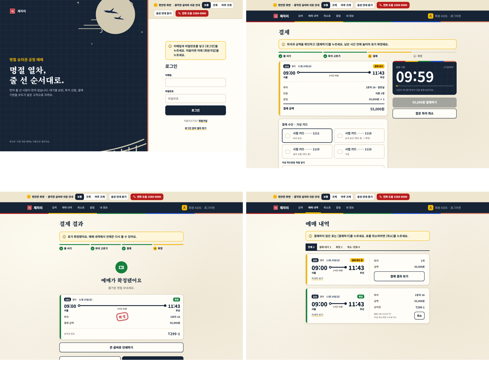
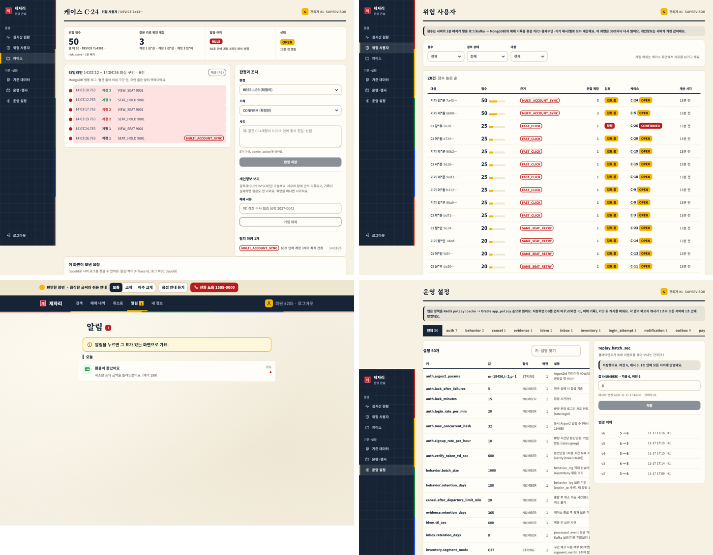
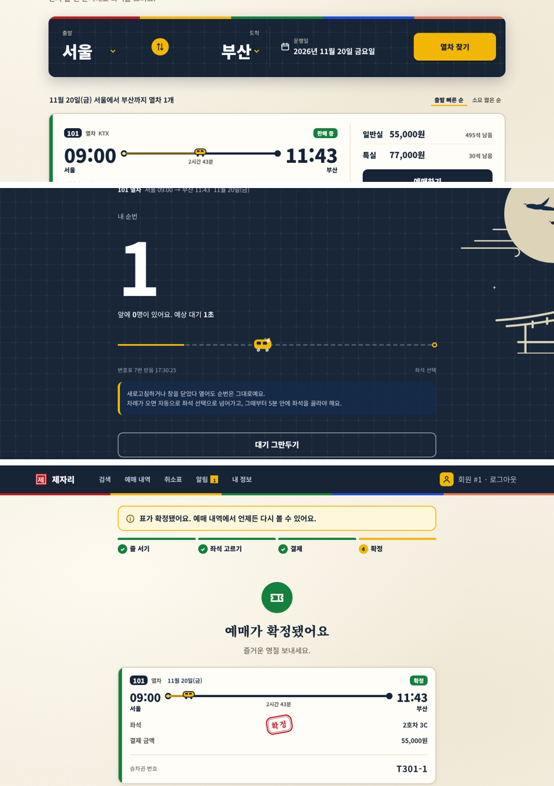

# 전체 화면 (React 프론트엔드)

> 작성: 강동균 · 2026-11-17 · 코드: `frontend/` · 실행법: `frontend/README.md`
> **다른 팀원 담당 화면도 대신 만들었습니다.** 표의 "담당"이 확인·다듬어 주세요. 서버 코드는 거의 그대로 쓰고, 운영 설정 API만 새로 만들었습니다.

## 방향

- **사용자 화면**: 시안(`docs/ui/U-*.html`) 디자인 그대로. 시안 CSS를 `.user` 아래로 묶어 그대로 씀 (`styles/user.css`)
- **관리자 화면**: 백엔드가 하는 일이 보이게. 숫자의 출처(Redis·Oracle·MongoDB), 서버 규칙, 오류 코드, traceId, 요청 기록

## 화면 목록

| 화면 | 주소 | 코드 | 담당 | 쓰는 API |
|---|---|---|---|---|
| U-01 로그인 | `/login` | `user/Login.jsx` | 강다인·조영준 | POST /auth/login |
| U-02 회원가입 | `/signup` | `user/Signup.jsx` | 강다인 | POST /auth/verify, /auth/signup |
| U-03 운행 검색 | `/` | `user/Search.jsx` | 강동균 | GET /stations, /runs |
| U-04 줄 서기 | `/queue/{runId}` | `user/Queue.jsx` | 김성원 | POST·GET·DELETE /runs/{id}/queue |
| U-05 좌석 선택 | `/runs/{runId}/seats` | `user/Seats.jsx` | 강동균 | GET /runs/{id}/seats, POST /reservations |
| U-06 결제 | `/pay/{id}` | `user/Pay.jsx` | 길동현·강동균 | GET /reservations/{id}, POST …/payments, …/cancel |
| U-07 결제 결과 | `/pay/{id}/result` | `user/PayResult.jsx` | 길동현 | GET /reservations/{id} (확인 중이면 3초마다) |
| U-08 예매 내역·취소 | `/reservations` | `user/Reservations.jsx` | 강다인 | GET /reservations, …/cancel-quote, POST …/cancel |
| U-09 내 정보 | `/me` | `user/Me.jsx` | 강다인·길동현 | GET·DELETE /me |
| U-10 취소표 | `/waitlist` | `user/Waitlist.jsx` | 강다인 | POST·GET·DELETE /waitlists |
| U-11 알림 | `/notifications` | `user/Notifications.jsx` | 길동현 | GET /notifications, PATCH …/read |
| A-01 관리자 로그인 | `/admin/login` | `admin/AdminLogin.jsx` | 조영준 | POST /admin/auth/login |
| A-02 기준 데이터 | `/admin/master` | `admin/Master.jsx` | 강동균 | /admin/stations·routes·car-types·trains |
| A-03 운행·행사 | `/admin/runs` | `admin/Runs.jsx` | 강동균 | /admin/sale-events·runs |
| A-04 실시간 현황 | `/admin/dashboard` | `admin/Dashboard.jsx` | 강동균·강다인·길동현 | GET /admin/dashboard/runs/{id} |
| A-05 위험 사용자 | `/admin/risk` | `admin/Risk.jsx` | 강다인 | GET /admin/risks |
| A-06 케이스 | `/admin/cases`, `/admin/cases/{id}` | `admin/Cases.jsx` | 강다인 | GET /admin/cases…, POST …/actions·unmask |
| A-07 운영 설정 | `/admin/settings` | `admin/Settings.jsx` | 조영준 | **새로 만듦** GET·PUT /admin/policies |

## 화면마다 핵심 원리 (짧게)

- **U-01·U-02**: 로그인 실패 문구는 어느 쪽이 틀렸는지 말하지 않는다. 가입은 모의 본인인증 → 1회용 토큰 → 가입 2단계. 비밀번호 규칙은 서버(PasswordPolicy)와 같은 것을 입력 중에 보여 준다
- **U-04**: 폴링 간격은 서버가 정한다(`pollIntervalSec`). RATE_LIMITED면 간격을 늘려 계속. 입장하면 토큰을 sessionStorage에 두고 좌석으로
- **U-06**: 결제 기한은 서버 값 기준 카운트다운. 멱등 키는 결제 한 번에 하나. 결제 수단 API가 없어 가상 카드번호를 받고, Mock PG가 끝자리로 결과를 정한다(0 거절 · 9 결과 모름 · 8 늦은 승인)
- **U-07**: PAYMENT_PENDING이면 3초마다 다시 읽고, 1분이 넘으면 "늦어지고 있어요"로 바꿔 계속 기다린다 (서버 확인 스캐너가 정리)
- **U-08**: 수수료는 화면이 계산하지 않는다. `cancel-quote`가 준 값만 보여 주고 두 번 눌러 확정
- **U-11**: 알림 행에는 종류와 대상만 있다. 문구는 화면이 종류별로 만들고, 누르면 읽음 표시 후 관련 화면으로
- **A-06**: 서버는 타임라인을 24시간까지만 준다. 의심 구간이 더 길면 마지막 24시간으로 잘라 묻고 그렇게 적는다. 가림 해제는 기록이 먼저(서버)
- **A-07**: `version`으로 낙관적 잠금(남이 먼저 바꿨으면 409), 이력 INSERT, 커밋 뒤 Redis `policy:cache` 갱신 → 모든 서버에 1초 안에 반영. Redis 캐시 값이 DB와 다르면 표에 표시

## 운영 설정 API (서버, 새로 만듦)

`src/main/java/com/jejari/admin/policy/` · 테스트 `PolicyAdminInfraTest` 3개 (실제 Oracle·Redis)

| 메서드 | 경로 | 권한 |
|---|---|---|
| GET | `/api/v1/admin/policies` | VIEWER |
| GET | `/api/v1/admin/policies/{key}`, `/{key}/history` | VIEWER |
| PUT | `/api/v1/admin/policies/{key}` `{value, version}` | SUPERVISOR |

## 확인한 것 (Playwright, 실제 앱 + 가상 데이터 DATA-02 200명)

| 단계 | 결과 |
|---|---|
| U-02 가입 → U-01 로그인 실패 → 성공 | "이메일 또는 비밀번호가 맞지 않아요", 로그인 뒤 원래 가려던 곳으로 |
| U-03 → U-04 → U-05 → U-06 → U-07 (카드 …1111) | 예매 확정, 승차권 번호 발급 |
| 같은 흐름 (카드 …1119) | "결제 결과를 확인하고 있어요" |
| U-08 확정 취소 | 출발 2일 15시간 전 → 수수료 5% 2,750원, 52,250원 환불 (DONE) |
| U-10 남은 좌석이 있는 운행에 대기 신청 | "아직 남은 좌석이 있어요" + 예매하기 |
| U-11 | 환불 알림 1건 (Outbox → Kafka → 알림 소비자) |
| U-09 | 이름·휴대폰 마스킹 |
| 가입 시도 반복 | 서버 `rate:signup`이 막음 → 화면에 "요청이 너무 많습니다" |
| A-05 | 위험 대상 22건, 규칙 마커 |
| A-06 | 타임라인 6건(의심 구간), 판정 CONFIRM 저장, 가림 해제 1건 |
| A-07 | 값 변경 → 버전 +1, 이력, 캐시 반영 |
| 모바일 390px | /login, /signup, / 가로 스크롤 없음 |

## 아직 없는 것

`docs/강동균/보완할-일.md`의 "전체 화면 (2026-11-17) 뒤에 남은 것"

## 움직임 (2026-11-17 추가)

`frontend/src/styles/motion.css` · `lib/ripple.js`. 움직임은 **무슨 일이 일어났는지 알려 줄 때만** 쓴다. 화면을 덮는 팝업은 쓰지 않는다.

| 어디 | 움직임 | 알려 주는 것 |
|---|---|---|
| 모든 화면 | 화면이 바뀌면 살짝 올라오며 나타남, 버튼을 누른 자리에서 물결 | 화면이 바뀌었다, 눌렸다 |
| U-03 검색 | 카드가 차례로 올라오고 노선 선 위를 작은 기차가 출발역 → 도착역으로 달림 (판매 중 카드는 마우스를 올리면 다시), 바꾸기 버튼 반 바퀴 | 이 열차가 어디서 어디로 가는지 |
| U-04 줄 서기 | 바퀴가 돌고 연기, 레일이 뒤로 흐름. 앞사람이 줄면 기차가 앞으로 가고 숫자가 톡. 입장하면 기차가 끝까지 달려 나간 뒤 좌석 화면으로 | 줄이 줄고 있다, 차례가 왔다 |
| U-05 좌석 | 고른 좌석이 톡 튐, 남이 먼저 잡은 좌석은 흔들리며 빨갛게, 남은 시간 1분 아래면 숨쉬듯 | 골랐다 / 뺏겼다 / 시간이 없다 |
| U-06 결제 | 기한 2분 아래면 시계가 뛰고, 결제 중 버튼에 도는 표시 | 서두르라, 처리 중 |
| U-07 결과 | 표시가 톡, "확정" 도장이 쾅, 실패면 흔들림 | 확정됐다 / 실패했다 |
| U-08 취소 시트 | 바탕이 흐려지며 아래에서 올라옴, 두 번 눌러야 하는 버튼은 흔들림 | 한 번 더 눌러야 한다 |
| A-04 현황 | 값이 바뀐 카드가 노랗게 깜빡이고 숫자가 올라옴, "실시간" 표시가 퍼짐, 막대가 자라남 | 방금 서버 값이 바뀌었다 |
| A-03 운행 | 10초 새로고침 사이 상태가 바뀐 줄이 깜빡임 | 스케줄러가 상태를 바꿨다 |
| A-06 타임라인 | 이벤트가 시간 순서대로 차례로 나타남 | 일이 일어난 순서 |

- **"움직임 줄이기"** (OS 설정 `prefers-reduced-motion`)를 켠 사람에게는 모든 애니메이션·전환이 꺼진다 (`tokens.css`). 줄 서기 입장도 기다리지 않고 바로 넘어간다
- 실제 앱에서 확인: 검색 1.1초 시점 기차가 노선 중간, 줄 서기 바퀴 회전, 좌석 톡, "움직임 줄이기"에서 애니메이션 `none`
