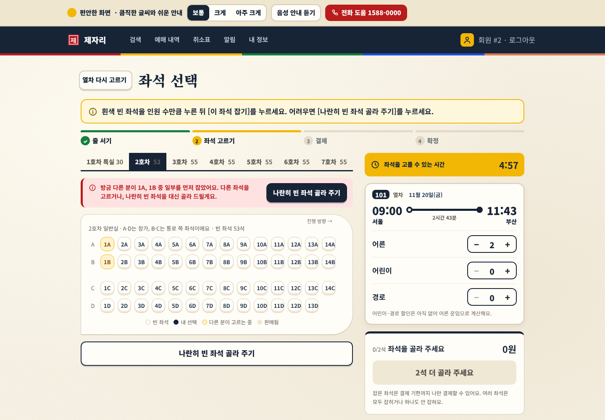
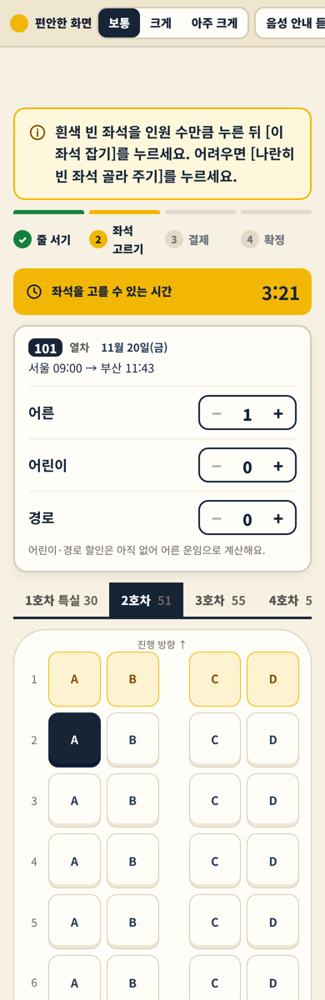

# 좌석 선택 화면 (U-05)

> 담당: 강동균 · 코드: `frontend/src/user/Seats.jsx` · 주소 `/runs/{runId}/seats?from=&to=`
> 관련: RSV-01, RSV-02, 화면 U-05. 함께 만든 최소판: U-01 로그인(`Login.jsx`), U-04 줄 서기(`Queue.jsx`)

## 한 줄 요약

대기열을 통과한 회원이 호차·좌석을 고르고 "이 좌석 잡기"로 선점한다. 여러 좌석은 모두 잡히거나 하나도 안 잡힌다.





## 예매 흐름 (지금 화면으로 끝까지 이어짐)

```
U-03 검색 → [예매하기] → (로그인 안 했으면 /login → 돌아옴)
→ /queue/{runId}   번호표 받고 서버가 알려 준 간격으로 순서 확인
→ 입장(ADMITTED)하면 입장 토큰을 sessionStorage에 두고
→ /runs/{runId}/seats   배치도(X-Queue-Token) → 선점(X-Queue-Token + Idempotency-Key)
→ /pay/{reservationId}  예약 번호·좌석·결제 기한·금액 (결제 화면 U-06은 아직)
```

## 화면

- 남은 시간(입장 토큰 만료까지), 열차·구간, 인원(어른·어린이·경로)
- 호차 탭(빈 좌석 수), 배치도: PC는 가로(시안 `.hcar`), 모바일은 세로(`.car`). 빈 좌석 / 내 선택 / 다른 분이 고르는 중 / 판매됨
- "나란히 빈 좌석 골라 주기": 같은 행에서 통로를 건너지 않는 연속 빈 좌석 → 없으면 같은 행 → 없으면 호차 안 아무 자리
- 아래 고정: 고른 좌석, 금액 합계, "이 좌석 잡기"

## 핵심 원리

1. **멱등 키는 "이 좌석 잡기" 한 번에 하나.** 응답을 못 받아 다시 보낼 때는 같은 키, 고른 좌석이나 인원이 바뀌면 새 키.
   그래서 버튼을 두 번 눌러도, 네트워크가 끊겨 다시 보내도 예약은 하나다. 서버가 202 `REQUEST_IN_PROGRESS`(같은 키 처리 중)를
   주면 1초 뒤 같은 키로 다시 묻는다.
2. **판정은 서버가 한다.** 배치도는 1초 캐시라 늦을 수 있다. 실제로 잡히는지는 선점 때 Redis Lua 한 번으로 정해지고
   (여러 좌석 전부 아니면 전무), 화면은 결과만 받는다. 매수 한도(1회·열차당·1일·명절)도 서버 정책이 `LIMIT_*`로 알려 준다.
3. **먼저 잡혔으면 다시 읽고 대안을 준다.** `SEAT_ALREADY_TAKEN`이면 고른 좌석을 비우고 배치도를 다시 읽어
   (방금 잡힌 좌석이 "고르는 중"으로 바뀜) "나란히 빈 좌석 골라 주기"를 바로 보여 준다.
4. **입장 토큰이 끝나면 다시 줄 서기.** 남은 시간이 0이 되거나 서버가 `QUEUE_TOKEN_INVALID`면 토큰을 지우고 "다시 줄 서기"로.
   좌석을 잡으면 토큰은 다 쓴 것으로 보고 지운다.

## 확인한 것 (Playwright, 실제 앱 · 회원 2명)

| 단계 | 결과 |
|---|---|
| 회원 1: 검색 → 예매하기 → 로그인 → 줄 서기 → 입장 → 좌석 | 남은 시간 4:22, 2명 · 나란히 → 2호차 1A·1B, 110,000원 |
| 회원 2: 같은 좌석을 먼저 골라 둠 | 2호차 1A·1B |
| 회원 1이 먼저 잡기 | 예약 109, 결제 기한 표시 |
| 회원 2가 늦게 잡기 | "방금 다른 분이 1A, 1B 중 일부를 먼저 잡았어요", 두 좌석이 "고르는 중"으로 바뀜 |
| 회원 2가 "나란히 빈 좌석 골라 주기" → 잡기 | 예약 111 |
| 폭 390px | 가로 스크롤 없음, 시안 순서(남은 시간 → 인원 → 호차 → 배치도) |
