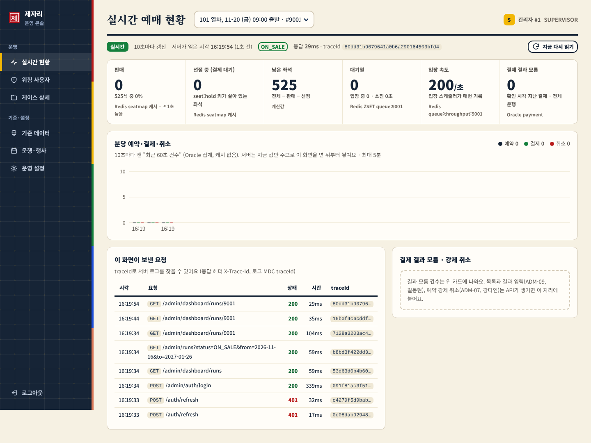

# 프론트엔드 틀 + 실시간 예매 현황 화면 (A-04)

> 담당: 강동균 · 코드: `frontend/` (React + Vite), `SpaForwardController`, `SecurityConfig.SPA_PAGES`
> 관련: ADM-03, 화면 A-01·A-04

## 한 줄 요약

React + Vite 프론트엔드를 `frontend/`에 만들고, 빌드 결과를 Spring Boot jar에 넣어 **앱과 같은 주소**로 내보낸다.
첫 화면은 관리자 **실시간 예매 현황**(A-04)이다.

## 방향: 사용자 화면은 예쁘게, 관리자 화면은 백엔드가 보이게

| | 사용자 화면 (U-*) | 관리자 화면 (A-*) |
|---|---|---|
| 목표 | 시안 디자인 그대로, 누구나 쉽게 | 서버가 지금 무엇을 하는지 보이게 |
| 보여 주는 것 | 열차·좌석·결제 | 숫자 + **출처**(Redis 캐시 / Oracle 집계) + 지연, 응답 시간, `X-Trace-Id`, 요청 기록 |

## A-04에서 보이는 것

- **지표 카드 6개**: 판매·선점·남은 좌석(Redis `seatmap` 캐시, 최대 1초 늦음), 대기열·입장 속도(Redis 대기열 키),
  결제 결과 모름(Oracle). 카드마다 아래에 출처를 적었다
- **상태줄**: 서버가 값을 읽은 시각(`asOf`)과 몇 초 전인지, 운행 상태, 마지막 응답 시간, traceId
- **분당 그래프**: 서버는 "지금 기준 최근 60초 건수"만 준다. 10초마다 받은 값을 화면에서 쌓아 그린다 (최대 5분)
- **이 화면이 보낸 요청**: 시각·경로·상태·시간·traceId. traceId로 서버 로그를 바로 찾는다
- 결과 모름 목록(ADM-09)·강제 취소(ADM-07)는 API가 생기면 붙일 자리만 있다

## 핵심 원리

1. **같은 출처로 배포한다.** 리프레시 토큰이 httpOnly 쿠키(`jejari_rt`, 경로 `/api/v1/auth`)라서, 화면과 API의 주소가 다르면
   CORS·`SameSite=None` 설정이 필요하다. `vite build` 결과를 jar의 `static/`에 넣으면 그 문제가 없다.
   개발 때는 Vite가 `/api`를 8080으로 넘겨(proxy) 똑같이 같은 출처처럼 동작한다.
2. **액세스 토큰은 메모리에만 둔다.** localStorage에 두면 스크립트 한 줄로 털린다. 새로고침하면 사라지므로
   리프레시 쿠키로 다시 받는다 (`api/client.js`의 `refresh`). 401이 오면 재발급을 **한 번만** 하고 같은 요청을 다시 보낸다.
3. **화면 경로는 서버가 index.html로 돌려준다.** React가 주소를 바꾸므로 `/admin/dashboard`에서 새로고침하면 서버로 요청이 온다.
   `SpaForwardController`가 화면 경로를 `index.html`로 넘기고, `SecurityConfig.SPA_PAGES`가 그 GET만 토큰 없이 허용한다.
   API(`/api/**`)는 그대로 막혀 있다.
4. **안 보는 탭은 폴링하지 않는다.** `usePolling`이 탭이 숨으면 멈추고, 다시 보이면 바로 한 번 읽는다.
5. **시각은 서울 기준.** 서버 시각에는 시간대가 없다(`LocalDateTime`). 서버는 Asia/Seoul 고정이므로(concurrency.md §0.7)
   화면도 브라우저 시간대와 관계없이 서울로 읽는다.

## 확인한 것

- 로그인 → 현황 → 10초 폴링 → 새로고침해도 로그인 유지 (Playwright, 실제 앱·Oracle·Redis)
- 폭 390px에서 가로 스크롤 없음 (왼쪽 메뉴가 위쪽 가로 줄로 바뀜)
- 화면 경로 200, API는 토큰 없이 401 그대로
