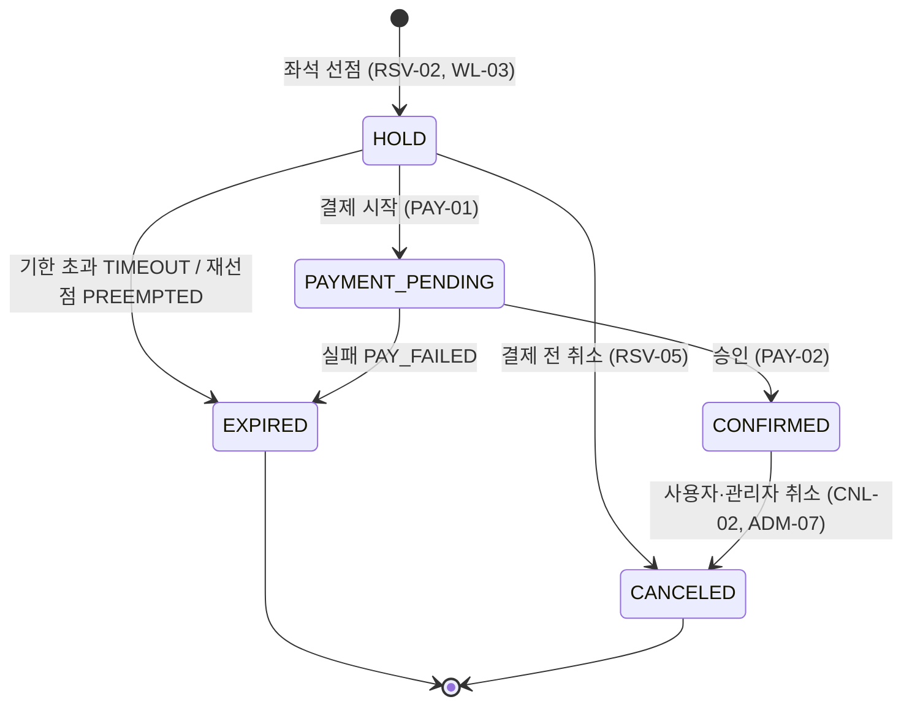

# 제자리 기능설계서

> 초안 · 2026-11-10 · 정리 길동현
> 근거: `README.md`(기획서), ERD v9(`docs/erd/jejari-erd.html`)와 `docs/concurrency.md`, `docs/Jejari_ERD.md`의 팀 결정 사항
> 표기: **[가정]** 은 팀 확인 전 임시로 정한 값입니다. 맨 끝 "미정 사항"에 모아 두었습니다.

이 문서는 "무엇을 만드는가"를 정합니다. 테이블·컬럼은 ERD, 트랜잭션 순서와 SQL은 `concurrency.md`가 원천이고, 여기서는 절 번호(예: 동시성 §4)로만 가리킵니다. 화면설계는 6장의 화면 후보 ID를 이어받아 씁니다.

## 목차

1. [범위와 우선순위](#1-범위와-우선순위)
2. [사용자와 권한](#2-사용자와-권한)
3. [기능 목록](#3-기능-목록)
4. [기능 상세](#4-기능-상세)
5. [상태 전이](#5-상태-전이)
6. [화면 후보](#6-화면-후보)
7. [API 목록](#7-api-목록)
8. [Kafka 이벤트 명세](#8-kafka-이벤트-명세)
9. [에러 코드](#9-에러-코드)
10. [비기능 요구사항과 성과 지표](#10-비기능-요구사항과-성과-지표)
11. [미정 사항](#11-미정-사항)

---

## 1. 범위와 우선순위

| 우선순위 | 뜻 | 대상 |
|---|---|---|
| P1 필수 | 1~2주차에 반드시 동작 (MVP) | 기준 데이터 적재, 회원·인증, 열차 조회, 대기열, 좌석 선점, 결제, 취소·환불, 취소표, outbox·inbox, 매수 제한, 행동 로그, 규칙 위험 점수, 의심 구간 타임라인, 실시간 예매 현황 |
| P2 판단 | 2주차 말에 진행 여부 결정 | 구간별 좌석 재고, 화면 녹화 재생, 외부 데이터 분석, 1.1의 P2 이동 기능 8개 |
| P3 발표 후 | 시간이 남으면 | 증거 해시, legal_hold, 열람 감사, Isolation Forest, 확장 예정 테이블 4개 |

범위 밖: 앱(WebView), 실제 PG 결제, 실제 본인인증, 실제 운영 기관 이름·로고.

### 1.1 1차 범위 조정 (2026-11-10)

5명이 3주에 P1 56개를 모두 깊게 만들기는 어렵습니다. 핵심 수치(중복 예약·결제 0건, 좌석 복구율, 탐지율·오탐률, 대기열 우회 차단)에 직결되는 것은 깊게, 나머지는 단순하게 만듭니다. 설계(ERD·`concurrency.md`)는 최종 목표로 그대로 두고, 1차 구현 범위만 아래처럼 줄입니다.

**P2로 내린 기능 (8개)**

| ID | 기능 | 담당 | 내린 이유 | 1차에서는 |
|---|---|---|---|---|
| ADM-01 | 노선·역·열차·좌석 등록 화면 | B | 기준 데이터는 바뀌지 않고 DATA-01 적재로 충분 | 적재 스크립트 |
| ADM-02 | 운행·명절 행사 등록 화면 | B | 시연용 운행 몇 개면 됨 | 시드 데이터 + 판매 오픈 시각에 `ON_SALE`로 바꾸는 스케줄러 |
| ADM-07 | 예약 강제 취소 | D | 핵심 수치와 무관. 취소 로직(CNL-02)은 그대로 | 없음 |
| ADM-08 | 운영 설정 화면 | E | 값은 `app_policy` 시드로 넣고 바꿀 일이 드묾 | DB에서 직접 수정 |
| ADM-09 | 결제 결과 모름 수동 처리 | C | Mock PG에서는 "모름"이 거의 생기지 않음 | 로그와 현황 화면 건수만 |
| PAY-05 | 늦은 승인 환불 | C | 1차 Mock PG는 늦은 승인을 만들지 않음 | Mock PG에 늦은 승인 시나리오를 넣을 때 함께 |
| CNL-03 | 환불 재시도 배치 | D·C | Mock PG 환불은 바로 성공 | 환불 실패는 로그만 |
| AUTH-06 | 내 정보 조회·탈퇴 | D | 시연 흐름에 없음 | 없음 |

**P1에 남기되 1차는 줄인 것**

| 대상 | 담당 | 1차 최소 버전 | 나중에 |
|---|---|---|---|
| EVT-02 Outbox 릴레이 | C | 샤드 1개, 인스턴스 1대 | 샤드 16개 + Redis 리스 (동시성 §11.2) |
| PAY-04 PG 결과 확인 스캐너 | C | 승인·실패만 처리, 모름은 다음 조회로 미루기만 | `rehold.lua`, 30분 관리자 알림 |
| AUTH-04 토큰 재발급·로그아웃 | E | 리프레시 토큰 회전만 | 회전된 토큰 재사용 시 계열 전체 폐기 |
| AUTH-07 결제 수단 등록 | C | 결제할 때 가상 카드번호를 받아 해시만 저장 | U-09 관리 화면 |
| CNL-01 수수료 미리보기 | D | 취소 확인 창에 금액만 표시 (CNL-02와 계산 공유) | 적용 구간 설명 |
| EVT-06·WL-04 알림 | C | `notification` INSERT만. 제안은 U-10 대기 목록에 "결제하기" 버튼으로 표시 | U-11 알림함 화면, PAY_REMINDER |
| 관리자 권한 | E | 관리자 권한 하나 | VIEWER·REVIEWER·SUPERVISOR 3단계, 마스킹 해제 권한 |
| 동시성 테스트 | 전원 | 핵심 10개: T1, T2, T3, T5, T6, T10, T15, T16, T18, T21 | 나머지 (동시성 §16) |

조정 후 P1은 48개, 1차 화면은 13개입니다 (U-09, U-11, A-02, A-03, A-07은 1차에서 만들지 않음).

---

## 2. 사용자와 권한

| 액터 | 설명 | 인증 |
|---|---|---|
| 비회원 | 열차 조회만 가능 | 없음 |
| 회원 | 예매·결제·취소·취소표 신청 | JWT (E 공통 인증) |
| 관리자 VIEWER | 현황·위험 사용자 조회 (개인정보 마스킹) | 관리자 로그인 + JWT |
| 관리자 REVIEWER | VIEWER + 케이스 판정·조치 | 〃 |
| 관리자 SUPERVISOR | REVIEWER + 마스킹 해제·내보내기·운영 설정 변경·예약 강제 취소 | 〃 |
| 시스템 | 만료 스캐너, outbox 릴레이, Kafka 컨슈머, 위험 점수 배치 | 내부 |

**[가정]** 기준 데이터 등록(열차·노선·좌석)은 SUPERVISOR만 합니다.

1차 구현은 관리자 권한을 하나로 두고, 위 3단계는 이후에 나눕니다 (1.1).

회원 상태(`member.status`)가 기능에 주는 영향:

| 상태 | 로그인 | 조회 | 대기열·예매 | 취소·환불 |
|---|---|---|---|---|
| ACTIVE | 가능 | 가능 | 가능 | 가능 |
| RESTRICTED | 가능 | 가능 | **[가정]** 가능하지만 대기열 최대 패널티 | 가능 |
| BANNED | 불가 (기존 세션 폐기) | 불가 | 불가 | 관리자 처리 |

---

## 3. 기능 목록

담당은 기획서 역할 분배(A 김성원, B 강동균, C 길동현, D 강다인, E 조영준)를 따릅니다.

| ID | 기능 | 액터 | 우선 | 담당 | 화면 |
|---|---|---|---|---|---|
| **회원·인증 (AUTH)** | | | | | |
| AUTH-01 | 회원가입 | 비회원 | P1 | D | U-02 |
| AUTH-02 | 모의 본인인증 (CI 발급) | 비회원 | P1 | D | U-02 |
| AUTH-03 | 로그인 (Argon2id) | 회원 | P1 | D·E | U-01 |
| AUTH-04 | 토큰 재발급·로그아웃 | 회원 | P1 | E | - |
| AUTH-05 | 관리자 로그인 | 관리자 | P1 | E | A-01 |
| AUTH-06 | 내 정보 조회·탈퇴 | 회원 | P2 | D | U-09 |
| AUTH-07 | 결제 수단 등록 (가상) | 회원 | P1 | C | U-09 |
| **열차 조회 (TRN)** | | | | | |
| TRN-01 | 역 목록 | 모두 | P1 | B | U-03 |
| TRN-02 | 운행 검색 (출발·도착·날짜) | 모두 | P1 | B | U-03 |
| TRN-03 | 운임 조회 | 모두 | P1 | B | U-03 |
| **대기열 (QUE)** | | | | | |
| QUE-01 | 대기열 진입 (위험 점수 반영 순번) | 회원 | P1 | A | U-04 |
| QUE-02 | 번호표 조회 (순번·예상 대기 시간) | 회원 | P1 | A | U-04 |
| QUE-03 | 입장 토큰 발급 | 시스템 | P1 | A | U-04 |
| QUE-04 | 입장 토큰 검증 (좌석 API 앞단) | 시스템 | P1 | A | - |
| QUE-05 | 대기열 이탈 | 회원 | P1 | A | U-04 |
| **예약 (RSV)** | | | | | |
| RSV-01 | 좌석 배치도 조회 | 회원 | P1 | B | U-05 |
| RSV-02 | 좌석 선점 (매수 제한 포함) | 회원 | P1 | B | U-05 |
| RSV-03 | 결제 기한 초과 자동 반환 | 시스템 | P1 | B | - |
| RSV-04 | 예매 내역 목록·상세 | 회원 | P1 | D | U-08 |
| RSV-05 | 결제 전 취소 (선점 해제) | 회원 | P1 | B | U-06 |
| **결제 (PAY)** | | | | | |
| PAY-01 | 결제 시작 (마감 연장) | 회원 | P1 | C | U-06 |
| PAY-02 | 결제 승인 처리 → 예약 확정 | 시스템 | P1 | C | U-07 |
| PAY-03 | 결제 실패 처리 → 좌석 복구 (Saga) | 시스템 | P1 | C | U-07 |
| PAY-04 | PG 결과 확인 스캐너 | 시스템 | P1 | C | - |
| PAY-05 | 늦은 승인 환불 | 시스템 | P2 | C | - |
| **취소·환불 (CNL)** | | | | | |
| CNL-01 | 취소 수수료 미리보기 | 회원 | P1 | D | U-08 |
| CNL-02 | 확정 예약 취소·환불 | 회원 | P1 | D | U-08 |
| CNL-03 | 환불 재시도 배치 | 시스템 | P2 | D·C | - |
| CNL-04 | 재판매 여부 집계 배치 | 시스템 | P2 | D | - |
| **취소표 (WL)** | | | | | |
| WL-01 | 취소표 예약 대기 신청 | 회원 | P1 | D | U-10 |
| WL-02 | 대기 목록 조회·대기 취소 | 회원 | P1 | D | U-10 |
| WL-03 | 취소표 제안 (대기자 먼저) | 시스템 | P1 | D·C | - |
| WL-04 | 제안 알림 | 시스템 | P1 | C | U-11 |
| WL-05 | 제안 수락 (= 결제) | 회원 | P1 | C | U-06 |
| **이벤트 신뢰성 (EVT)** | | | | | |
| EVT-01 | Outbox 기록 | 시스템 | P1 | C | - |
| EVT-02 | Outbox 릴레이 (샤드·리스) | 시스템 | P1 | C | - |
| EVT-03 | Inbox 멱등 소비 | 시스템 | P1 | C | - |
| EVT-04 | 요청 멱등 처리 (예약·결제) | 시스템 | P1 | C·B | - |
| EVT-05 | Saga 진행·보상 | 시스템 | P1 | C | - |
| EVT-06 | 알림 발송 (가상 채널) | 시스템 | P1 | C | U-11 |
| **위험 점수 (RISK)** | | | | | |
| RISK-01 | 행동 로그 수집 (Kafka → MongoDB) | 시스템 | P1 | D | - |
| RISK-02 | 규칙 기반 위험 점수 산정 | 시스템 | P1 | D | - |
| RISK-03 | 점수 캐시·대기열 반영 | 시스템 | P1 | D·A | - |
| RISK-04 | 의심 케이스 자동 생성 | 시스템 | P1 | D | - |
| RISK-05 | Isolation Forest 비교 | 시스템 | P3 | D | - |
| **관리자 (ADM)** | | | | | |
| ADM-01 | 노선·역·열차·좌석 등록 | 관리자 | P2 | B | A-02 |
| ADM-02 | 운행·명절 행사 등록, 판매 오픈 | 관리자 | P2 | B | A-03 |
| ADM-03 | 실시간 예매 현황 | 관리자 | P1 | B | A-04 |
| ADM-04 | 위험 사용자 목록 (마스킹) | 관리자 | P1 | D | A-05 |
| ADM-05 | 의심 구간 타임라인 | 관리자 | P1 | D | A-06 |
| ADM-06 | 케이스 판정·조치 | 관리자 | P1 | D | A-06 |
| ADM-07 | 예약 강제 취소 | 관리자 | P2 | D | A-04 |
| ADM-08 | 운영 설정 (app_policy) | 관리자 | P2 | E | A-07 |
| ADM-09 | 결제 결과 모름 건 처리 | 관리자 | P2 | C | A-04 |
| ADM-10 | 트래픽 모니터링 (Grafana) | 관리자 | P1 | E | 외부 |
| ADM-11 | 화면 녹화 재생 | 관리자 | P2 | D | A-06 |
| **데이터 (DATA)** | | | | | |
| DATA-01 | 공공데이터 적재 (역·차량·거리) | 시스템 | P1 | B | - |
| DATA-02 | 가상 회원·예매 데이터 생성 | 시스템 | P1 | E·D | - |
| DATA-03 | 봇 시뮬레이션 (k6, 정답 라벨) | 시스템 | P1 | E | - |
| DATA-04 | 외부 데이터 분석 (Kaggle) | 시스템 | P2 | D | - |

---

## 4. 기능 상세

각 기능은 **입력 → 처리 → 출력 → 예외** 순으로 씁니다. 처리 순서가 복잡한 기능은 동시성 문서 절을 따릅니다.

### 4.1 회원·인증

**AUTH-01·02 회원가입 + 모의 본인인증**
- 입력: 이메일, 비밀번호, 이름, 휴대폰 번호, 모의 인증 수단(MOCK_PASS / MOCK_PHONE)
- 처리
  1. 모의 인증: 이름 + 휴대폰 번호로 가짜 CI를 만들고 `ci_hash = HMAC(CI)` 저장. 같은 사람은 항상 같은 CI가 나와야 다계정 묶음이 됩니다.
  2. `member` 생성: 휴대폰은 `phone_enc`(AES-256-GCM) + `phone_hash`(HMAC), 비밀번호는 `member_credential`에 Argon2id.
  3. `identity_verification`에 결과 기록.
- 규칙: 같은 이메일 가입 불가. **같은 CI로 여러 계정 가입은 허용**하고(다계정 실험 대상), 매수 제한은 CI 기준으로 합산.
- 예외: 이메일 중복 `AUTH_EMAIL_DUPLICATED`, 인증 실패 `AUTH_VERIFY_FAILED`

**AUTH-03 로그인**
- 처리: `rate:login:{ipHash}` 확인 → 세마포어(`auth.max_concurrent_hash`) → Argon2id 검증(없는 계정도 더미 해시로 같은 시간) → 성공 시 `auth_session` 발급(액세스 + 리프레시) → `needs_rehash`면 재해싱
- 규칙: 연속 실패 **[가정]** 5회면 `locked_until = 지금 + 15분`. 모든 시도를 `login_attempt`에 기록.
- 예외: `AUTH_INVALID_CREDENTIALS`, `AUTH_LOCKED`, `AUTH_RATE_LIMITED`, `AUTH_BANNED`

**AUTH-04 토큰 재발급·로그아웃**
- 리프레시 토큰은 SHA-256 해시만 저장하고, 재발급할 때마다 회전(ROTATED). 이미 회전된 토큰이 다시 오면 탈취로 보고 `token_family_id` 전체 폐기.

**AUTH-05 관리자 로그인**: 회원 로그인과 같은 방식, `actor_type = ADMIN`. **[가정]** TOTP는 P3.

**AUTH-07 결제 수단 등록**: 가상 카드번호 → `payment_method`에 해시만 저장. 결제 수단 해시가 위험 점수의 묶음 키입니다.

### 4.2 열차 조회

**TRN-02 운행 검색**
- 입력: 출발역, 도착역, 운행일
- 출력: 운행 목록(열차 번호, 출발·도착 시각, 소요 시간, 등급별 운임, 등급별 남은 좌석 수, 판매 상태)
- 규칙: 남은 좌석 수는 `seatmap:{runId}` 캐시에서 읽습니다(DB 미조회). `train_run.status`가 `ON_SALE`이 아니면 "예매 오픈 전 / 마감"으로 표시하고 대기열 버튼을 막습니다.
- 대기열 없이 호출 가능합니다.

### 4.3 대기열

**QUE-01 대기열 진입**
- 입력: run_id
- 선행: 로그인, 운행이 `ON_SALE`
- 처리
  1. 위험 점수 조회: 회원의 CI·결제 수단·기기 해시로 `risk:*` 캐시를 읽고 결합 규칙(`risk.member_penalty_rule` = MAX)으로 하나를 고릅니다.
  2. `penalty_ms = 점수 × risk.penalty_ms_per_point` (예: 80점 → 80초 뒤로)
  3. 중복 진입 확인
     - `queue:member:{memberId}`가 있으면: 같은 운행이면 기존 순번을 그대로 돌려줍니다(새로고침해도 뒤로 밀리지 않음). 다른 운행이면 거절합니다(회원당 동시 대기 1개).
     - `queue:ci:{ciHash}`에서 만료 멤버를 `ZREMRANGEBYSCORE`로 정리한 뒤, 다른 회원이 남아 있으면 거절합니다(같은 CI의 여러 계정이 동시에 줄 서는 것 차단).
     - 거절은 `queue_log.left_reason = REJECTED_DUPLICATE`로 남깁니다.
  4. `seq = INCR queue:seq:{runId}` 후 `ZADD queue:{runId} score=진입시각ms + penalty_ms member={12자리 0채움 seq}:{memberId}`. score가 같으면 member 문자열 순서(= 진입 순서)로 정렬됩니다. 같은 처리에서 `queue:member`, `queue:ci`도 기록합니다. 3~4는 한 Lua 스크립트로 원자적으로 실행합니다.
  5. `queue_log`에 조정 전·후 순번 기록 (순번 조정 정확도 검증용).
- 출력: 번호표(순번, 앞사람 수, 예상 대기 시간)
- 규칙: 위험 사용자의 요청을 지연시키지 않습니다. 순번만 뒤로 갑니다.
- 예외: `RUN_NOT_ON_SALE`, `QUEUE_DUPLICATED`

**QUE-02 번호표 조회**
- 출력: 현재 순번, 예상 대기 시간(= 순번 ÷ `queue:throughput:{runId}`), 다음 조회 권장 간격, 입장 여부
- **[가정]** 클라이언트는 서버가 준 간격(1~5초)으로 폴링합니다. SSE·웹소켓은 쓰지 않습니다(연결 수가 부하 테스트를 왜곡).

**QUE-03 입장 토큰 발급**
- 스케줄러가 초당 `queue.admit_per_sec`명씩 맨 앞부터 꺼내 `queue:active:{runId}`(score = 토큰 만료 시각)에 넣고 `queue:pass:{runId}:{memberId}`(TTL `queue.pass_ttl_sec` = 300초) 발급.
- 번호표 조회 응답에 토큰이 실려 나갑니다.

**QUE-04 입장 토큰 검증**
- 좌석 배치도·선점 API는 요청 헤더 `X-Queue-Token`을 검사합니다. 없거나, 다른 운행·다른 회원 것이거나, 만료됐으면 거부.
- 예외: `QUEUE_TOKEN_REQUIRED`, `QUEUE_TOKEN_INVALID`
- 목표: 토큰 없이 좌석 API 호출 시 차단율 100%, 무효 토큰 재사용 차단 100%.

### 4.4 예약

**RSV-01 좌석 배치도**
- 입력: run_id, 승차역, 하차역, 등급
- 출력: 호차별 좌석 배치와 좌석마다 상태(빈 좌석 / 선점 중 / 판매됨)
- 규칙: `seatmap:{runId}`에서 읽습니다. 캐시가 조금 늦을 수 있으므로 최종 판정은 선점 시점에 합니다.

**RSV-02 좌석 선점** — 동시성 §1, §2, §3, §10
- 입력: run_id, 승차역, 하차역, 좌석 ID 목록, 승객 유형(어른·어린이·경로), `Idempotency-Key` 헤더
- 선행: 유효한 입장 토큰
- 처리 요약
  1. 1회 매수 한도 확인 (기본 4매)
  2. 멱등 키로 예약 ID 확보. 같은 키 재요청이면 기존 예약을 돌려줌
  3. Redis 매수 한도 1차 (열차당 4매, 명절 전체 8매, CI 합산)
  4. Redis 좌석 경쟁 (`hold.lua`, 모든 좌석 한꺼번에 SET NX). 지면 DB 쓰기 0건으로 거절
  5. 이긴 사람만 DB 트랜잭션: 예약 HOLD, 좌석 재고 HOLD, 카운터 증가, 이력, Saga, outbox `SEAT_HELD`
  6. 실패하면 Redis 보상 (좌석 키·한도·멱등 키 원복)
- 출력: reservation_id, 상태 HOLD, 결제 기한(`pay_deadline_at`, 기본 10분), 금액
- 규칙
  - 여러 좌석은 전부 성공하거나 전부 실패합니다(일부만 잡히지 않음).
  - 결제 기한이 지난 HOLD 좌석은 다른 사람이 이어받을 수 있습니다(재선점, §3). 결제 중인 좌석은 이어받지 못합니다.
  - 금액은 선점 시점 운임으로 고정합니다(`total_amount`).
- 예외: `SEAT_ALREADY_TAKEN`, `LIMIT_PER_RESERVATION`, `LIMIT_PER_RUN`, `LIMIT_PER_HOLIDAY`, `RUN_NOT_ON_SALE`, `REQUEST_IN_PROGRESS`(202)

**RSV-03 결제 기한 초과 자동 반환** — 동시성 §6.1, §7
- 스캐너가 주기적으로 기한이 지난 HOLD 예약을 EXPIRED로 바꾸고 좌석 행 삭제, 카운터 감소, outbox `RESERVATION_EXPIRED(TIMEOUT)`.
- Redis 좌석 키는 TTL로 이미 사라졌으므로 그 좌석은 모두에게 바로 열립니다.
- **[가정]** 스캐너 주기 5초, 한 번에 최대 500건.

**RSV-04 예매 내역**
- 출력: 내 예약 목록(상태별 필터), 상세(운행, 좌석, 승차권 번호, 금액, 결제 상태, 결제 기한, 취소 가능 여부와 예상 수수료)
- 승차권 번호는 CONFIRMED일 때만 보여줍니다.

**RSV-05 결제 전 취소** — 동시성 §7.4
- HOLD 예약만 취소 가능(수수료 없음, `cancellation` 미생성). PAYMENT_PENDING은 `PAYMENT_IN_PROGRESS`로 거절.
- 풀린 좌석은 대기자에게 먼저 제안됩니다(WL-03).

### 4.5 결제

PG는 테스트 모드를 감싸는 `PgClient` 인터페이스 뒤에 둡니다. **[가정]** 1차는 직접 만든 Mock PG(지연·실패·무응답을 설정으로 흉내), 여유가 있으면 실제 PG 테스트 키로 교체합니다.

**PAY-01 결제 시작** — 동시성 §4
- 입력: reservation_id, 결제 수단 ID, `Idempotency-Key`
- 처리: 예약 HOLD → PAYMENT_PENDING, 마감 연장(`GREATEST(기존, 지금 + 180초 + 60초)`, 한 번만), 좌석·Saga·취소표 마감 동시 연장, `payment` REQUESTED, outbox `PAYMENT_STARTED` → 커밋 후 Redis 키 연장 → PG 승인 요청
- 규칙: 결제 시작은 예약당 한 번입니다. 결제 실패 후 재시도는 없습니다(다시 예매).
- 예외: `RESERVATION_NOT_HOLD`, `RESERVATION_EXPIRED`, `SEAT_LOST`, `PAYMENT_DUPLICATED`

**PAY-02 승인 처리** — 동시성 §5.1
- PG 승인 응답·콜백·조회 결과 어느 경로로 와도 같은 결과(멱등).
- 처리: 좌석 SOLD, payment APPROVED, 예약 CONFIRMED, Saga DONE, outbox `RESERVATION_CONFIRMED`, 취소표 제안 예약이면 waitlist ACCEPTED → 커밋 후 Redis 좌석 키를 `SOLD:R`로.
- 좌석을 이미 잃었으면 확정하지 않고 늦은 승인 환불(PAY-05).

**PAY-03 실패 처리** — 동시성 §5.2, §7
- payment FAILED → 예약 EXPIRED(`PAY_FAILED`) → 좌석 반환·카운터 감소 → 좌석은 대기자에게 먼저.
- 별도 `PAYMENT_FAILED` 예약 상태는 없습니다.

**PAY-04 PG 결과 확인 스캐너** — 동시성 §6.2
- 마감이 지났는데 결과를 모르는 결제를 PG에 조회. 승인 → PAY-02, 실패·없음 → PAY-03, **모름 → 자동 만료하지 않음**(다음 조회 연기, 좌석 유지, 30분 지나면 관리자 알림 → ADM-09).

**PAY-05 늦은 승인 환불** (P2, 1.1) — 동시성 §7.3
- 돈은 빠졌는데 예약을 확정할 수 없을 때 전액 환불(`cancel_type = PAY_FAILED`, 수수료 0). 예약은 되살리지 않습니다.

### 4.6 취소·환불

**CNL-01 수수료 미리보기**
- 출력: 결제 금액, 출발까지 남은 시간, 적용 구간, 수수료, 환불 예정액
- 수수료(예시): 3일 전 0% · 1~3일 5% · 3시간~1일 10% · 3시간 이내 20% · 출발 후 40% (`cancel_fee_policy`)
- 금액 계산: **[가정]** 좌석별 금액 × 비율, 원 단위 미만 버림.

**CNL-02 확정 예약 취소** — 동시성 §8
- 입력: reservation_id
- 처리: 예약 CONFIRMED → CANCELED, 좌석 SOLD 행 삭제, 카운터 감소, `cancellation`(수수료·환불액·구매 후 경과 분·출발 전 남은 분), outbox `RESERVATION_CANCELED` → 커밋 후 좌석 키 `REOFFER:R`(대기자 먼저) → PG 환불 요청
- 규칙
  - **[가정]** 1차는 예약 전체 취소만. 좌석 일부 취소는 P2.
  - **[가정]** 운행 출발 이후 취소는 출발 후 20분까지 40% 수수료로 허용, 그 뒤는 불가.
  - 사용자 취소(`USER`)만 위험 점수 신호로 집계합니다.
- 예외: `RESERVATION_NOT_CONFIRMED`, `CANCEL_NOT_ALLOWED`

**CNL-03 환불 재시도** (P2, 1.1): `refund_status`가 REQUESTED·FAILED인 건을 주기적으로 다시 요청. 완료되면 `payment.status = REFUNDED`.

**CNL-04 재판매 여부**: 운행 출발 후 배치가 취소된 좌석이 다시 팔렸는지 `resold_yn`에 기록 (기획 배경의 "재판매되지 못한 표" 지표).

### 4.7 취소표

**WL-01 대기 신청**
- 입력: run_id, 승차역, 하차역, 등급, 매수
- 선행: 해당 등급이 매진. **[가정]** 대기열 입장 토큰은 필요 없음(매진 화면에서 바로 신청).
- 규칙
  - **[가정]** 회원당 같은 운행 대기 1건, 전체 활성 대기 3건까지.
  - 매수는 1회 매수 한도 이하.
  - 순서는 `requested_at`. 위험 점수로 순서를 바꾸지 않습니다 **[가정]**.
- 예외: `WAITLIST_DUPLICATED`, `WAITLIST_LIMIT`, `WAITLIST_NOT_SOLD_OUT`

**WL-03 취소표 제안** — 동시성 §9
- 빈 좌석 이벤트(`RESERVATION_CANCELED`, `RESERVATION_EXPIRED`)를 소비 그룹 `seat-release`가 받아 처리.
- 대기 순서대로 구간·등급·매수가 맞는 대기자에게 시스템이 대신 좌석을 선점(예약 `source = WAITLIST`)하고 waitlist OFFERED + 알림.
- 대기자가 매수 한도에 걸리면 SKIPPED, 다음 대기자로.
- 취소로 풀린 좌석은 60초(`waitlist.reoffer_hold_sec`) 동안 대기자 전용. 맞는 대기자가 없으면 일반 판매로.
- 인스턴스가 여러 대여도 한 대기자에게 한 번만 제안(`SKIP LOCKED` + 조건부 UPDATE + `wl:` 멱등 키).

**WL-05 제안 수락**: 제안받은 예약을 결제(PAY-01)하면 수락입니다. 기한(기본 10분, 결제 시작 시 연장)이 지나면 만료되고 다음 대기자에게 넘어갑니다.

### 4.8 이벤트 신뢰성

**EVT-01·02 Outbox** — 동시성 §11
- 상태를 바꾸는 트랜잭션 안에서 `outbox_event` INSERT. 릴레이가 Kafka로 발행.
- 샤드 16개, 샤드마다 Redis 리스를 잡은 인스턴스 하나만 발행 → 같은 예약 이벤트는 `seq` 순서 그대로.
- 발행 5회 실패하면 FAILED로 두고 그 샤드만 멈춘 뒤 알림(뒤 이벤트가 앞지르지 않게).
- 발행 완료 행은 24시간 뒤 정리.

**EVT-03 Inbox** — 동시성 §12
- 모든 컨슈머는 업무 처리와 같은 트랜잭션에서 `processed_event` INSERT. 중복이면 건너뜀. 보관 8일.

**EVT-04 요청 멱등** — 동시성 §1
- 클라이언트는 버튼 누를 때마다 UUID를 만들고 재시도에는 같은 키를 씁니다. 헤더 `Idempotency-Key`.
- 예약: `idem:{memberId}:{key}` + DB `UNIQUE(member_id, idempotency_key)`
- 결제: `idem:pay:{reservationId}:{key}` + DB `UNIQUE(reservation_id, idempotency_key)` + 예약당 승인 1건 인덱스

**EVT-05 Saga**
- `saga_instance`가 단계(SEAT_HELD → PAYING → CONFIRMED)와 제한 시각을 들고 있습니다. 실패·만료 시 COMPENSATED.
- 보상 = 좌석 반환 + 카운터 감소 + Redis 정리. B가 제공하는 해제 로직을 reservation_id 기준으로 호출하며 두 번 불러도 결과가 같습니다.

**EVT-06 알림**
- 종류: WAITLIST_OFFER(취소표 제안), PAY_REMINDER(결제 기한 임박), EXPIRED(예약 만료), WAITLIST_SKIPPED(매수 한도 초과로 건너뜀), REFUNDED(환불 완료)
- **[가정]** 실제 발송 없이 IN_APP 알림함 + 로그. `notification`에 기록하고 `sent_at`·`read_at`으로 알림 → 결제 전환율을 봅니다.
- **[가정]** PAY_REMINDER는 기한 2분 전.

### 4.9 위험 점수

**RISK-01 행동 로그**
- 앱이 VIEW_TRAIN, VIEW_SEAT, QUEUE_ENTER, SEAT_HOLD, PAY, CANCEL 이벤트를 Kafka로 보내고 적재 컨슈머가 MongoDB `behavior_log`에 1000건씩 배치 저장.
- 식별 정보는 HMAC 해시만. 보관 180일(팀 확정).

**RISK-02 규칙 기반 점수**
- 대상: 계정이 아닌 CI·결제 수단·기기 단위.
- 신호: 1회·누적 구매 매수, 구매 후 취소까지 시간, 취소 비율, 출발 직전 취소 수, 연결 계정 수, 평균 요청 간격, 계정 나이.
- 규칙(마커 코드): FAST_CLICK(클릭 간격 기준 미달), SAME_SEAT_RETRY(같은 좌석 반복 시도), CANCEL_AFTER_PAY(구매 후 단시간 취소), MULTI_ACCOUNT_SYNC(같은 CI 여러 계정 동시 선점), LINEAR_MOUSE(P2, 녹화 필요)
- 출력: `final_score`(0~100), 근거 목록(`reasons` JSON). 반감기 30일로 감쇠. 신규 계정은 기본 점수를 조금 높게 시작.
- **[가정]** 주기 배치 1분 + 취소 이벤트 시 즉시 재계산. 규칙별 임계값과 배점은 D가 정해 `app_policy`에 둡니다.

**RISK-03 대기열 반영**: 계산 결과를 `risk:{subjectType}:{hash}`에 캐시. 대기열 진입 때 이 값만 읽습니다(QUE-01).

**RISK-04 의심 케이스 자동 생성**: 점수 80 이상 또는 규칙 적중 시 `suspicious_case` OPEN, 해당 이벤트 전후를 의심 구간(`window_from` ~ `window_to`)으로 묶고 `case_marker`(AUTO) 생성.

### 4.10 관리자

**ADM-01·02 기준 데이터·운행 등록** (P2, 1.1. 1차는 적재 스크립트·시드 데이터 + 판매 오픈 스케줄러)
- 노선·역·차량 유형·열차 등록 시 좌석은 차량 유형의 좌석 수만큼 자동 생성.
- 운행 생성 → 판매 오픈 시각이 되면 `ON_SALE`. 명절 행사(`sale_event`)에 묶으면 명절 전체 매수 제한이 적용됩니다.

**ADM-03 실시간 예매 현황**
- 운행별 판매·선점·남은 좌석, 분당 예약·결제·취소 수, 대기열 길이와 입장 속도, 결제 결과 모름 건수.
- **[가정]** 10초 폴링 화면. 서버 지표(TPS, 응답 시간)는 Grafana(ADM-10).

**ADM-04 위험 사용자 목록**
- 점수 순 목록. 이름·연락처는 마스킹(SUPERVISOR만 해제, 해제 이력 기록). 필터: 점수 구간, 검토 상태, 대상 유형.

**ADM-05 의심 구간 타임라인**
- 대상 선택 → 시간순 이벤트, 의심 구간 하이라이트, 발동 규칙, 점수 변화 그래프. 같은 CI·기기·결제 수단의 다른 계정 이벤트도 함께.
- 기획서의 차별점입니다. 1차 범위는 타임라인과 하이라이트, "영상처럼 재생"(ADM-11)은 P2.

**ADM-06 판정·조치**
- 판정: RESELLER / MACRO / CANCEL_ABUSE / NORMAL(오탐)
- 조치: CONFIRM(위험 확정), CLEAR(오탐 해제, 점수 초기화), RESTRICT, BAN. `admin_action`에 사유와 함께 기록하고, 조치 즉시 `risk:*` 캐시와 `member.status`에 반영.

**ADM-07 예약 강제 취소** (P2, 1.1): 동시성 §8의 `ADMIN` 경로. 수수료 0, 전액 환불, 사유 필수.

**ADM-08 운영 설정** (P2, 1.1): `app_policy` 값 변경 → version + 1 → 이력 → 캐시 갱신 → 각 서버가 다시 로딩. SUPERVISOR만.

**ADM-09 결제 결과 모름 처리** (P2, 1.1): PG 결과를 30분 넘게 모르는 결제 목록. 관리자가 PG 관리 화면에서 확인한 결과(승인·실패)를 입력하면 PAY-02·03으로 처리.

---

## 5. 상태 전이

### 5.1 예약 `reservation.status`



- 허용되지 않은 전이(예: CANCELED → CONFIRMED)는 조건부 UPDATE가 0행이 되어 막힙니다. 모든 전이는 `reservation_history`에 남습니다.
- PAYMENT_PENDING은 사용자가 취소할 수 없고, 재선점 대상도 아닙니다.

### 5.2 결제 `payment.status`

| 현재 | 다음 | 언제 |
|---|---|---|
| (없음) | REQUESTED | 결제 시작 |
| REQUESTED | APPROVED | PG 승인 |
| REQUESTED | FAILED | PG 거절, 조회 결과 실패·없음 |
| FAILED | APPROVED | 늦은 승인 (곧바로 환불 시작) |
| APPROVED | REFUNDED | 취소·늦은 승인 환불 완료 |

### 5.3 취소표 `waitlist.status`

| 현재 | 다음 | 언제 |
|---|---|---|
| (없음) | WAITING | 대기 신청 |
| WAITING | OFFERED | 제안 (시스템이 좌석 선점) |
| WAITING | SKIPPED | 제안 시점에 매수 한도 초과 |
| WAITING | CANCELED | 사용자가 대기 취소 |
| OFFERED | ACCEPTED | 결제 승인 |
| OFFERED | EXPIRED | 기한 초과 또는 결제 실패 |

> SKIPPED는 ERD v8에서 추가됐습니다.

### 5.4 좌석 (Redis `seat:hold:*` 값 + `seat_inventory.status`)

| Redis 값 | DB 행 | 뜻 |
|---|---|---|
| 없음 | 없음 | 빈 좌석 |
| `R` | HOLD | 예약 R이 선점 중 (TTL = 결제 기한) |
| `SOLD:R` | SOLD | 판매됨 (TTL = 출발 시각) |
| `REOFFER:R` | 없음 | 취소로 풀림, 60초 동안 대기자 전용 |

### 5.5 의심 케이스 `suspicious_case.status`

OPEN → REVIEWING(담당자 배정) → CONFIRMED(위험 확정) 또는 DISMISSED(오탐)

### 5.6 대기열 (회원 한 명 기준)

진입 → 대기(`queue:{runId}`) → 입장(`queue:active:{runId}` + 입장 토큰) → 토큰 만료 또는 이탈. 이탈 사유는 `queue_log.left_reason`(ADMITTED / TIMEOUT / LEFT / REJECTED_DUPLICATE). REJECTED_DUPLICATE는 중복 진입으로 처음부터 거절된 경우입니다.

---

## 6. 화면 후보

화면설계에서 이 ID를 그대로 씁니다. U-09, U-11, A-02, A-03, A-07은 1차에서 만들지 않습니다 (1.1).

| ID | 화면 | 기능 |
|---|---|---|
| U-01 | 로그인 | AUTH-03 |
| U-02 | 회원가입·모의 본인인증 | AUTH-01, 02 |
| U-03 | 메인·운행 검색 결과 | TRN-01~03 |
| U-04 | 대기열 (번호표) | QUE-01~05 |
| U-05 | 좌석 선택 | RSV-01, 02 |
| U-06 | 결제 (기한 카운트다운) | PAY-01, RSV-05, WL-05 |
| U-07 | 결제 결과 | PAY-02, 03 |
| U-08 | 예매 내역·상세·취소 | RSV-04, CNL-01, 02 |
| U-09 | 내 정보·결제 수단 | AUTH-06, 07 |
| U-10 | 취소표 대기 신청·목록 | WL-01, 02 |
| U-11 | 알림함 | EVT-06, WL-04 |
| A-01 | 관리자 로그인 | AUTH-05 |
| A-02 | 노선·역·열차·좌석 관리 | ADM-01 |
| A-03 | 운행·명절 행사 관리 | ADM-02 |
| A-04 | 실시간 예매 현황 | ADM-03, 07, 09 |
| A-05 | 위험 사용자 목록 | ADM-04 |
| A-06 | 케이스 상세 (타임라인·판정·재생) | ADM-05, 06, 11 |
| A-07 | 운영 설정 | ADM-08 |

---

## 7. API 목록

초안입니다. 요청·응답 필드는 기능 담당자가 구현하면서 Swagger로 채웁니다.

- 기본 경로 `/api/v1`, 관리자는 `/api/v1/admin`
- 인증: `Authorization: Bearer {액세스 토큰}`
- 좌석 API: `X-Queue-Token` 필수
- 상태를 바꾸는 예약·결제 API: `Idempotency-Key` 필수
- 응답: 성공은 본문 그대로, 실패는 `{ "code": "SEAT_ALREADY_TAKEN", "message": "…", "traceId": "…" }`

| 메서드 | 경로 | 기능 | 인증 |
|---|---|---|---|
| POST | `/auth/verify` | 모의 본인인증 | - |
| POST | `/auth/signup` | 회원가입 | - |
| POST | `/auth/login` | 로그인 | - |
| POST | `/auth/refresh` | 토큰 재발급 | 리프레시 |
| POST | `/auth/logout` | 로그아웃 | 회원 |
| GET | `/me` | 내 정보 | 회원 |
| DELETE | `/me` | 탈퇴 | 회원 |
| GET·POST | `/me/payment-methods` | 결제 수단 조회·등록 | 회원 |
| GET | `/stations` | 역 목록 | - |
| GET | `/runs?from=&to=&date=` | 운행 검색 | - |
| GET | `/runs/{runId}` | 운행 상세·운임 | - |
| POST | `/runs/{runId}/queue` | 대기열 진입 | 회원 |
| GET | `/runs/{runId}/queue/me` | 번호표 조회 (입장 시 토큰 포함) | 회원 |
| DELETE | `/runs/{runId}/queue/me` | 대기열 이탈 | 회원 |
| GET | `/runs/{runId}/seats?from=&to=&grade=` | 좌석 배치도 | 회원 + 토큰 |
| POST | `/reservations` | 좌석 선점 | 회원 + 토큰 + 멱등 |
| GET | `/reservations` | 예매 내역 | 회원 |
| GET | `/reservations/{id}` | 예매 상세 | 회원 |
| POST | `/reservations/{id}/payments` | 결제 시작 | 회원 + 멱등 |
| POST | `/payments/callback` | PG 결과 콜백 | PG 서명 |
| GET | `/reservations/{id}/cancel-quote` | 수수료 미리보기 | 회원 |
| POST | `/reservations/{id}/cancel` | 취소 (HOLD·CONFIRMED 공통) | 회원 |
| POST | `/waitlists` | 취소표 대기 신청 | 회원 |
| GET | `/waitlists` | 내 대기 목록 | 회원 |
| DELETE | `/waitlists/{id}` | 대기 취소 | 회원 |
| GET | `/notifications` | 알림함 | 회원 |
| PATCH | `/notifications/{id}/read` | 읽음 | 회원 |
| POST | `/logs/behavior` | 행동 로그 묶음 전송 | 회원 |
| POST | `/admin/auth/login` | 관리자 로그인 | - |
| CRUD | `/admin/stations`, `/admin/routes`, `/admin/trains`, `/admin/car-types` | 기준 데이터 | SUPERVISOR |
| CRUD | `/admin/runs`, `/admin/sale-events` | 운행·행사 | SUPERVISOR |
| GET | `/admin/dashboard/runs/{runId}` | 실시간 현황 | VIEWER |
| POST | `/admin/reservations/{id}/cancel` | 강제 취소 | SUPERVISOR |
| GET | `/admin/payments/unknown` | 결과 모름 결제 | REVIEWER |
| POST | `/admin/payments/{id}/resolve` | 결과 수동 입력 | SUPERVISOR |
| GET | `/admin/risks?minScore=&status=` | 위험 사용자 목록 | VIEWER |
| GET | `/admin/cases`, `/admin/cases/{id}` | 케이스 목록·상세 | VIEWER |
| GET | `/admin/cases/{id}/timeline` | 의심 구간 타임라인 | VIEWER |
| POST | `/admin/cases/{id}/actions` | 판정·조치 | REVIEWER |
| POST | `/admin/cases/{id}/unmask` | 마스킹 해제 (사유 필수) | SUPERVISOR |
| GET·PUT | `/admin/policies/{key}` | 운영 설정 | 조회 VIEWER / 변경 SUPERVISOR |

---

## 8. Kafka 이벤트 명세

### 8.1 토픽

| 토픽 | 키 | 내용 | 파티션 **[가정]** |
|---|---|---|---|
| `jejari.reservation` | reservation_id | 예약·결제·취소 흐름 이벤트 전부 (outbox) | 12 |
| `jejari.waitlist` | waitlist_id | 대기 신청·제안 결과 (outbox) | 6 |
| `jejari.behavior` | ci_hash | 행동 로그 (앱 직접 발행) | 12 |
| `jejari.replay` | session_id | 녹화 이벤트 (P2) | 6 |

예약 흐름은 결제·취소 이벤트까지 **한 토픽, 같은 키**에 둡니다. 토픽을 나누면 같은 예약의 "결제 승인"과 "취소"가 다른 토픽에 들어가 순서를 보장할 수 없기 때문입니다. 비교 실험(동시성 §17.2)에서만 키를 run_id로 바꿉니다.

### 8.2 공통 봉투

```json
{
  "eventId": "UUID (outbox_event.event_id)",
  "eventType": "SEAT_HELD",
  "seq": 1024,
  "aggregateType": "RESERVATION",
  "aggregateId": "1001",
  "occurredAt": "2026-11-20T10:00:00.123+09:00",
  "payload": { }
}
```

컨슈머는 `eventId`로 중복을 거르고(EVT-03), 같은 예약 안에서는 `seq`가 커지는 순서로 옵니다.

### 8.3 이벤트

| eventType | 발행 시점 | payload 핵심 | 소비 |
|---|---|---|---|
| `SEAT_HELD` | 좌석 선점 커밋 | reservationId, memberId, ciHash, runId, seats[{seatId, segNo}], from, to, seatCount, amount, payDeadlineAt, source | 알림(기한 임박 예약), 위험 점수 |
| `PAYMENT_STARTED` | 결제 시작 커밋 | reservationId, paymentId, methodHash, amount, payDeadlineAt | 모니터링 |
| `RESERVATION_CONFIRMED` | 결제 승인 커밋 | reservationId, paymentId, pgTxId, confirmedAt, source, waitlistId | 알림, 위험 점수, 현황 |
| `RESERVATION_EXPIRED` | 만료·결제 실패·재선점 | reservationId, runId, seats, from, to, seatCount, reason(TIMEOUT / PAY_FAILED / PREEMPTED) | **seat-release**(Redis 보상 + 취소표 제안), 알림 |
| `RESERVATION_CANCELED` | 결제 전·확정 후 취소 | reservationId, runId, seats, from, to, seatCount, reason(USER_BEFORE_PAY / USER / ADMIN), cancelFee, refundAmount, minutesAfterPurchase, minutesBeforeDeparture | **seat-release**, 위험 점수, 환불 |
| `REFUND_COMPLETED` **[가정]** | 환불 완료 | reservationId, cancelId, refundAmount, refundPgTxId | 알림 |
| `WAITLIST_OFFERED` **[가정]** | 취소표 제안 커밋 | waitlistId, memberId, offeredReservationId, offerDeadlineAt | 알림 |
| `WAITLIST_SKIPPED` **[가정]** | 한도 초과로 건너뜀 | waitlistId, memberId, reason | 알림 |

### 8.4 소비 그룹

| 그룹 | 구독 | 하는 일 |
|---|---|---|
| `seat-release` | RESERVATION_EXPIRED, RESERVATION_CANCELED | Redis 좌석 키·한도 보상(보장 경로), 취소표 제안 |
| `notification` | SEAT_HELD, RESERVATION_CONFIRMED, RESERVATION_EXPIRED, WAITLIST_OFFERED, WAITLIST_SKIPPED, REFUND_COMPLETED | 알림 생성 |
| `risk-signal` | RESERVATION_CONFIRMED, RESERVATION_CANCELED | 구매·취소 신호 반영, 점수 재계산 |
| `behavior-sink` | jejari.behavior | MongoDB insertMany 적재 |
| `refund` | RESERVATION_CANCELED(USER·ADMIN) | PG 환불 요청 **[가정]** 앱이 커밋 후 직접 요청하고, 이 그룹은 유실 대비 보장 경로 |

---

## 9. 에러 코드

| 코드 | HTTP | 상황 |
|---|---|---|
| `AUTH_EMAIL_DUPLICATED` | 409 | 이메일 중복 |
| `AUTH_VERIFY_FAILED` | 400 | 모의 본인인증 실패 |
| `AUTH_INVALID_CREDENTIALS` | 401 | 아이디·비밀번호 불일치 (계정 존재 여부를 알려주지 않음) |
| `AUTH_LOCKED` | 423 | 연속 실패 잠금 |
| `AUTH_RATE_LIMITED` | 429 | 로그인 시도 과다 |
| `AUTH_BANNED` | 403 | 이용 정지 회원 |
| `AUTH_TOKEN_EXPIRED` | 401 | 액세스 토큰 만료 |
| `QUEUE_DUPLICATED` | 409 | 다른 운행 대기 중이거나 같은 CI의 다른 계정이 대기 중 |
| `QUEUE_TOKEN_REQUIRED` | 403 | 입장 토큰 없음 |
| `QUEUE_TOKEN_INVALID` | 403 | 입장 토큰 만료·불일치·재사용 |
| `RUN_NOT_ON_SALE` | 409 | 판매 전·마감 운행 |
| `SEAT_ALREADY_TAKEN` | 409 | 다른 사람이 선점·구매한 좌석 |
| `LIMIT_PER_RESERVATION` | 422 | 1회 매수 초과 |
| `LIMIT_PER_RUN` | 422 | 열차당 매수 초과 (CI 합산) |
| `LIMIT_PER_HOLIDAY` | 422 | 명절 전체 매수 초과 (CI 합산) |
| `REQUEST_IN_PROGRESS` | 202 | 같은 멱등 키 요청 처리 중 |
| `RESERVATION_NOT_FOUND` | 404 | 없는 예약 또는 남의 예약 |
| `RESERVATION_NOT_HOLD` | 409 | 결제 시작 불가 상태 |
| `RESERVATION_EXPIRED` | 410 | 결제 기한 초과 |
| `SEAT_LOST` | 409 | 결제 시작 시 좌석을 이미 잃음 |
| `PAYMENT_IN_PROGRESS` | 409 | 결제 중이라 취소 불가 |
| `PAYMENT_DUPLICATED` | 409 | 이미 결제 시작·승인된 예약 |
| `RESERVATION_NOT_CONFIRMED` | 409 | 확정 전 예약에 확정 취소 요청 |
| `CANCEL_NOT_ALLOWED` | 409 | 취소 가능 시간 지남 |
| `WAITLIST_NOT_SOLD_OUT` | 409 | 매진이 아닌데 대기 신청 |
| `WAITLIST_DUPLICATED` | 409 | 같은 운행 중복 대기 |
| `WAITLIST_LIMIT` | 422 | 활성 대기 건수 초과 |
| `ADMIN_FORBIDDEN` | 403 | 관리자 권한 부족 |
| `RATE_LIMITED` | 429 | API 호출 과다 (`rate:api`) |

---

## 10. 비기능 요구사항과 성과 지표

| 항목 | 목표 | 관련 기능 | 측정 |
|---|---|---|---|
| 좌석 중복 예약 | 0건 | RSV-02 | 같은 좌석 100·1000명 동시 선점 (동시성 T1, §17.1) |
| 중복 결제 | 0건 | PAY-01·02, EVT-04 | 결제 연타·키 변경 재시도 |
| 좌석 복구율 | 100% | RSV-03, PAY-03, EVT-05 | 동시성 §17.3 정의 |
| 대기열 우회 차단 | 100% | QUE-04 | 토큰 없이·무효 토큰으로 좌석 API 호출 |
| 순번 조정 정확도 | 의도한 penalty만큼 뒤로 | QUE-01, RISK-03 | `queue_log` 조정 전·후 순번 |
| 재배정 순서 위반 | 0건 | WL-03 | 동시성 §17.3 |
| 탐지율 / 오탐률 | 90% 이상 / 5% 이하 | RISK-02·04 | k6 봇 시나리오 정답 라벨 (`synthetic_label`) |
| 처리량·응답 시간 | 개선 전후 비교 | 전체 | k6, Grafana |
| 락 방식 비교 | TPS·p95·p99 | RSV-02 | 동시성 §17.1 (비관적·낙관적·Redis+DB) |
| Kafka 키 비교 | 파티션 쏠림·지연 | EVT-02 | 동시성 §17.2 |
| 평문 개인정보 | 0건 | AUTH, RISK, 로그 | DB·MongoDB·로그·JWT payload 검사 |
| 시간대 | 모든 구성요소 Asia/Seoul | 전체 | 기동 점검 (동시성 T34) |

---

## 11. 미정 사항

팀 회의에서 정해야 하는 것들입니다. 정해지면 위 본문의 **[가정]** 표시를 지웁니다.

| # | 질문 | 지금 가정 | 정할 사람 |
|---|---|---|---|
| 1 | PG를 Mock으로 만들지, 실제 PG 테스트 모드(토스페이먼츠 등)를 쓸지 | Mock 먼저, 여유 있으면 교체 | C |
| 2 | 대기열 상태 전달: 폴링 / SSE | 폴링 (서버가 간격 지정) | A·E |
| 3 | RESTRICTED 회원은 무엇이 제한되나 | 예매 가능, 대기열 최대 패널티 | D |
| 4 | 좌석 일부 취소 지원 여부 | 1차는 예약 전체 취소만 | D·C |
| 5 | 출발 후 취소 허용 시간 | 출발 후 20분까지 40% | D |
| 6 | 취소표 대기 신청 한도 | 같은 운행 1건, 전체 3건 | D |
| 7 | 취소표 대기 순서에 위험 점수를 반영할지 | 반영 안 함 (신청 순서) | D·A |
| 8 | 알림 채널 | IN_APP 알림함만 (실제 발송 없음) | C |
| 9 | 위험 점수 산정 주기 | 1분 배치 + 취소 시 즉시 | D |
| 10 | 만료 스캐너 주기 | 5초, 500건씩 | B |
| 11 | 로그인 잠금 기준 | 5회 실패 시 15분 | D·E |
| 12 | 관리자 MFA(TOTP) | P3 | E |
| 13 | 토픽 이름·파티션 수, WAITLIST·REFUND 이벤트 추가 | 8장 표대로 | C |
| 14 | ~~동균 브랜치의 v8 ERD·concurrency.md를 main에 언제 합칠지~~ | 해결: main에 합쳐짐, 이 문서는 ERD v9 기준 | B |
| 15 | 기획서 핵심 기능 표의 관리자 "열차·노선·좌석 등록"(필수)과 ADM-01 P2 이동이 어긋남 | 1차는 적재 스크립트. 기획서 표를 고칠지, 조회 화면만 남길지 | B·길동현 |
